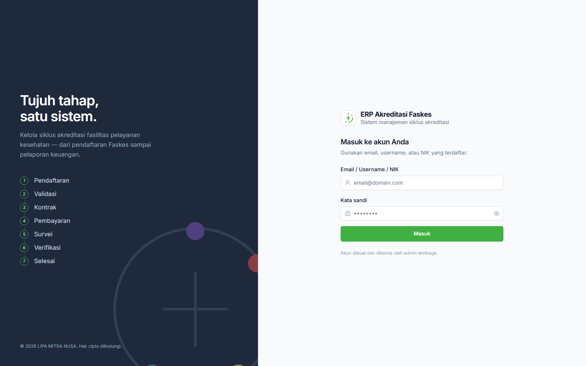
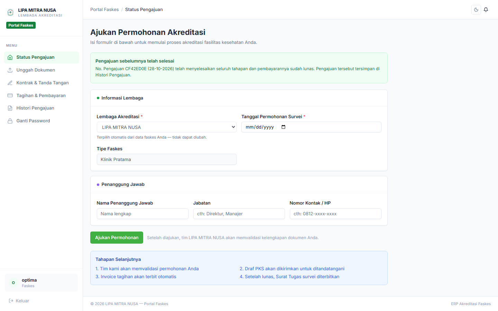
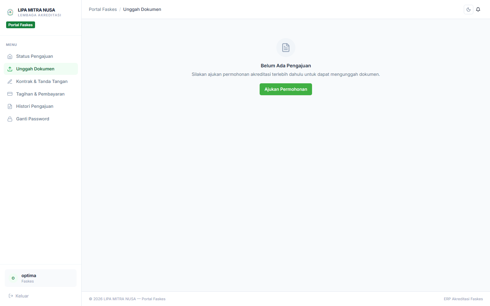
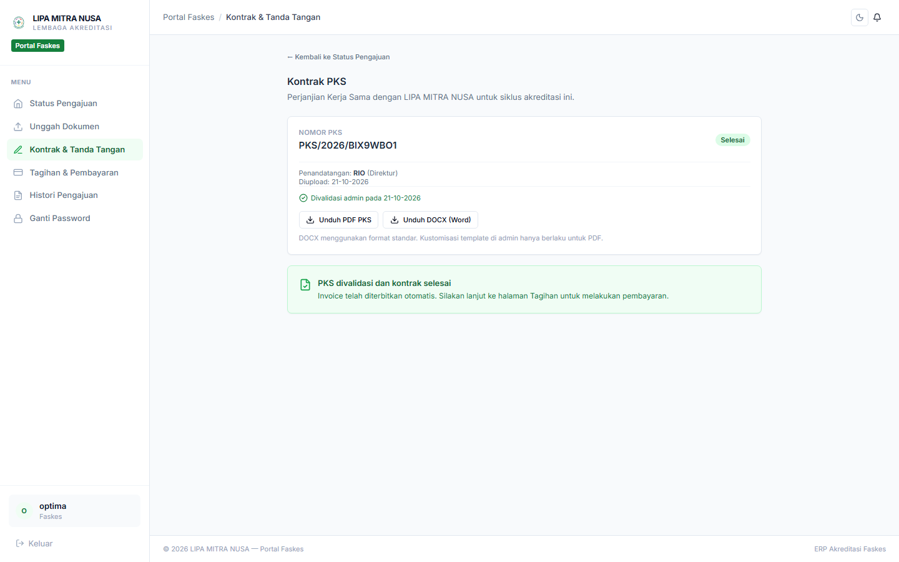
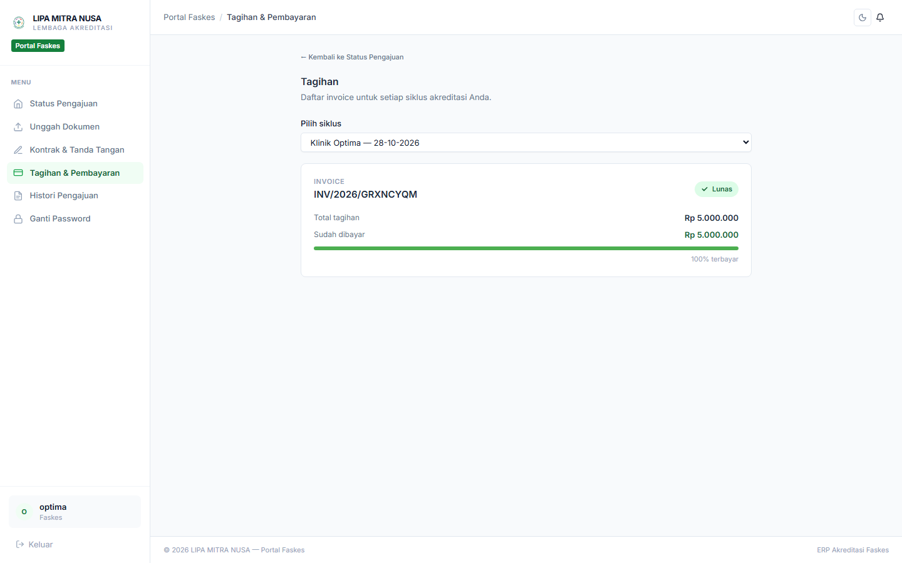
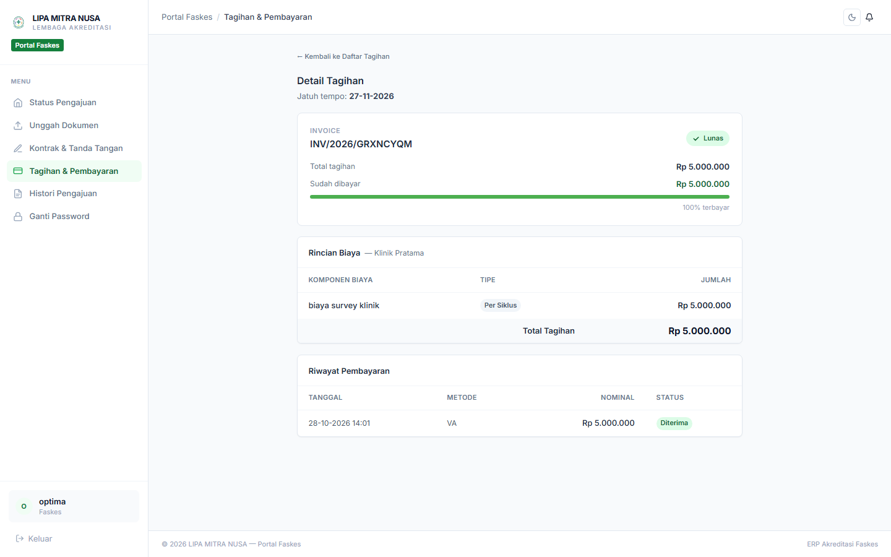
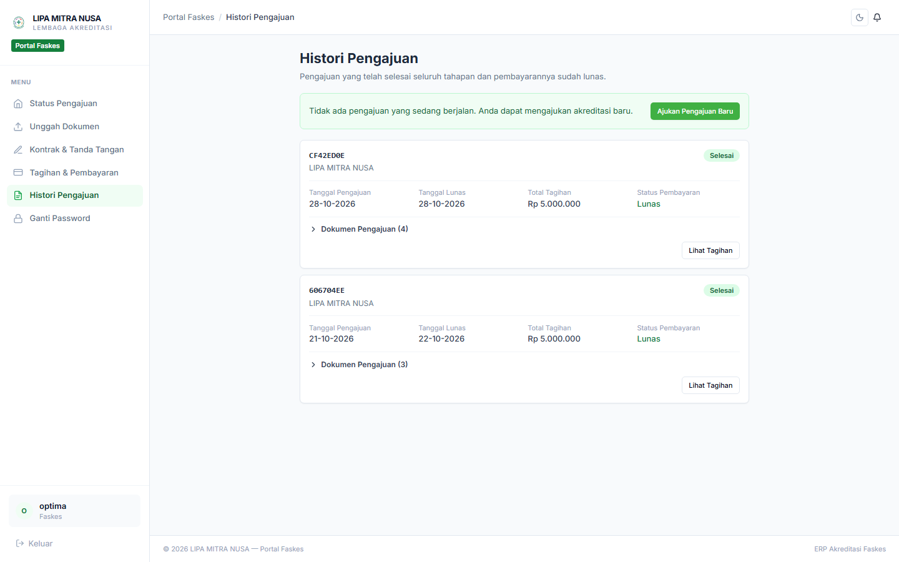
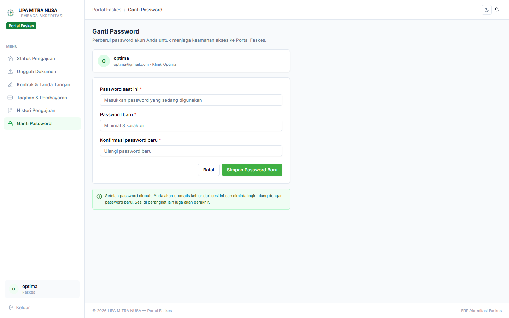

# Bab 01 — Pendaftaran & Portal Faskes

> Modul: Pendaftaran & Validasi Dokumen, Kontrak & Invoicing · Peran: Faskes
> Rute: `/auth/login`, `/faskes/*`

Bab ini adalah pintu masuk Anda sebagai pihak Faskes: mulai dari login,
mengajukan akreditasi, mengunggah dokumen pendukung, menandatangani PKS,
sampai membayar invoice. Semua menu yang dipakai Faskes berada di satu
portal yang disebut **Portal Faskes**, dengan menu di sisi kiri.

---

## 1.1 Masuk (Login)

**Alamat:** `/auth/login` · **Peran:** semua pengguna (halaman publik) · **Syarat akses:** tanpa syarat akses — halaman terbuka untuk semua, termasuk yang belum login

### Yang ditampilkan

- **Panel kiri** — judul "Tujuh tahap, satu sistem." dengan keterangan singkat
  sistem, lalu daftar tujuh tahap akreditasi bernomor: Pendaftaran,
  Validasi, Kontrak, Pembayaran, Survei, Verifikasi, Selesai. Di bawahnya
  catatan hak cipta.
- **Panel kanan** — logo "ERP Akreditasi Faskes" dengan sub-teks "Sistem
  manajemen siklus akreditasi".
- Judul "Masuk ke akun Anda" dan petunjuk "Gunakan email, username, atau NIK
  yang terdaftar."
- Dua isian:
  - "Email / Username / NIK" — placeholder "email@domain.com", dengan ikon
    orang di kiri.
  - "Kata sandi" — placeholder "••••••••", dengan ikon gembok di kiri dan
    ikon mata di kanan.
- Tombol hijau "Masuk".
- Teks di bawah tombol: "Akun dibuat dan dikelola oleh admin lembaga."

### Apa yang bisa dilakukan

- **Mengisi kedua isian lalu menekan "Masuk"** — sistem memeriksa keabsahan
  akun Anda. Bila berhasil, Anda langsung diarahkan ke beranda sesuai
  peran: Faskes ke halaman Status Pengajuan, Surveior dan Verifikator ke
  halaman penugasan, Rekomendator ke halaman rekomendasi, Divisi SDM ke
  dasbor, Direktur/Keuangan ke dasbor piutang.
- **Menekan ikon mata** — menampilkan atau menyembunyikan kata sandi. Ini
  hanya memengaruhi tampilan, tidak mengubah isian.
- **Menunggu** — saat tombol ditekan, tombol berubah menjadi "Memproses..."
  dengan ikon berputar dan kedua isian dinonaktifkan sebentar.

### Catatan

- **Pesan gagal yang mungkin muncul** (kotak merah di atas formulir):
  - "Kredensial tidak cocok." — email/username/NIK tidak terdaftar atau
    kata sandi salah.
  - "Akun terkunci sementara. Coba lagi dalam {minutes} menit." — akun
    terkunci setelah beberapa kali gagal login.
  - "Akun nonaktif atau terkunci. Hubungi administrator."
- Akun terkunci otomatis selama 15 menit setelah 5 kali percobaan gagal.
- Kolom "Email / Username / NIK" menerima email, username, atau NIK tenaga
  ahli yang terdaftar.

---

## 1.2 Portal Faskes (kerangka halaman)

**Alamat:** `/faskes/` · **Peran:** Faskes · **Syarat akses:** Pendaftaran & Validasi Dokumen — Lihat

> Halaman-halaman berikutnya semuanya berada di dalam kerangka yang sama.
> Gambar di bawah diambil dari halaman Status Pengajuan.

### Yang ditampilkan

- **Sidebar kiri** — logo dan nama lembaga (bila logo lembaga tersedia, logo
  itu yang dipakai). Di bawahnya badge hijau "Portal Faskes", lalu judul grup
  "Menu", dan enam menu berikut:
  1. Status Pengajuan
  2. Unggah Dokumen
  3. Kontrak & Tanda Tangan
  4. Tagihan & Pembayaran
  5. Histori Pengajuan
  6. Ganti Password
- **Blok pengguna** di dasar sidebar — avatar berisi inisial nama, nama
  pengguna, dan peran ("Faskes"), lalu tombol "Keluar".
- **Top bar** — remah jalan (remah "Portal Faskes" lalu nama menu yang
  sedang dibuka), tombol tema, dan tombol lonceng.
- **Kaki halaman** — "© {tahun} {nama lembaga} — Portal Faskes" di kiri dan
  "ERP Akreditasi Faskes" di kanan.

### Apa yang bisa dilakukan

- **Menekan salah satu menu** — berpindah ke halaman menu tersebut. Menu
  yang sedang dibuka ditandai latar hijau.
- **Menekan "Keluar"** — keluar dari akun dan kembali ke halaman login.
- **Menekan tombol tema** — berganti antara mode terang dan gelap.
- **Menekan tombol lonceng** — *(perilaku perlu konfirmasi ke tim devs)*;
  belum ada aksi yang terpasang pada tombol ini.

### Catatan

- Di layar sempit (ponsel atau tablet kecil), sidebar menjadi drawer yang
  dibuka lewat tombol menu di kiri atas dan ditutup lewat ikon "X" atau
  menyentuh area gelap di belakangnya.
- Semua menu portal Faskes tampil untuk pengguna Faskes. Penyaringan hak
  akses sebenarnya dilakukan di sisi server, bukan dengan menyembunyikan
  menu.

---

## 1.3 Status Pengajuan

**Alamat:** `/faskes/` · **Peran:** Faskes · **Syarat akses:** Pendaftaran & Validasi Dokumen — Lihat, Tambah

### Yang ditampilkan

Tampilan berubah mengikuti keadaan pengajuan Anda.

**Bila belum ada pengajuan aktif** — yang tampak pada gambar:

- Judul "Ajukan Permohonan Akreditasi" dengan sub-judul "Isi formulir di
  bawah untuk memulai proses akreditasi fasilitas kesehatan Anda."
- Banner hijau "Pengajuan sebelumnya telah selesai" — berisi nomor dan
  tanggal pengajuan lama beserta keterangan bahwa pengajuan tersebut kini
  tersimpan di Histori Pengajuan.
- Kartu "Informasi Lembaga":
  - "Lembaga Akreditasi *" — daftar pilihan, sudah terisi otomatis dan tidak
    dapat diubah, dengan keterangan "Terpilih otomatis dari data faskes Anda
    — tidak dapat diubah."
  - "Tipe Faskes" — terisi otomatis dari data faskes Anda, tidak dapat
    diketik manual.
  - "Tanggal Permohonan Survei *" — pemilih tanggal, tidak boleh diisi
    tanggal sebelum hari ini.
- Kartu "Penanggung Jawab" dengan isian "Nama Penanggung Jawab", "Jabatan",
  dan "Nomor Kontak / HP".
- Tombol "Ajukan Permohonan" dengan teks pendamping "Setelah diajukan, tim
  LIPA MITRA NUSA akan memvalidasi kelengkapan dokumen Anda."
- Kotak biru "Tahapan Selanjutnya" berisi empat langkah bernomor: validasi
  permohonan, pengiriman draf PKS, penerbitan invoice otomatis, dan
  penerbitan Surat Tugas survei setelah lunas.

**Bila sudah ada pengajuan aktif:**

- Judul "Status Pengajuan" dengan sub-judul berisi nama Anda.
- Banner oranye yang menjelaskan posisi proses — misalnya menunggu pelunasan
  atau tertahan di Pembayaran.
- Kartu "TAHAPAN AKREDITASI" berisi deretan tujuh tahap: Pendaftaran,
  Validasi, Kontrak, Pembayaran, Survei, Verifikasi, Selesai. Legenda:
  "Proses selesai", "Menunggu proses", "Ditolak". Di bawah tahap Survei
  terdapat sub-tahap: Menunggu Surat Tugas, Survei Dijadwalkan, Survei Sedang
  Berlangsung, Laporan FA Dikirim.
- Kartu shortcut ke "Unggah Dokumen", dan — bila sudah melewati tahap
  tersebut — "Kontrak & Tanda Tangan" serta "Tagihan & Pembayaran".
- Kartu "DETAIL PENGAJUAN" berisi No. Pengajuan, Lembaga, Tanggal
  Pengajuan, Tanggal Permohonan Survei, dan Status Kelengkapan ("Lengkap" atau
  "Menunggu").

### Apa yang bisa dilakukan

- **Menekan "Ajukan Permohonan"** — mengirim formulir dan membuat siklus
  akreditasi baru. Pengajuan Anda akan divalidasi oleh tim lembaga.
- **Menekan kartu shortcut "Unggah Dokumen"** — membuka halaman pengunggahan
  dokumen.
- **Menekan kartu shortcut "Kontrak & Tanda Tangan"** — membuka PKS milik
  siklus berjalan.
- **Menekan kartu shortcut "Tagihan & Pembayaran"** — membuka daftar invoice.

### Catatan

- **Satu faskes hanya boleh memiliki satu pengajuan yang sedang berjalan.**
  Bila Anda masih punya pengajuan aktif, sistem menolak pengajuan baru
  dengan pesan "Anda masih memiliki pengajuan akreditasi yang sedang
  berjalan. Selesaikan proses saat ini sebelum mengajukan yang baru."
- Pengajuan yang sudah masuk Histori (tuntas dan lunas) tidak dihitung sebagai
  pengajuan aktif, sehingga Anda boleh mengajukan akreditasi lagi.
- "Tipe Faskes" terisi otomatis dan tidak dapat diubah.
-Isian wajib yang kosong ditolak dengan pesan "Lembaga akreditasi wajib
  dipilih" atau "Tanggal permohonan wajib diisi".
- Halaman ini disegarkan otomatis setiap 30 detik agar posisi tahap tetap
  mutakhir.

---

## 1.4 Unggah Dokumen

**Alamat:** `/faskes/dokumen` · **Peran:** Faskes · **Syarat akses:** Pendaftaran & Validasi Dokumen — Lihat, Tambah

### Yang ditampilkan

- Remah jalan: tombol panah kiri (kembali ke Status Pengajuan) lalu teks
  "Status Pengajuan".
- Judul "Unggah Dokumen" dengan sub-judul "{nama faskes} · {nama lembaga}".
- **Bila belum ada pengajuan aktif** (keadaan pada gambar): judul "Belum Ada
  Pengajuan" dengan teks "Silakan ajukan permohonan akreditasi terlebih dahulu
  untuk dapat mengunggah dokumen", dan tombol "Ajukan Permohonan".
- **Bila pengajuan aktif**, halaman menampilkan:
  - Kotak amber "Catatan dari Tim Validasi" bila admin memberikan catatan
    perbaikan; tiap catatan mencantumkan "{nama pembuat} · {tanggal}".
  - Baris kemajuan "Kelengkapan Dokumen" dengan teks "{terunggah} / {total}
    terunggah" dan badge persentase.
  - Tujuh kartu dokumen, masing-masing dengan label, keterangan, dan badge
    "WAJIB" pada tiga dokumen wajib:

    | Label | Keterangan | Wajib |
    |---|---|---|
    | Screenshot DFO | Screenshot Daftar Tilik Fasilitas (DFO) yang sudah diisi | ya |
    | Surat Permohonan Survei | Surat resmi dari Faskes yang mengajukan permohonan survei | ya |
    | Self Assessment | Hasil penilaian mandiri oleh Faskes terhadap standar akreditasi | ya |
    | Sisdmk / SISDMK | Sistem Informasi SDM Kesehatan | tidak |
    | ASPak | Aksi Cepat Pasien Keselamatan Pasien | tidak |
    | INM | Indikator Nasional Mutu | tidak |
    | IKP | Indikator Kinerja Prioritas | tidak |

  - Pada kartu yang belum terisi: area tarik-lepas "Klik atau drag file ke
    sini" dengan keterangan "PDF, JPG, PNG, DOC, DOCX, XLS, XLSX · Maks 10
    MB".
  - Pada kartu yang sudah terisi: nama file, "v{versi} · {ukuran} ·
    {tanggal}", label "Tersimpan", serta tombol "Revisi", "Riwayat", dan
    "Unduh".
  - Kotak biru bawah berisi: "Format: PDF, JPG, PNG, DOC, DOCX, XLS, XLSX ·
    Maks 10 MB per file. Klik pada dokumen yang sudah terunggah untuk
    memperbarui versi. Setiap revisi wajib disertai alasan."

### Apa yang bisa dilakukan

- **Klik atau menyeret file ke kartu dokumen** — mengunggah dokumen untuk
  pertama kali.
- **Menekan "Revisi"** — membuka dialog "Revisi Dokumen": menampilkan versi
  saat ini, area pilih file baru, dan isian "Alasan Revisi" yang wajib diisi.
  Setelah dipilih, tekan "Unggah Versi Baru".
- **Menekan "Riwayat"** — membuka dialog "Riwayat Versi — {nama dokumen}"
  berisi tabel versi (Versi, File, Diunggah Oleh, Tanggal, Aksi), alasan
  revisi tiap versi, dan tombol "Unduh" per baris.
- **Menekan "Unduh"** — mengunduh berkas dokumen yang terunggah.
- **Menekan "Ajukan Permohonan"** — kembali ke halaman Status Pengajuan untuk
  membuat pengajuan bila belum ada.

### Catatan

- **Unggah ulang tidak menimpa berkas lama.** Setiap unggahan pada dokumen
  yang sama membuat versi baru (versi = versi tertinggi + 1).
- **Tiga dokumen wajib** menentukan status kelengkapan. Setelah ketiganya
  lengkap, status siklus berubah menjadi "Lengkap" dan proses bisa lanjut ke
  tahap Kontrak.
- **Batas ukuran 10 MB** ditegakkan server. Berkas dengan ekstensi `.doc` dan
  `.xls` lolos di layar tetapi ditolak server karena daftar format server
  tidak memuat keduanya — *(perilaku perlu konfirmasi ke tim devs)*.
- Pesan error unggahan muncul tepat di bawah kartu dokumen yang bermasalah.
  Contoh pesan sukses dari server: "Dokumen berhasil diunggah."

---

## 1.5 Kontrak & Tanda Tangan

**Alamat:** `/faskes/kontrak` · **Peran:** Faskes · **Syarat akses:** Kontrak & Invoicing — Lihat, Ubah

### Yang ditampilkan

- Tautan "← Kembali ke Status Pengajuan".
- Judul "Kontrak PKS" dengan sub-judul "Perjanjian Kerja Sama dengan LIPA
  MITRA NUSA untuk siklus akreditasi ini."
- Kartu kontrak berisi "NOMOR PKS" beserta nomornya, dan badge status
  kontrak.
- Bila PKS sudah ditandatangani: baris "Penandatangan: {nama} ({jabatan})"
  dan "Diupload: {tanggal}".
- Bila PKS sudah divalidasi admin: baris hijau "Divalidasi admin pada
  {tanggal}".
- Dua tombol unduhan: "Unduh PDF PKS" dan "Unduh DOCX (Word)", disertai
  catatan "DOCX menggunakan format standar. Kustomisasi template di admin
  hanya berlaku untuk PDF."
- Kartu status kontrak. Contoh pada gambar (status selesai):
  - Judul "PKS divalidasi dan kontrak selesai"
  - Isi "Invoice telah diterbitkan otomatis. Silakan lanjut ke halaman
    Tagihan untuk melakukan pembayaran."
- Tombol "Lihat PKS yang Sudah Ditandatangani" muncul bila berkas bertanda
  tangan sudah tersedia.

### Apa yang bisa dilakukan

- **"Unduh PDF PKS"** — mengunduh berkas PKS dalam format PDF.
- **"Unduh DOCX (Word)"** — mengunduh berkas PKS dalam format Word.
- **"Lihat PKS yang Sudah Ditandatangani"** — membuka/mengunduh PKS versi
  bertanda tangan.
- **Mengunggah PKS bertanda tangan** — berlaku saat status kontrak
  "Menunggu Tanda Tangan". Halaman menampilkan formulir "Upload PKS yang Sudah
  Ditandatangani" dengan area tarik-lepas PDF, isian "Nama penandatangan *",
  "Jabatan *", dan "NIK penandatangan (opsional)", lalu tombol "Upload &
  Kirim PKS yang Sudah Ditandatangani".

### Catatan

- **Status kontrak menentukan apa yang tampil:**
  - "Draf" — "Draf PKS sedang disiapkan oleh Admin Lembaga".
  - "Menunggu Tanda Tangan" — Anda yang harus menandatangani dan mengunggah
    kembali.
  - "Menunggu Validasi Admin" — "PKS sudah diupload dan menunggu validasi
    admin"; admin memverifikasi dalam 1–2 hari kerja.
  - "Selesai" — kontrak selesai dan invoice terbit otomatis.
  - "Ditolak" dan "Kedaluwarsa" — PKS tidak dapat dipakai, perlu menghubungi
    admin lembaga.
- Saat status "Menunggu Tanda Tangan", catatan di bawah tombol berbunyi
  "Cetak, tanda tangan & beri materai, lalu upload kembali di bawah."
- Isian yang kosong ditolak dengan pesan "Nama penandatangan wajib diisi" dan
  "Jabatan wajib diisi".
- Berkas yang bukan PDF ditolak dengan pesan "File harus format PDF." dan
  berkas lebih dari 10 MB ditolak dengan "Ukuran file maksimal 10 MB.".
- Setelah PKS berstatus selesai, invoice terbit otomatis dan Anda diarahkan
  ke menu Tagihan & Pembayaran.

---

## 1.6 Detail Kontrak PKS

**Alamat:** `/faskes/kontrak/:id` · **Peran:** Faskes · **Syarat akses:** Kontrak & Invoicing — Lihat, Ubah

### Yang ditampilkan

- Remah jalan "Portal Faskes / Kontrak & Tanda Tangan" dan tautan "←
  Kembali ke Status Pengajuan".
- Judul "Kontrak PKS" dengan sub-judul "Perjanjian Kerja Sama dengan LIPA
  MITRA NUSA untuk siklus akreditasi ini."
- Kartu "NOMOR PKS" berisi nomor kontrak, misalnya "PKS/2026/BIX9WB01".
- Baris penandatangan ("Penandatanganan: RIO (Direktur)") dan tanggal
  unggah ("Diupload: 21-10-2026").
- Baris hijau "Divalidasi admin pada 21-10-2026".
- Tombol "Unduh PDF PKS" dan "Unduh DOCX (Word)" dengan catatan format di
  bawahnya.
- Kartu hijau "PKS divalidasi dan kontrak selesai" beserta penjelasannya.
- Tombol "Selesai" di bagian bawah kartu kontrak.

### Apa yang bisa dilakukan

- **Mengunduh PKS** dalam format PDF atau DOCX.
- **Kembali ke Status Pengajuan** lewat tautan di atas.
- **Tombol "Selesai"** di bagian bawah kartu kontrak — *(perilaku perlu
  konfirmasi ke tim devs)*, belum jelas apakah tombol ini berpindah halaman
  atau hanya menutup panel.

### Catatan

- Halaman detail menampilkan satu kontrak tertentu. Bila Anda membuka
  `/faskes/kontrak` tanpa nomor kontrak, sistem otomatis mengarahkan ke
  kontrak milik siklus yang belum selesai lengkap, atau ke kontrak siklus
  pertama bila semuanya sudah masuk histori — supaya PKS terakhir tetap bisa
  diunduh.
- Isi halaman sama dengan halaman Kontrak & Tanda Tangan; bedanya hanya
  kontrak yang ditampilkan dikunci pada satu siklus.

---

## 1.7 Tagihan & Pembayaran

**Alamat:** `/faskes/tagihan` · **Peran:** Faskes · **Syarat akses:** Kontrak & Invoicing — Lihat

### Yang ditampilkan

- Tautan "← Kembali ke Status Pengajuan".
- Judul "Tagihan" dengan sub-judul "Daftar invoice untuk setiap siklus
  akreditasi Anda."
- Daftar pilihan "Pilih siklus" bila Anda punya lebih dari satu siklus.
  Setiap pilihan berformat "{nama faskes} — {tanggal pengajuan}".
- Kartu invoice:
  - Label "Invoice" dan nomor invoice.
  - Badge status: Lunas, Sebagian, Belum Bayar, Jatuh Tempo, Kedaluwarsa,
    atau Refund.
  - Baris "Total tagihan", "Sudah dibayar", dan "Sisa" (baris "Sisa" hanya
    tampil bila masih ada sisa).
  - Bar kemajuan dan kaki "{persen}% terbayar".
- Tombol "Bayar Sekarang" muncul bila masih ada invoice yang belum lunas.

### Apa yang bisa dilakukan

- **Menekan kartu invoice** — membuka halaman detail tagihan.
- **Menekan "Bayar Sekarang"** — membuka invoice pertama yang belum lunas.
- **Mengubah pilihan "Pilih siklus"** — menampilkan invoice milik siklus yang
  dipilih.

### Catatan

- **Invoice baru muncul setelah PKS disetujui admin.** Bila siklus Anda
  belum punya invoice, halaman menampilkan "Belum ada invoice untuk siklus
  ini. Invoice akan muncul setelah PKS disetujui." Bila Anda belum punya
  siklus sama sekali, tampilannya "Belum ada tagihan untuk Anda."
- Dokumen yang telah lunas tetap dapat dilihat dari menu ini.
- Tagihan juga dapat dibuka langsung dari tombol "Lihat Tagihan" pada
  Histori Pengajuan.

---

## 1.8 Detail Tagihan

**Alamat:** `/faskes/tagihan/:id` · **Peran:** Faskes · **Syarat akses:** Kontrak & Invoicing — Lihat, Tambah, Ubah

### Yang ditampilkan

- Tautan "← Kembali ke Daftar Tagihan".
- Judul "Detail Tagihan" dengan sub-judul "Jatuh tempo: {tanggal}".
- Kartu status invoice: nomor invoice, "Total tagihan", "Sudah dibayar",
  bar kemajuan, badge status, dan kaki "{persen}% terbayar".
- **Bila invoice sudah lunas** (keadaan pada gambar), kartu pembayaran dan
  pilihan metode disembunyikan, dan yang tampil adalah:
  - Kartu "Rincian Biaya" — tabel dengan kolom "Komponen Biaya", "Tipe",
    "Jumlah", serta baris akhir "Total Tagihan". Nilai Tipe berupa: Tetap,
    Per Siklus, Per Sertifikat, Per Tahun, Per Periksa, Sekali Bayar.
  - Kartu "Riwayat Pembayaran" — tabel dengan kolom "Tanggal", "Metode",
    "Nominal", "Status". Metode: Transfer, QRIS, atau VA. Status: Menunggu
    verifikasi, Diterima, atau Ditolak (alasan penolakan ditampilkan di
    bawah status).
- **Bila invoice belum lunas**, tampilannya berbeda:
  - Banner "Bukti Diterima" — "Pembayaran telah diverifikasi. Invoice akan
    diperbarui secara otomatis." atau banner "Bukti Menunggu Verifikasi" —
    "Bukti transfer {Rp nominal} sedang diverifikasi admin. Mohon tunggu 1x24
    jam kerja."
  - Kartu Virtual Account atau QRIS: judul dengan sub-judul "Aktif" dan badge
    "Otomatis", hitung mundur "Berakhir dalam:", nomor Virtual Account dengan
    tombol "Salin VA", "Total Pembayaran", dan "Pembayaran akan diverifikasi
    otomatis 1-5 menit setelah transfer."
  - Petunjuk pembayaran: "Petunjuk Pembayaran Virtual Account" (BCA, BNI,
    Mandiri, BRI, Permata) atau "Petunjuk Pembayaran QRIS" (6 langkah memindai
    kode QR dari aplikasi m-banking).
  - Tombol "Cek Status Pembayaran", "Dapatkan Nomor VA Baru", dan "Ganti
    Metode Pembayaran".
  - Kartu "Pilih Metode Pembayaran" bila belum ada nomor VA: tiga pilihan —
    "Virtual Account", "QRIS", dan "Transfer Manual". Untuk Transfer Manual
    tersedia isian "Nominal *", "No. Referensi Transfer *", "Dari rekening
    *", dan "File bukti (PDF / gambar) *".

### Apa yang bisa dilakukan

- **"Dapatkan Nomor VA" / "Generate QRIS"** — membuat nomor Virtual Account
  atau kode QRIS baru untuk invoice tersebut.
- **"Dapatkan Nomor VA Baru"** — membatalkan nomor lama dan membuat yang
  baru, dipakai bila nomor lama sudah kedaluwarsa.
- **"Cek Status Pembayaran"** — memaksa sistem memeriksa apakah transfer
  Anda sudah diterima. Bila sudah lunas, muncul pesan "Pembayaran
  terverifikasi. Invoice sudah lunas."
- **"Salin VA"** — menyalin nomor Virtual Account ke papan klip.
- **"Kirim Bukti Transfer"** — mengirim bukti transfer bank manual untuk
  diverifikasi admin. Pesan sukses: "Bukti transfer berhasil diunggah. Admin
  akan memverifikasi dalam 1x24 jam kerja."
- **"Ganti Metode Pembayaran"** — membatalkan nomor VA/QRIS sebelumnya lalu
  memilih metode baru.

### Catatan

- **Pembayaran lewat Virtual Account dan QRIS diverifikasi otomatis** dalam
  1–5 menit. Tombol "Cek Status Pembayaran" adalah jalan cadangan bila
  notifikasi otomatis tidak pernah datang.
- **Bukti transfer manual** menunggu verifikasi admin, maksimal 1x24 jam
  kerja. Bila bukti ditolak, muncul kotak merah "Bukti sebelumnya ditolak".
- **Batas ukuran berkas bukti berbeda antara layar dan server**: layar
  menerima sampai 10 MB, sedangkan server hanya menerima sampai 4 MB
  *(perilaku perlu konfirmasi ke tim devs)*.
- Isian yang belum lengkap ditolak dengan pesan "Nominal wajib diisi", "No.
  Referensi wajib diisi", "Dari rekening wajib diisi", "Pilih file bukti
  transfer.", dan "Ukuran file maksimal 10 MB.".
- Halaman ini disegarkan otomatis setiap 10 detik selama invoice belum lunas.

---

## 1.9 Histori Pengajuan

**Alamat:** `/faskes/histori` · **Peran:** Faskes · **Syarat akses:** Pendaftaran & Validasi Dokumen — Lihat

### Yang ditampilkan

- Judul "Histori Pengajuan" dengan sub-judul "Pengajuan yang telah selesai
  seluruh tahapan dan pembayarannya sudah lunas."
- Banner hijau "Tidak ada pengajuan yang sedang berjalan. Anda dapat
  mengajukan akreditasi baru." dengan tombol "Ajukan Pengajuan Baru".
- Satu kartu per pengajuan yang sudah selesai, berisi:
  - Nomor pengajuan dan nama lembaga, dengan badge "Selesai".
  - Empat kolom: "Tanggal Pengajuan", "Tanggal Lunas", "Total Tagihan", dan
    "Status Pembayaran" (nilainya "Lunas").
  - Tombol expandable "Dokumen Pengajuan ({jumlah})". Saat dibuka, tiap
    dokumen ditampilkan dengan jenis dokumen, badge tipe berkas (PDF /
    IMG / DOC / FILE), badge versi bila lebih dari satu versi, nama berkas dan
    ukurannya, serta "Diunggah oleh {nama} · {tanggal}", dengan tombol "Lihat"
    dan "Unduh".
  - Tombol "Lihat Tagihan".
- Paginasi bila historinya lebih dari satu halaman: "Total {jumlah}
  pengajuan · Halaman {halaman} dari {total halaman}", tombol "Sebelumnya"
  dan "Berikutnya".

### Apa yang bisa dilakukan

- **Menekan "Ajukan Pengajuan Baru"** — kembali ke Status Pengajuan untuk
  memulai akreditasi baru.
- **Menekan "Dokumen Pengajuan"** — membuka atau menutup daftar dokumen
  pengajuan tersebut.
- **Menekan "Lihat"** — membuka pratinjau dokumen (gambar ditampilkan langsung,
  PDF ditampilkan di dalam halaman, format lain ditolak dengan pesan
  "Format file tidak dapat ditampilkan. Gunakan tombol Unduh.").
- **Menekan "Unduh"** — mengunduh berkas dokumen.
- **Menekan "Lihat Tagihan"** — membuka tagihan milik pengajuan tersebut.
- **Menekan "Sebelumnya" / "Berikutnya"** — berpindah halaman histori.

### Catatan

- **Histori hanya memuat pengajuan yang tuntas.** Sebuah pengajuan baru
  masuk sini bila tahapannya selesai 7 dan invoice-nya lunas. Pengajuan yang
  tahapannya sudah selesai tetapi tagihannya belum lunas tetap terlihat di
  Status Pengajuan dengan banner menunggu pelunasan.
- Daftar dokumen pada kartu bisa dikosongkan — pesan "Tidak ada dokumen
  yang diunggah pada pengajuan ini."

---

## 1.10 Ganti Password

**Alamat:** `/faskes/ganti-password` · **Peran:** semua pengguna yang sudah login · **Syarat akses:** tidak ada syarat privilege tambahan

### Yang ditampilkan

- Judul "Ganti Password" dengan sub-judul "Perbarui password akun Anda untuk
  menjaga keamanan akses ke Portal Faskes."
- Kartu profil: avatar berisi huruf awal nama, nama pengguna, dan baris
  "{email} · {nama faskes}".
- Tiga isian:
  - "Password saat ini *" — placeholder "Masukkan password yang sedang
    digunakan".
  - "Password baru *" — placeholder "Minimal 8 karakter".
  - "Konfirmasi password baru *" — placeholder "Ulangi password baru".
- Indikator kekuatan password berupa bar dan label: "Lemah", "Cukup", atau
  "Kuat", disertai teks "Gunakan kombinasi huruf besar, kecil, angka, dan
  simbol untuk password yang lebih kuat."
- Tombol "Batal" dan tombol hijau "Simpan Password Baru".
- Kotak hijau di bawah form: "Setelah password diubah, Anda akan otomatis
  keluar dari sesi ini dan diminta login ulang dengan password baru. Sesi di
  perangkat lain juga akan berakhir."

### Apa yang bisa dilakukan

- **Mengisi ketiga isian lalu menekan "Simpan Password Baru"** — menyimpan
  password baru. Setelah berhasil, form dinonaktifkan, tombol berubah
  menjadi "Berhasil", dan Anda otomatis keluar lalu diminta login ulang
  dengan password baru.
- **Menekan "Batal"** — kembali ke Status Pengajuan tanpa mengubah apa pun.

### Catatan

- Pesan kesalahan yang tampil di bawah isian:
  - "Password saat ini wajib diisi"
  - "Password baru minimal 8 karakter"
  - "Konfirmasi password baru tidak cocok"
  - "Password baru tidak boleh sama dengan password lama"
- Bila password lama salah, pesan dari server adalah "Password lama salah."
- **Mengganti password mengakhiri sesi di perangkat lain juga**, karena token
  lama ikut dicabut di server. Sebelum login ulang, pastikan Anda mengingat
  password baru.
- Indikator kekuatan password hanya alat bantu di layar. Server hanya
  menetapkan ketentuan minimal 8 karakter dan maksimal 72 karakter.

---

## Layar terkait

- [Bab 00 — Alur Siklus Akreditasi](00-alur-siklus.md)
- [Bab 02 — Operasional Internal](02-operasional.md)
- [Bab 05 — Keuangan](05-keuangan.md)
