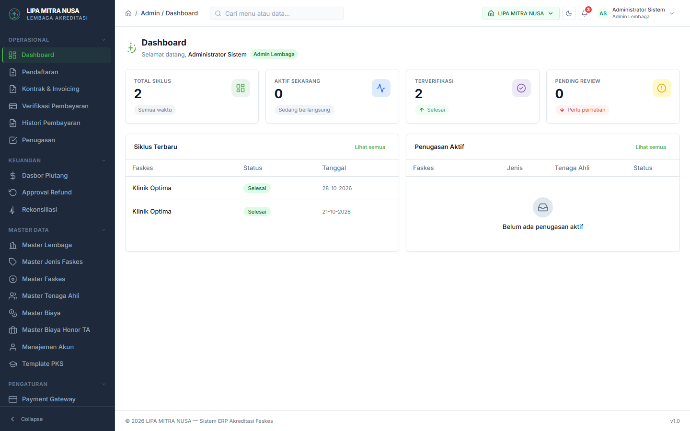
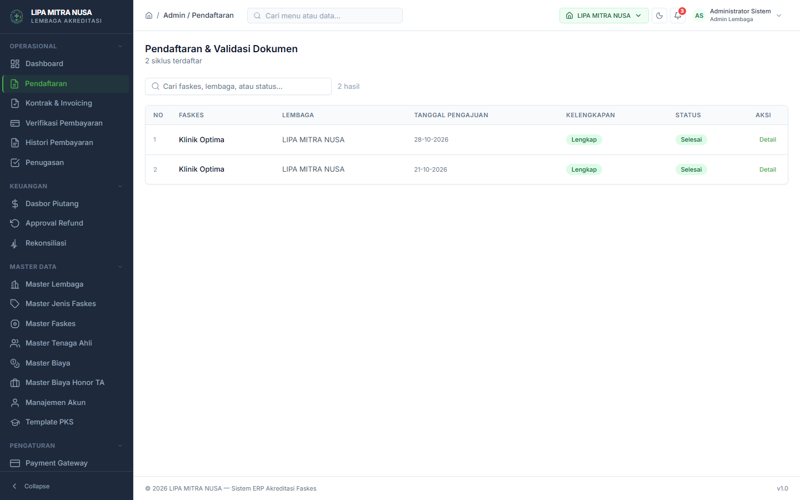
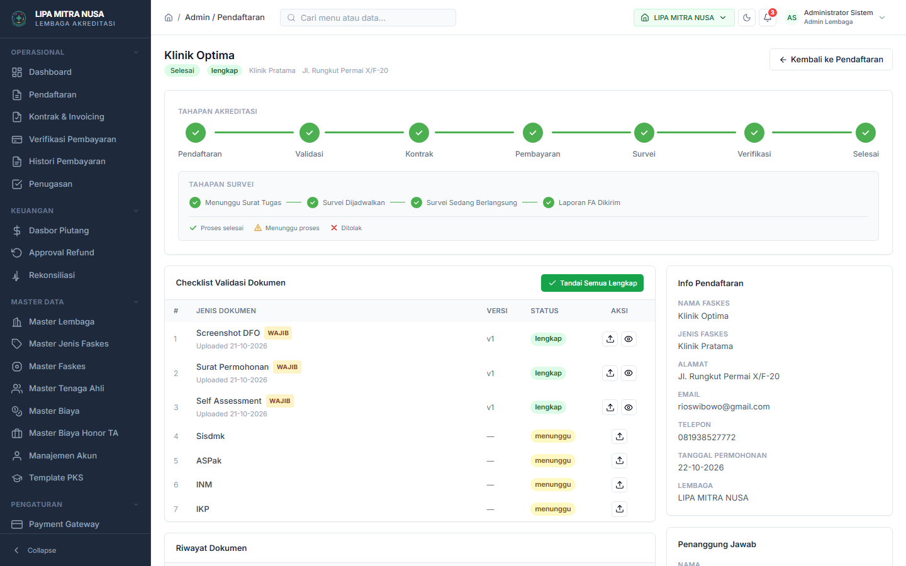
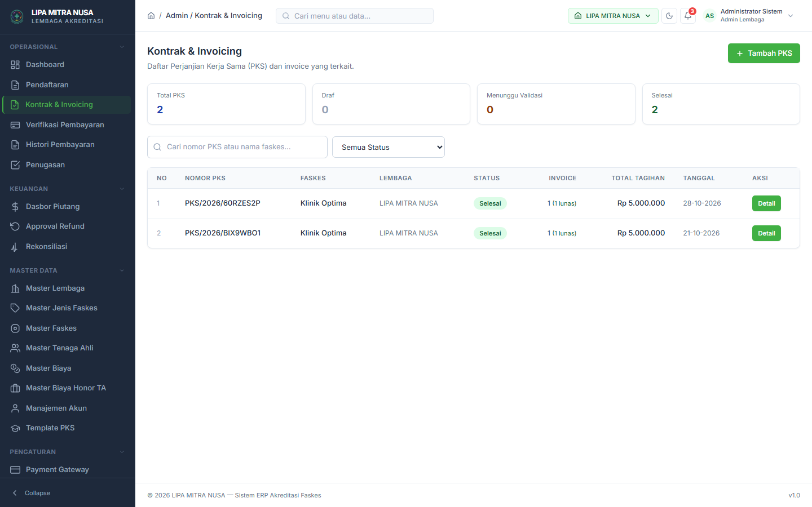
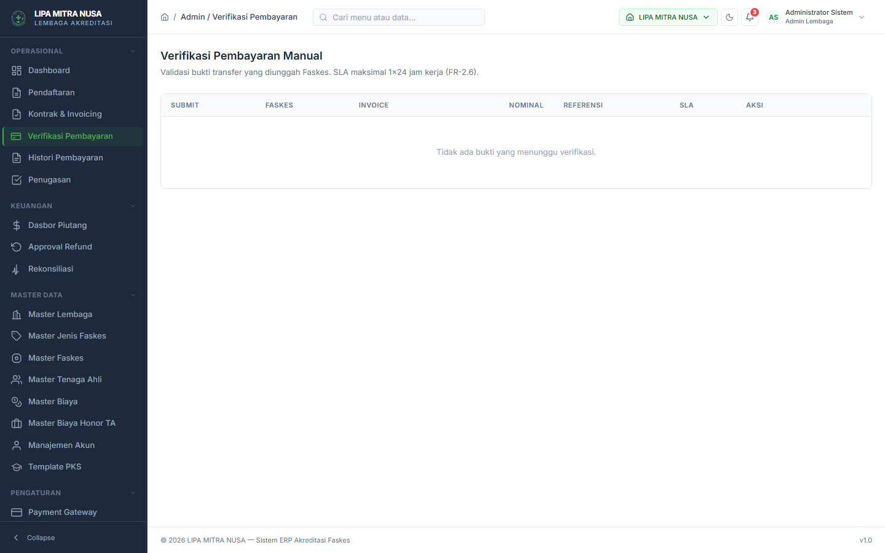
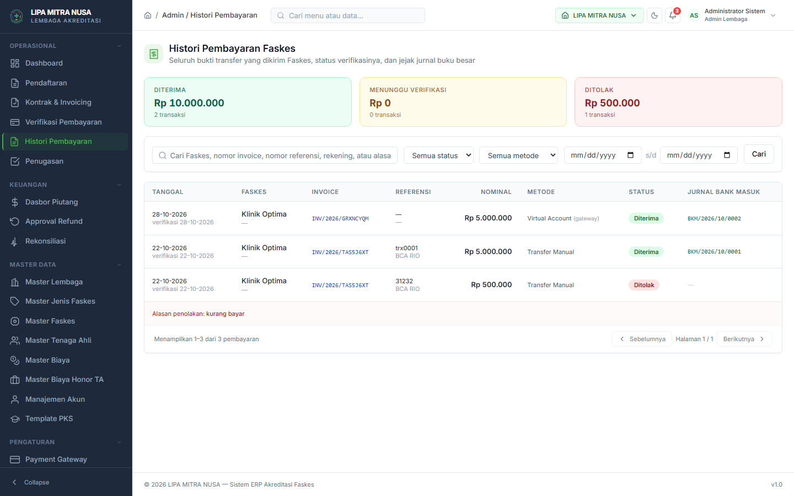
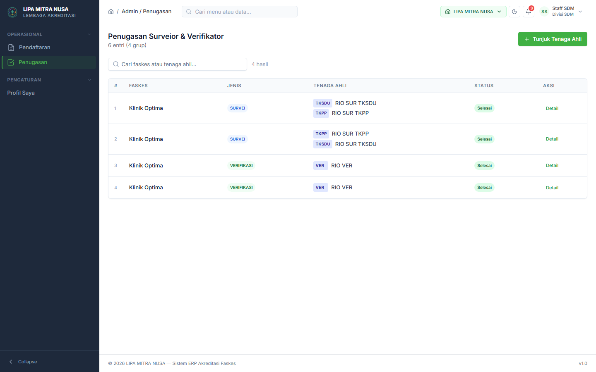

# Bab 02 — Operasional Internal

> Modul: Operasional · Peran: Administrator, Admin Lembaga, Divisi SDM ·
> Alamat portal: `/admin`

Bab ini untuk Anda yang bekerja di sisi internal, yaitu tim yang
menangani pengajuan akreditasi dari awal sampai tenaga ahli ditugaskan.
Enam menu di grup **OPERASIONAL** menjadi tempat kerja harian Anda:
memantau siklus, memeriksa kelengkapan dokumen, mengatur kontrak dan
tagihan, memverifikasi pembayaran, dan menunjuk tenaga ahli.

Semua layar dalam bab ini berada di portal internal. Data yang Anda lihat
selalu dibatasi pada **lembaga yang sedang Anda pakai** di pojok kanan
atas. Bila Anda berpindah lembaga, isi seluruh layar ikut menyesuaikan.

---

## 2.1 Dashboard

**Alamat:** `/admin/dashboard` · **Peran:** Administrator, Admin Lembaga ·
**Syarat akses:** Dasbor Eksekutif — Lihat

### Yang ditampilkan

- Judul **Dashboard** dengan sapaan **"Selarat datang, {nama}"** di
  bawahnya, disertai lencana berisi nama peran Anda, misalnya
  **Admin Lembaga**.
- Empat kartu statistik:
  - **Total Siklus** dengan keterangan **"Semua waktu"**.
  - **Aktif Sekarang** dengan keterangan **"Sedang berlangsung"**.
  - **Terverifikasi** dengan keterangan **"Selesai"**.
  - **Pending Review** dengan keterangan **"Perlu perhatian"**.
- Kartu **Siklus Terbaru** dengan tombol **Lihat semua** di kanan atas.
  Tabelnya memuat kolom **Faskes**, **Status**, dan **Tanggal**. Isinya
  maksimal lima siklus terakhir.
- Kartu **Penugasan Aktif** dengan tombol **Lihat semua** di kanan atas.
  Tabelnya memuat kolom **Faskes**, **Jenis**, **Tenaga Ahli**, dan
  **Status**. Isinya maksimal sepuluh penugasan aktif dari server.
- Pada tangkapan layar di atas, kartu **Penugasan Aktif** menampilkan ikon
  tumpukan dokumen dan teks **"Belum ada penugasan aktif"** — ini kondisi
  normal, bukan kesalahan.
- Saat data masih dimuat, keempat kartu statistik menampilkan
  bilangan kosong abu-abu dan kedua tabel menampilkan lima baris shimmer.

### Apa yang bisa dilakukan

- **Lihat semua** pada kartu **Siklus Terbaru** — membuka menu
  [Pendaftaran](#22-pendaftaran).
- **Lihat semua** pada kartu **Penugasan Aktif** — membuka menu
  [Penugasan](#26-penugasan).
- Halaman ini tidak memiliki tombol ubah. Baris tabel bukan tombol dan
  tidak bisa diklik; navigasi selalu lewat tombol **Lihat semua** atau
  lewat sidebar.

### Catatan

- Angka pada keempat kartu dihitung dari data **penugasan**, bukan dari
  daftar siklus:
  - **Total Siklus** = jumlah siklus berbeda yang punya penugasan.
  - **Aktif Sekarang** = siklus dengan penugasan survei berstatus
    **sedang_bertugas** atau **selesai** dan belum punya penugasan
    verifikasi selesai.
  - **Terverifikasi** = penugasan verifikasi berstatus **selesai**.
  - **Pending Review** = penugasan berstatus **menunggu**.
- Angka ini dihitung ulang paling cepat setiap 60 detik dan disimpan
  terpisah untuk tiap lembaga.
- Kolom **Status** pada tabel **Siklus Terbaru** menampilkan status
  turunan, bukan status mentah yang tersimpan di sistem. Status
  "Selesai" di sini berarti siklus sudah tuntas.
- Kolom **Jenis** pada tabel **Penugasan Aktif** menampilkan nilai
  mentah, yaitu **survei** atau **verifikasi**, dalam lencana bulat.
  Lencana **SURVEI** dan **VERIFIKASI** dipakai di menu
  [Penugasan](#26-penugasan).
- Kolom **Tanggal** dan kolom **Jenis** disembunyikan otomatis pada
  layar sempit supaya tabel tetap terbaca.
- Bila permintaan data gagal, pesan dari server muncul apa adanya di
  area pesan, misalnya **"HTTP 500"** bila server tidak dapat
  dihubungi.

---

## 2.2 Pendaftaran

**Alamat:** `/admin/pendaftaran` · **Peran:** Administrator, Admin Lembaga,
Faskes · **Syarat akses:** Pendaftaran & Validasi Dokumen — Lihat

### Yang ditampilkan

- Judul **Pendaftaran & Validasi Dokumen** dengan subjudul
  **"{n} siklus terdaftar"**.
- Kolom pencarian dengan contoh **"Cari faskes, lembaga, atau status..."**,
  dan di sebelahnya teks **"{n} hasil"**.
- Tabel pendaftaran dengan kolom:
  - **No** — nomor urut baris di halaman, bukan nomor siklus.
  - **Faskes** — nama fasilitas kesehatan.
  - **Lembaga** — nama lembaga tempat faskes terdaftar.
  - **Tanggal Pengajuan** — tanggal pengajuan, ditulis
    `dd-mm-yyyy`.
  - **Kelengkapan** — lencana kelengkapan dokumen.
  - **Status** — lencana status siklus.
  - **Aksi** — tombol **Detail**.
- Pada tangkapan layar di atas, tabel berisi dua baris: nama faskes
  **Klinik Optima**, lembaga **LIPA MITRA NUSA**, kelengkapan
  **Lengkap**, dan status **Selesai**.
- Bila tidak ada data sama sekali, baris tabel menampilkan **"Belum ada
  pendaftaran"**. Bila ada kata kunci pencarian yang tidak menghasilkan
  apa pun, teksnya menjadi **"Tidak ada hasil untuk pencarian ini"**.
- Saat daftar dimuat, tabel menampilkan delapan baris shimmer abu-abu.

### Apa yang bisa dilakukan

- **Mengetik di kolom pencarian** — langsung menyaring daftar. Pencarian
  dikirim ke server setiap Anda mengetik, tanpa perlu menekan tombol
  apa pun. Yang dicari adalah nama faskes atau status.
- **Detail** — membuka halaman
  [Detail Pendaftaran](#221-detail-pendaftaran) untuk satu siklus.

### Catatan

- Server otomatis mengurutkan daftar dari tanggal pengajuan terbaru.
- Lencana status memakai satu kamus warna yang sama di seluruh
  aplikasi. Contoh yang sering muncul:
  - Hijau: **Lengkap**, **Aktif**, **Selesai**, **Disetujui**, **Final**,
    **Berhasil**, **Lunas**.
  - Kuning: **Menunggu**, **Menunggu Dokumen**, **Menunggu Tindakan**,
    **Menunggu Persetujuan**, **Menunggu Kontrak**, **Menunggu
    Pembayaran**, **Belum Bayar**, **Sebagian**, **Aktifasi Akun**.
  - Merah: **Ditolak**, **Dibatalkan**, **Gagal**.
  - Biru: **Terkirim**, **Survei**, **Verifikasi**, **Refund**.
  - Abu-abu: **Draft**, **Digantikan**.
- Bila status di luar kamus itu muncul, status ditampilkan mentah
  apa adanya.
- Server menerima beberapa penyaring lain yang belum tersedia di
  layar ini, seperti penyaring lembaga dan status kelengkapan.
- Daftar menampilkan 15 baris per halaman, dengan batas maksimum 50
  baris.
- Data dibatasi pada lembaga aktif. Kolom **Lembaga** diisi dari
  nama lembaga pada siklus tersebut.

### 2.2.1 Detail Pendaftaran

**Alamat:** `/admin/pendaftaran/{id}` · **Peran:** Administrator,
Admin Lembaga · **Syarat akses:** Pendaftaran & Validasi Dokumen — Lihat

#### Yang ditampilkan

- Tombol **← Kembali ke Pendaftaran** di kiri atas.
- Judul halaman berisi nama faskes, misalnya **Klinik Optima**,
  disusul lencana status siklus, lencana kelengkapan, jenis faskes,
  dan alamat faskes bila tersedia.
- Kartu **Tahapan Akreditasi** berisi deretan tujuh lingkaran
  bernomor: **Pendaftaran**, **Validasi**, **Kontrak**, **Pembayaran**,
  **Survei**, **Verifikasi**, **Selesai**.
  - Di bawahnya ada baris **TAHAPAN SURVEI** dengan empat sub-tahap:
    **Menunggu Surat Tugas**, **Survei Dijadwalkan**, **Survei Sedang
    Berlangsung**, **Laporan FA Dikirim**.
  - Legenda di bawahnya: **Proses selesai**, **Menunggu proses**, dan
    **Ditolak**.
  - Baris sub-tahap hanya tampil bila siklus sedang di tahap Survei
    atau Tahap Survei sudah selesai.
- Kartu **Checklist Validasi Dokumen** dengan tombol **Tandai Semua
  Lengkap** dan tabel dengan kolom **#**, **Jenis Dokumen**, **Versi**,
  **Status**, **Aksi**.
  - Jenis dokumen: **Screenshot DFO**, **Surat Permohonan**, **Self
    Assessment**, **Sisdmk**, **ASPAK**, **INM**, **IKP**.
  - Tiga dokumen pertama diberi lencana kuning **"Wajib"**.
  - Kolom **Versi** menampilkan nomor versi seperti `v1` atau tanda
    **—** bila belum ada.
  - Kolom **Status** menampilkan lencana **lengkap**, **ditolak**, atau
    **menunggu**.
- Kartu **Riwayat Dokumen** — hanya tampil bila sudah ada dokumen
  yang diunggah. Tabelnya memuat kolom **Jenis**, **Versi**, **Tanggal
  Upload**, dan **Aksi** (tombol **Lihat**).
- Kartu **Info Pendaftaran** dengan baris label dan nilai: **Nama
  Faskes**, **Jenis Faskes**, **Alamat**, **Email**, **Telepon**,
  **Tanggal Permohonan**, **Lembaga**.
- Kartu **Penanggung Jawab** — hanya tampil bila data penanggung jawab
  terisi. Barisnya **Nama**, **Jabatan**, **Kontak**. Pada tangkapan
  layar di atas kartu ini kosong.
- Kartu **Catatan Revisi** berisi daftar catatan yang pernah dikirim
  lengkap dengan nama pembuatnya dan tanggalnya. Bila belum ada
  catatan, tulisannya **"Belum ada catatan revisi"**.

#### Apa yang bisa dilakukan

- **Unggah / Unggah ulang** (ikon unggah di kolom **Aksi**) — membuka
  pemilih berkas, lalu mengirim berkas ke server bersama jenis
  dokumennya. Jenis berkas yang diterima: PDF, JPEG, PNG, DOCX, dan
  XLSX, maksimal 10240 KB (10 MB). Versi dokumen otomatis naik setiap
  kali berkas baru diunggah.
- **Lihat file** (ikon mata) — membuka pratinjau dokumen dalam jendela.
  Isi jendela menampilkan gambar untuk berkas gambar, PDF untuk berkas
  PDF, dan teks **"Format file tidak didukung untuk preview"** untuk
  jenis lain. Ada tombol **Unduh** dan tombol tutup.
- **Tandai lengkap** (ikon centang) — menandai satu dokumen sudah
  lengkap. Tombol ini hanya muncul bila dokumennya sudah ada dan belum
  ditandai lengkap.
- **Tandai Semua Lengkap** — menandai seluruh dokumen yang sudah
  terunggah sebagai lengkap. Sebelum mengirim, sistem memeriksa tiga
  dokumen wajib. Bila salah satu belum ada, sistem menampilkan
  pesan **"Dokumen wajib belum diunggah: {daftar dokumen}. Unggah
  dulu sebelum menandai lengkap."** dan tidak mengirim apa pun. Bila
  semua lengkap, sistem membalas **"Validasi berhasil disimpan!"**.
- **Kirim Catatan** — mengirim catatan revisi. Bila kolom catatan
  kosong, pesan **"Catatan wajib diisi"** muncul di bawah kolomnya.
  Catatan yang terkirim akan otomatis mengosongkan kolom.
- **← Kembali ke Pendaftaran** — kembali ke daftar.

#### Catatan

- Hanya tiga dokumen yang benar-benar mengunci perpindahan tahap:
  **Screenshot DFO**, **Surat Permohonan**, dan **Self Assessment**.
  Empat dokumen lain adalah dokumen pendukung dan boleh menyusul.
- Setelah checklist diperbarui, sistem menulis kelengkapan siklus
  menjadi **lengkap** bila semua dokumen wajib lengkap, atau
  **belum_lengkap** bila masih ada yang kurang. Siklus pun naik ke
  tahap Kontrak bila semua wajib lengkap.
- **Catatan revisi mengembalikan siklus ke awal.** Begitu catatan
  dikirim, kelengkapan dokumen kembali menjadi belum lengkap, siklus
  turun ke tahap Pendaftaran, dan statusnya kembali menjadi menunggu
  dokumen. Ini disengaja, karena Faskes harus memperbaiki dokumennya
  lebih dulu.
- Menolak kelengkapan dokumen dilakukan lewat catatan revisi, bukan
  lewat tombol tersendiri.
- Unggah tiga dokumen wajib lengkap sekaligus membuat kelengkapan
  otomatis menjadi **lengkap** tanpa perlu menekan tombol tandai.
- Bila berkas tidak ditemukan di server, pesan **"File tidak
  ditemukan."** muncul.
- Validasi server menolak berkas yang jenisnya salah atau lebih besar
  dari 10 MB. Bila unggah gagal, pesan server tampil di kotak
  peringatan.

---

## 2.3 Kontrak & Invoicing

**Alamat:** `/admin/kontrak-invoicing` · **Peran:** Administrator,
Admin Lembaga, Faskes · **Syarat akses:** Kontrak & Invoicing — Lihat

### Yang ditampilkan

- Judul **Kontrak & Invoicing** dengan subjudul **"Daftar Perjanjian
  Kerja Sama (PKS) dan invoice yang terkait."**
- Tombol **+ Tambah PKS** di kanan atas.
- Empat kartu statistik: **Total PKS**, **Draf**, **Menunggu
  Validasi**, dan **Selesai**.
- Baris pencarian dan filter:
  - Kolom pencarian dengan contoh **"Cari nomor PKS atau nama faskes..."**.
  - Dropdown status dengan pilihan **Semua Status**, **Draf**, **Menunggu
    Tanda Tangan Faskes**, **Menunggu Validasi Admin**, **Disetujui**,
    **Selesai**, **Ditolak**, dan **Kedaluwarsa**.
- Tabel PKS dengan kolom:
  - **No** — nomor urut baris.
  - **Nomor PKS** — nomor perjanjian kerja sama.
  - **Faskes** — nama fasilitas kesehatan.
  - **Lembaga** — nama lembaga.
  - **Status** — lencana status PKS.
  - **Invoice** — jumlah invoice, disertai tambahan **"({n} lunas)"**
    bila ada yang sudah lunas.
  - **Total Tagihan** — jumlah seluruh invoice. Bila belum ada invoice
    tetapi ada estimasi, label kecil **"Estimasi"** muncul di atas
    nominal. Bila keduanya kosong, tampil **—**.
  - **Tanggal** — tanggal PKS.
  - **Aksi** — tombol **Detail**.
- Pada tangkapan layar di atas, kedua baris menampilkan status
  **Selesai**, kolom **Invoice** berisi **"1 (1 lunas)"**, dan total
  tagihan **Rp 5.000.000**.
- Baris paginasi tampil hanya bila ada lebih dari satu halaman, dengan
  teks **"Menampilkan {n} dari {total} PKS"** dan **"{halaman} / {total
  halaman}"**, serta tombol **‹ Sebelumnya** dan **Selanjutnya ›**.
- Bila belum ada PKS, baris tabel menampilkan **"Tidak ada PKS
  ditemukan."**. Saat tabel dimuat, teksnya **"Memuat..."**.

### Apa yang bisa dilakukan

- **+ Tambah PKS** — membuka jendela **Buat Draf PKS** yang memuat:
  - Daftar siklus yang layak dibuatkan PKS. Format tiap baris:
    nama faskes · jenis faskes · lembaga · tanggal pengajuan.
  - Label **Pilih Siklus**.
  - Label **Nomor PKS (opsional)** dengan contoh **"Contoh:
    PKS/LAM-KES/2026/0001"** dan keterangan **"Jika dikosongkan, nomor
    PKS akan dibuat otomatis."**
  - Tombol **Batal** dan **Buat Draf PKS**. Selama proses, tombol
    berubah menjadi **"Membuat..."**.
- **Mengetik di kolom pencarian** lalu menekan Enter — memfilter daftar
  dan mengembalikan nomor halaman ke 1.
- **Memilih status** — memfilter daftar dan mengembalikan nomor halaman
  ke 1.
- **Detail** atau klik baris — membuka panel **Detail PKS** yang memuat:
  - Nomor PKS. Bila status masih **Draf**, ada tombol pensil yang
    mengubah nomor menjadi kolom isian, dengan tombol **Simpan** dan
    **Batal**.
  - Kotak penandatangan, bila ada: nama dan jabatan penandatangan,
    NIK, tanggal unggah, serta **"✓ Divalidasi: {tanggal}"** bila
    sudah divalidasi admin.
  - Blok biru **Estimasi Tagihan (dari master biaya)** dengan
    keterangan **"Invoice akan diterbitkan otomatis setelah PKS
    divalidasi"** dan tabel rincian biaya beserta baris **Total**.
    Blok ini hanya tampil bila PKS belum punya invoice.
  - Blok kuning **"PKS Ditandatangani — Perlu Validasi"** dengan
    teks **"Faskes telah mengupload PKS yang sudah ditandatangani.
    Silakan verifikasi sebelum memvalidasi."** dan tombol **Preview**,
    **Download**, **Validasi & Setujui**, serta **Tolak**.
  - Panel penolakan, yang muncul setelah tombol **Tolak** ditekan:
    kolom alasan dengan contoh **"Alasan penolakan..."**, tombol
    **Kirim Penolakan**, dan **Batal**. Tombol kirim nonaktif bila
    alasan masih kosong.
  - Blok hijau **"PKS Selesai Divalidasi"** dengan teks **"PKS sudah
    divalidasi. Invoice telah diterbitkan."** serta tombol **Preview**
    dan **Download**.
  - Blok **Invoice** berisi nomor invoice, lencana status, baris **Total
    tagihan**, **Sudah dibayar**, dan **Sisa**, progress bar, teks
    **"{n}% terbayar"**, tabel **Rincian Biaya** dengan kolom
    **Komponen**, **Satuan**, **Jumlah**, baris **Total**, serta tombol
    **Cetak Tagihan** dan **Kirim Tagihan**.
- **Kirim ke Faskes** — jendela ini punya dua pilihan:
  - **Via Template PKS** — mengirim draf PKS yang sudah dibuat sistem
    dari template. Keterangan: **"Standar — cocok jika data faskes &
    lembaga sudah lengkap di sistem."**
  - **Upload & Kirim** — mengunggah berkas PKS yang sudah disiapkan
    di luar sistem. Keterangan: **"Gunakan jika PKS diedit di luar
    sistem sebelum dikirim."** Area pilih berkas menuliskan **"Klik
    pilih file PDF"** dengan keterangan **"Format: PDF · Maks 10 MB"**.
- **Validasi & Setujui** — memvalidasi PKS bertanda tangan. Tombol
  berubah menjadi **"Memvalidasi..."** selama proses. Setelah berhasil,
  invoice terbit otomatis dan siklus naik ke tahap Pembayaran.
- **Tolak** — membuka panel penolakan, lihat butir di atas.
- **Preview** dan **Download** — membuka berkas PKS bertanda tangan.
  Berkas yang diunduh bernama `PKS-Tertanda-{nomor_pks}.pdf`.
- **Cetak Tagihan** — menampilkan pratinjau tagihan dalam bingkai di
  dalam halaman, dengan tombol **Cetak** untuk mencetak.
- **Kirim Tagihan** — membuka jendela **Kirim Tagihan ke Faskes** yang
  memuat ringkasan **Invoice**, **Total**, **Jatuh Tempo**, **Faskes**,
  **Telepon**, dan **Email**, lalu pilihan kanal **WhatsApp**,
  **Email**, atau **Keduanya**. Tombol **Kirim Tagihan** berubah
  menjadi **"Mengirim..."** selama proses.

### Catatan

- **Prasyarat pembuatan PKS.** PKS hanya bisa dibuat untuk siklus yang
  dokumennya sudah tervalidasi lengkap. Bila belum, server menolak
  dengan pesan **"Dokumen siklus belum tervalidasi lengkap. PKS belum
  dapat dibuat."** Bila siklus ini sudah punya PKS, pesannya
  **"PKS untuk siklus ini sudah ada."**
- **Invoice terbit otomatis** begitu PKS divalidasi. Invoice tidak
  dibuat satu per satu dari menu lain.
- Saat PKS masih berstatus **Draf**, nomor PKS masih bisa diedit.
  Setelah dikirim, nomor menjadi permanen.
- Berkas lampiran yang diunggah pada mode **Upload & Kirim** hanya
  boleh PDF dan maksimal 10 MB. Berkas yang terlalu besar ditolak
  dengan pesan **"File terlalu besar. Maksimum 10 MB."** dan berkas
  yang bukan PDF ditolak dengan **"Hanya file PDF yang diizinkan."**
- Saat PKS sudah dikirim atau tidak lagi berstatus draf, server menolak
  dengan **"PKS sudah dikirim atau tidak dalam status draft."**
- Bila PKS belum pernah diunggah bertanda tangan, server menolak
  validasi dengan **"PKS belum diupload atau sudah divalidasi."** Bila
  PKS bukan sedang menunggu validasi, pesan penolakannya
  **"PKS tidak dalam status menunggu validasi."**
- Nomor PKS maksimal 50 karakter dan harus unik.
- Pengiriman tagihan tidak pernah gagal diam-diam. Server selalu
  membalas **"Tagihan berhasil dikirim."**, **"Sebagian tagihan
  terkirim."**, atau **"Gagal mengirim tagihan."** Per kanal, hasilnya
  ditunjukkan per baris, misalnya **"Nomor WhatsApp faskes belum
  terdaftar."** Bila lampiran PDF gagal dibuat, email dikirim tanpa
  lampiran dan muncul peringatan **"Lampiran PDF gagal dibuat, email
  dikirim tanpa lampiran."**
- Label satuan pada rincian biaya: **Tetap**, **Per Siklus**, **Per
  Sertifikat**, **Per Tahun**, **Per Periksa**, **Sekali Bayar**.
- Lencana status invoice: **Lunas**, **Sebagian**, **Belum Bayar**,
  **Jatuh Tempo**, **Kedaluwarsa**, **Refund**.
- Ada dua cara di sistem untuk membatalkan dan merevisi PKS, namun
  tombolnya belum tersedia di layar ini.
  *(perilaku perlu konfirmasi ke tim devs)*

---

## 2.4 Verifikasi Pembayaran

**Alamat:** `/admin/verifikasi-pembayaran` · **Peran:** Administrator,
Admin Lembaga, Verifikator · **Syarat akses:** Kontrak & Invoicing — Lihat

### Yang ditampilkan

- Judul **Verifikasi Pembayaran Manual** dengan subjudul **"Validasi
  bukti transfer yang diunggah Faskes. SLA maksimal 1x24 jam kerja
  (FR-2.6)."**
- Tabel antrean bukti dengan kolom:
  - **Submit** — waktu relatif sejak bukti dikirim, misalnya **"2 jam
    lalu"** atau **"3 hari lalu"**.
  - **Faskes** — nama fasilitas kesehatan.
  - **Invoice** — nomor invoice.
  - **Nominal** — nominal transfer.
  - **Referensi** — nomor referensi transfer.
  - **SLA** — waktu relatif sejak bukti dikirim. Bila sudah melewati
    24 jam, lencana **Overdue** muncul dan baris tersebut diberi
    latar merah muda.
  - **Aksi** — ikon mata, ikon unduh, dan tombol **Verifikasi**.
- Bila ada bukti yang melewati SLA, di atas tabel muncul peringatan
  **"{n} bukti melewati SLA 24 jam"**.
- Pada tangkapan layar di atas, antrean kosong dan baris tabel
  menampilkan **"Tidak ada bukti yang menunggu verifikasi."** — ini
  kondisi normal, bukan kesalahan.
- Saat halaman dimuat, seluruh area menampilkan **"Memuat..."**.

### Apa yang bisa dilakukan

- **Ikon mata** — membuka jendela **Bukti Transfer** dengan subjudul
  **"{nomor invoice} • {nominal} • {nomor referensi}"** dan tombol
  **Download**. Area isinya menampilkan **"Memuat bukti..."** saat
  memuat, lalu pratinjau gambar atau PDF. Untuk tipe berkas lain,
  tampil **"Preview tidak tersedia untuk tipe file ini."** beserta
  tombol **Download File**.
- **Ikon unduh** — mengunduh berkas bukti transfer.
- **Verifikasi** — membuka jendela **Verifikasi Bukti Transfer** yang
  memuat:
  - Kotak ringkasan: **Faskes**, **Nominal**, **Referensi**, dan
    **Dari** (rekening asal).
  - Kotak peringatan kuning: **"Setelah bukti diterima, penerimaan kas
    belum masuk buku besar. Buat jurnal Bank Masuk (Debit Bank / Kredit
    Piutang Usaha) dari halaman Piutang → Detail Invoice."**
  - Label **Alasan penolakan *** dengan contoh **"Contoh: Nominal tidak
    sesuai dengan tagihan."** dan keterangan **"Alasan ini dikirim ke
    Faskes via WhatsApp/email agar mereka dapat mengunggah ulang
    bukti."**
  - Tombol **Batal**, **Tolak**, dan **Terima**.
- **Terima** — menerima bukti sebagai sah. Status invoice dihitung
  ulang otomatis setelah verifikasi.
- **Tolak** — menolak bukti. Bila kolom alasan kosong, pesan **"Alasan
  penolakan wajib diisi."** muncul di bawah kolom. Setelah dikirim,
  Faskes menerima notifikasi berisi alasan penolakan.
- Setelah verifikasi berhasil, jendela tertutup dan antrean dimuat
  ulang.

### Catatan

- **Menerima bukti bukan berarti kas sudah tercatat.** Jurnal Bank
  Masuk dibuat terpisah oleh tim Keuangan lewat tombol **Buat Jurnal
  Bank Masuk** di halaman Detail Piutang. Bukti yang ditolak tidak
  boleh menghasilkan penerimaan kas.
- Menolak bukti mengirim notifikasi ke Faskes lewat WhatsApp, dengan
  cadangan email bila WhatsApp gagal. Subjeknya **"Bukti transfer
  ditolak"**.
- Bila setelah verifikasi status invoice menjadi **lunas**, Faskes
  menerima notifikasi dengan subjek **"Invoice {nomor} telah LUNAS"**.
- Server menolak verifikasi bila bukti sudah diverifikasi, dengan
  pesan **"Bukti sudah diverifikasi (status: {status})."**
- Bila bukti tidak ditemukan, pesan **"Bukti pembayaran tidak
  ditemukan."** Bila berkasnya tidak ada, pesan **"Bukti tidak
  memiliki file."**
- Antrean diurutkan dengan yang sudah melewati SLA lebih dulu, agar
  Anda bekerja dari yang paling mendesak.
- Verifikasi termasuk tindakan yang butuh izin **Setujui** di sistem,
  bukan izin **Ubah**. Bila hak akses Anda tidak mencukupi, pesan
  **"Anda tidak memiliki hak akses untuk aksi ini."** muncul.

---

## 2.5 Histori Pembayaran

**Alamat:** `/admin/histori-pembayaran` · **Peran:** Administrator,
Admin Lembaga, Verifikator · **Syarat akses:** Kontrak & Invoicing — Lihat

### Yang ditampilkan

- Judul **Histori Pembayaran Faskes** dengan subjudul **"Seluruh bukti
  transfer yang dikirim Faskes, status verifikasinya, dan jejak jurnal
  buku besar"**.
- Tiga kartu ringkasan:
  - **DITERIMA** (hijau) — total rupiah dan **"{n} transaksi"**.
  - **MENUNGGU VERIFIKASI** (kuning) — total rupiah dan **"{n}
    transaksi"**.
  - **DITOLAK** (merah) — total rupiah dan **"{n} transaksi"**.
- Panel filter:
  - Kolom pencarian dengan contoh **"Cari Faskes, nomor invoice, nomor
    referensi, rekening, atau alasan penolakan..."**
  - Dropdown **Semua status**, **Menunggu**, **Diterima**, **Ditolak**.
  - Dropdown **Semua metode**, **Virtual Account**, **QRIS**,
    **Transfer Manual**.
  - Dua kolom tanggal, dengan penanda **"s/d"** di antaranya.
  - Tombol **Cari** dan tombol **Reset**. Tombol **Reset** hanya muncul
    bila ada filter aktif.
- Tabel riwayat dengan kolom:
  - **Tanggal** — tanggal bukti dikirim, dan baris kedua **"verifikasi
    {tanggal}"** bila sudah diverifikasi.
  - **Faskes** — nama faskes beserta tipenya.
  - **Invoice** — nomor invoice yang bisa diklik.
  - **Referensi** — nomor referensi dan rekening asal.
  - **Nominal** — nominal transfer.
  - **Metode** — label metode. Bila bukti datang lewat payment
    gateway, ditambahkan teks **"(gateway)"**.
  - **Status** — lencana **Menunggu**, **Diterima**, atau **Ditolak**.
  - **Jurnal Bank Masuk** — nomor jurnal dalam warna hijau bila sudah
    dijurnal, **"Belum dijurnal"** bila statusnya Diterima tetapi belum
    ada jurnalnya, atau **—**.
- Bila ada alasan penolakan, baris tambahan berlatar merah muda
  menuliskan **"Alasan penolakan: {alasan}"**.
- Baris paginasi dengan teks **"Menampilkan {awal}–{akhir} dari {total}
  pembayaran"**, tombol **Sebelumnya** dan **Berikutnya**, serta teks
  **"Halaman {halaman} / {total halaman}"**.
- Pada tangkapan layar di atas, tabel berisi tiga baris: dua **DITERIMA**
  dengan jurnal **BKM/2026/10/0002** dan **BKM/2026/10/0001**, serta
  satu **DITOLAK** dengan alasan **"Alasan penolakan: kurang bayar"**.
- Bila tidak ada pembayaran sama sekali, baris tabel menampilkan
  **"Belum ada pembayaran yang tercatat."** Bila filter aktif tetapi
  tidak ada yang cocok, teksnya **"Tidak ada pembayaran yang cocok dengan
  filter."**
- Bila halaman gagal dimuat, banner merah menampilkan **"Gagal memuat
  histori pembayaran: {pesan}"**.

### Apa yang bisa dilakukan

- **Mengetik di kolom pencarian lalu menekan Enter**, atau menekan
  tombol **Cari** — mencari berdasarkan nama Faskes, nomor invoice,
  nomor referensi, rekening, atau alasan penolakan.
- **Memilih status, metode, dan rentang tanggal** — langsung berlaku
  tanpa perlu menekan tombol **Cari**, dan nomor halaman kembali ke
  1.
- **Reset** — mengosongkan seluruh filter dan menampilkan daftar dari
  halaman pertama. Tombol ini hanya muncul bila ada filter aktif.
- **Klik nomor invoice** — membuka halaman Detail Piutang untuk invoice
  tersebut.
- **Sebelumnya** dan **Berikutnya** — berpindah halaman daftar, 25
  baris per halaman.

### Catatan

- Halaman ini adalah jejak audit penerimaan kas lintas invoice. Kolom
  **Jurnal Bank Masuk** menunjukkan apakah bukti yang sudah diterima
  sudah dicatat ke buku besar atau belum.
- Angka pada tiga kartu ringkasan dihitung dari seluruh riwayat, bukan
  hanya dari halaman yang sedang tampil.
- Pencarian baru berlaku setelah tombol **Cari** ditekan atau Enter
  ditekan. Teks yang Anda ketik di kolom pencarian tidak langsung
  menyaring tabel.
- Metode pembayaran yang dikenali: **Virtual Account**, **QRIS**, dan
  **Transfer Manual**.
- Server menerima parameter tambahan yang belum tersedia di UI ini,
  seperti penyaring sumber pembayaran dan penyaring faskes.
  *(perilaku perlu konfirmasi ke tim devs)*
- Data dibatasi pada lembaga aktif.

---

## 2.6 Penugasan

**Alamat:** `/admin/penugasan` · **Peran:** Administrator, Admin Lembaga,
Divisi SDM, Surveior, Verifikator · **Syarat akses:** Penugasan — Lihat

### Yang ditampilkan

- Judul **Penugasan Surveior & Verifikator** dengan subjudul **"{n} entri
  ({m} grup)"**.
- Tombol **+ Tunjuk Tenaga Ahli** di kanan atas.
- Kolom pencarian dengan contoh **"Cari faskes atau tenaga ahli..."**,
  dan di sebelahnya teks **"{n} hasil"**.
- Tabel penugasan dengan kolom:
  - **#** — nomor urut baris.
  - **Faskes** — nama faskes, dan bila ada jenis faskesnya ditulis
    dalam kurung.
  - **Jenis** — lencana **SURVEI** (biru) atau **VERIFIKASI** (hijau).
  - **Tenaga Ahli** — daftar orang dengan lencana peran **TKPP**,
    **TKSDU**, atau **VER**. Bila kosong, tampil **—**.
  - **Status** — lencana **Menunggu**, **Bertugas**, **Selesai**,
    **Ditolak**, atau **Dibatalkan**.
  - **Aksi** — tombol **Detail**, dan tombol **Batal** yang hanya
    muncul bila seluruh entri dalam grup itu masih berstatus
    **Menunggu**.
- Pada tangkapan layar di atas, tabel berisi empat baris: dua grup
  **SURVEI** dan dua grup **VERIFIKASI**, semuanya berstatus **Selesai**.
- Tiap baris mewakili satu kombinasi siklus dan jenis penugasan, bukan
  satu orang.
- Bila belum ada penugasan, baris tabel menampilkan **"Belum ada
  penugasan"**. Bila ada pencarian yang tidak menghasilkan apa pun,
  teksnya **"Tidak ada hasil"**. Saat tabel dimuat, teksnya
  **"Memuat..."**.

### Apa yang bisa dilakukan

- **+ Tunjuk Tenaga Ahli** — membuka jendela **Tunjuk Tenaga Ahli** yang
  memuat:
  - **Siklus *** — daftar pilihan, mula-mula **"— Pilih Siklus —"**,
    lalu tiap opsi berbunyi **"{nama faskes} ({jenis}) (Tahap {n})"**.
  - **Jenis** — pilihan **Survei** atau **Verifikasi**.
  - Untuk mode **Survei**: **Surveyor TKPP ***, **Surveyor TKSDU ***,
    **Tanggal Mulai**, dan **Tanggal Selesai**.
  - Untuk mode **Verifikasi**: **Verifikator ***.
  - **Surat Tugas (PDF, opsional)** dengan jenis berkas PDF.
  - Tombol **Batal** dan **Tunjuk**. Tombol berubah menjadi **"Memproses…"**
    selama proses.
- **Detail** — membuka jendela **Detail Penugasan** yang memuat:
  - Nama faskes beserta jenisnya dan lencana jenis penugasan.
  - Tiga kartu ringkasan: **Jumlah TA**, **Bertugas**, dan **Menunggu**.
  - Daftar **Tenaga Ahli** — tiap kartu memuat inisial, nama, lencana
    peran, lencana status, teks **"Penugasan #{n}"**, dan tombol
    **Ganti** bila statusnya masih Menunggu.
  - Blok **Surat Tugas** — bila surat tugas sudah ada, tampil nomor
    surat, tanggal terbit, serta tombol **Lihat** dan **Unduh**. Bila
    belum, tulisannya **"Belum diterbitkan"**.
  - Blok **File Laporan** — bila ada, tampil nama berkas, ukuran dalam
    MB, keterangan, serta tombol **Lihat** dan **Unduh**.
  - Blok **Kendala ({n})** — tiap kendala memakai lencana **CoI** atau
    **FM** beserta deskripsi dan tanggal laporan.
  - Blok **Histori Pergantian** — nama tenaga ahli, status, alasan
    dalam kurung, dan tanggal.
  - Tombol **Tutup**.
- **Ganti** — membuka jendela **Ganti Surveior** atau **Ganti
  Verifikator** sesuai jenis penugasannya. Jendela ini memuat teks
  **"Mengganti {nama} ({jenis})"**, label **Pilih Pengganti** (kotak
  pencarian dengan daftar pilihan), label **Alasan (opsional)** dengan
  contoh **"Contoh: surveyor berhalangan"**, serta tombol **Batal** dan
  **Ganti**.
- **Batal** (kolom **Aksi**) — membatalkan penugasan. Sistem meminta
  konfirmasi **"Batalkan {n} penugasan ini?"** sebelum membatalkannya.
- **Lihat** dan **Unduh** untuk Surat Tugas maupun File Laporan —
  membuka atau mengunduh berkas.

### Catatan

- **Penugasan survei wajib dua orang**: satu **TKPP** dan satu
  **TKSDU**, dan keduanya tidak boleh orang yang sama. Bila Anda
  memilih orang yang sama untuk kedua peran, pesan **"TKPP dan TKSDU
  tidak boleh orang yang sama"** muncul.
- **Verifikasi hanya boleh ditugaskan setelah laporan survei terkirim.**
  Bila belum, server menolak dengan **"Survei untuk siklus ini belum
  selesai. Verifikasi hanya dapat dilakukan setelah laporan survei
  dikirim."** Bila survei sudah selesai, penolakannya **"Survei untuk
  siklus ini sudah selesai. Tidak dapat menugaskan surveyor lagi."**
  Bila verifikasi sudah berjalan, pesannya **"Verifikasi untuk siklus
  ini sudah berjalan/selesai. Tidak dapat menugaskan verifikator lagi."**
- Server juga menolak penugasan bila tenaga ahlinya tidak aktif
  (**"{nama} tidak aktif."**) atau sedang bertugas di siklus lain
  (**"{nama} sedang bertugas di siklus lain."**).
- Mengganti tenaga ahli hanya bisa dilakukan untuk penugasan yang
  masih aktif. Bila penugasan sudah selesai, server menolak dengan
  **"Hanya penugasan aktif (menunggu/sedang bertugas/ditolak) yang
  dapat diganti."** Bila pengganti orangnya sama dengan yang lama,
  pesannya **"Tenaga ahli pengganti sama dengan yang lama."**
- **Surveior yang sedang menunggu atau bertugas tidak muncul** di
  daftar kandidat, supaya satu orang tidak ditugaskan ganda. Saat
  mengganti tenaga ahli, kandidat yang sedang bertugas justru
  ditampilkan.
- Verifikator boleh menerima lebih dari satu penugasan.
- Status penugasan yang tercatat di sistem: **menunggu**, **sedang
  bertugas**, **selesai**, **ditolak**, **dibatalkan**, dan **digantikan**.
  Dua status terakhir disembunyikan dari daftar.
- Status yang tampil pada kolom **Status** adalah status gabungan
  satu grup, dihitung dengan urutan prioritas: ada yang dibatalkan
  maka **Dibatalkan**; ada yang ditolak maka **Ditolak**; semua selesai
  maka **Selesai**; semuanya bertugas atau selesai maka **Bertugas**;
  ada yang menunggu maka **Menunggu**.
- Surat tugas otomatis bernomor dengan pola **"ST/{JENIS}/{TAHUN}/{KODE}"**
  dan kode acak enam karakter.
- Surat tugas hanya dapat terbit bila dokumen Faskes sudah tervalidasi
  lengkap dan PKS sudah disetujui. Rinciannya ada di
  [Bab 00 — Alur Siklus Akreditasi](00-alur-siklus.md#03-gatekeeper-apa-yang-mengunci-apa).
- Ada tombol **Pilih Pengganti** dan **Batal** yang muncul sebagai
  formulir di dalam jendela detail penugasan, sebelum Anda memilih
  nama pengganti dari daftar.
- Bila berkas Surat Tugas atau laporan gagal dibuka atau diunduh,
  pesan **"Gagal membuka file: {pesan}"** atau **"Gagal mengunduh:
  {pesan}"** muncul di peramban.

---

## Layar terkait

- [Bab 00 — Alur Siklus Akreditasi](00-alur-siklus.md) — tujuh tahap
  siklus dan gatekeeper yang mengunci tiap langkah
- [Bab 01 — Pendaftaran & Portal Faskes](01-pendaftaran.md) — sisi Faskes
  saat mengirim dokumen dan menandatangani PKS
- [Bab 03 — Surveior & Verifikator](03-surveior.md) — halaman kerja
  tenaga ahli yang Anda tunjuk
- [Bab 04 — Rekomendasi](04-rekomendasi.md) — keputusan rekomendasi
  setelah laporan pengerjaan diterima
- [Bab 05 — Keuangan](05-keuangan.md) — jurnal Bank Masuk, Dasbor
  Piutang, dan pelunasan invoice
- [Bab 07 — Master Data](07-master-data.md) — master biaya, template
  PKS, dan master tenaga ahli
- [Bab 08 — Pengaturan & Hak Akses](08-pengaturan.md) — hak akses tiap
  peran terhadap menu di bab ini
