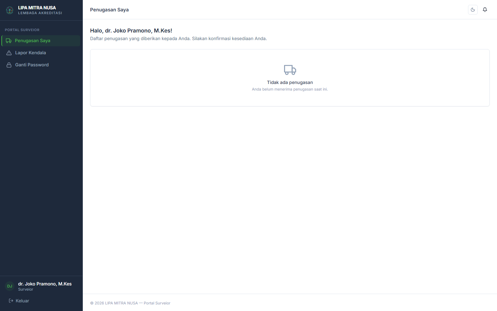
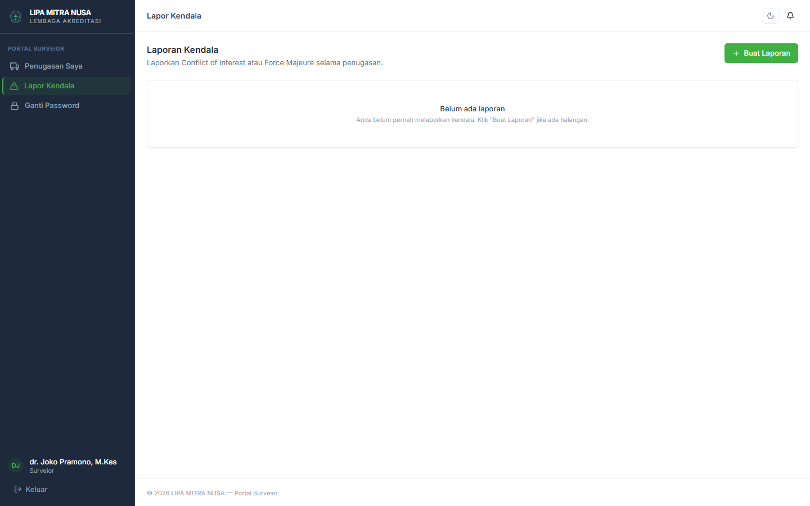
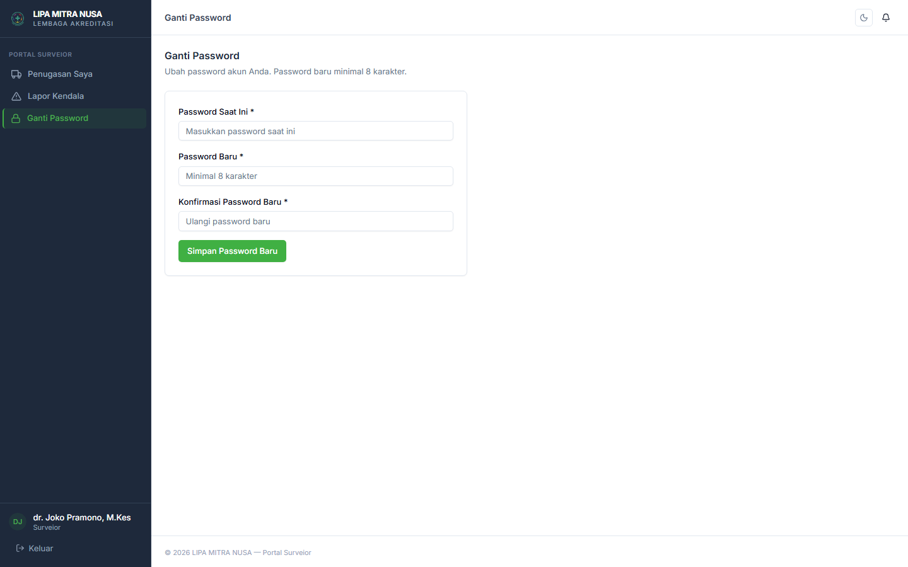

# Bab 03 — Surveior & Verifikator

> Modul: Penugasan · Peran: Surveior, Verifikator · Alamat portal: `/surveior`

Bab ini khusus untuk Anda yang bekerja sebagai **Surveior** atau
**Verifikator** di lapangan. Anda masuk ke portal terpisah dari portal
internal — isinya hanya tiga menu: daftar penugasan yang diberikan
kepada Anda, laporan kendala, dan penggantian password.

Alur kerja Anda secara ringkas: **Surat tugas → konfirmasi kesediaan →
kirim laporan pengerjaan beserta bukti → tandai selesai**. Bila ada
halangan di tengah jalan, Anda bisa melaporkan kendala dari menu
**Lapor Kendala**.

---

## 3.1 Penugasan Saya

**Alamat:** `/surveior/penugasan` · **Peran:** Surveior, Verifikator · **Syarat akses:** Penugasan — Lihat, Ubah

### Yang ditampilkan

- Header portal berisi logo dan nama lembaga, judul halaman **Penugasan
  Saya**, tombol ganti tema, dan tombol lonceng.
- Sidebar dengan tiga menu navigasi: **Penugasan Saya**, **Lapor
  Kendala**, dan **Ganti Password**. Di bagian bawah sidebar tampil
  inisial nama, nama lengkap, nama peran, dan tombol **Keluar**.
- Sapaan **"Halo, {nama}!"** di atas area daftar.
- Subjudul: **"Daftar penugasan yang diberikan kepada Anda. Silakan
  konfirmasi kesediaan Anda."**
- Area daftar penugasan. Pada tangkapan layar di atas, area ini kosong
  dan menampilkan ikon modul, judul **"Tidak ada penugasan"**, serta
  keterangan **"Anda belum menerima penugasan saat ini."** — ini kondisi
  normal, bukan kesalahan.

Bila Anda sudah memiliki penugasan, tiap penugasan tampil sebagai kartu
berisi:

- Label kecil **"Penugasan survei"** atau **"Penugasan verifikasi"**.
- Nama Faskes yang ditugaskan, dan nama lembaga bila tersedia.
- Badge status di sudut kanan atas: **Menunggu Konfirmasi**, **Sedang
  Bertugas**, **Selesai**, **Ditolak**, **Dibatalkan**, atau
  **Digantikan**.
- Daftar tanggal, menyesuaikan jenis penugasan:
  - Penugasan **verifikasi** memuat `Tanggal Kirim Laporan Survei` dan
    `Tanggal Kirim Laporan Verifikasi`.
  - Penugasan **survei** memuat `Tanggal Mulai Survei`, `Tanggal Selesai
    Survei`, dan `Tanggal Kirim Laporan Survei`.
- Blok **Surat Tugas** bila surat tugas tersedia, lengkap dengan tombol
  **Buka** dan **Unduh**.
- Tombol aksi sesuai status penugasan (lihat bagian berikut).
- Untuk penugasan yang sudah berstatus akhir, tampil teks penutup:
  **"Penugasan ini sudah selesai."**, **"Penugasan ini sudah
  ditolak."**, atau **"Penugasan ini sudah ditutup."**

### Apa yang bisa dilakukan

- **Terima** — tombol ini muncul saat status penugasan **Menunggu
  Konfirmasi**. Anda diminta mengonfirmasi kesediaan lewat pesan
  konfirmasi peramban **"Konfirmasi kesediaaan untuk penugasan {jenis} di
  siklus ini?"**. Setelah Anda setuju, sistem membalas **"Kesediaan
  dikonfirmasi. Penugasan sedang berjalan."** dan status penugasan
  berubah menjadi **Sedang Bertugas**.
- **Tolak** — muncul pada status **Menunggu Konfirmasi**. Anda dapat
  menulis alasan penolakan, opsional. Setelah dikirim, sistem membalas
  **"Penolakan dicatat. Admin akan menugaskan pengganti."**
- **Lapor Kendala** — muncul selama penugasan masih aktif (status
  **Menunggu Konfirmasi** atau **Sedang Bertugas**). Membuka jendela
  **Lapor Kendala** yang memuat:
  - Teks: **"Laporkan kendala untuk penugasan {jenis} di {nama faskes}.
    Admin akan menindaklanjuti laporan Anda."**
  - **Jenis Kendala *** dengan pilihan **Conflict of Interest (CoI)**
    dan **Force Majeure**.
  - **Deskripsi Kendala *** — textarea dengan petunjuk **"Jelaskan
    kendala yang Anda alami..."** (maks. 5000 karakter). Kolom ini wajib
    diisi; bila kosong pesan **"Deskripsi kendala wajib diisi"** muncul.
  - Tombol **Batal** dan **Kirim Laporan**.
- **Tandai Selesai** / **Kirim Laporan & Selesai** — muncul saat status
  penugasan **Sedang Bertugas**. Nama tombol berbeda menurut kondisi:
  **Kirim Laporan & Selesai** bila Anda belum punya laporan, dan
  **Tandai Selesai** bila laporan sudah ada. Tombol membuka jendela
  **Kirim Laporan Pengerjaan** (atau **Tandai Selesai**), yang memuat:
  - Bila laporan sudah ada: **"Laporan pengerjaan sudah dikirim oleh
    teammate. Anda cukup menandai penugasan ini selesai."**
  - Bila belum ada: **"Lampirkan screenshot atau dokumen bukti pengerjaan
    untuk penugasan {jenis} di {nama faskes}."**
  - **File Bukti Pengerjaan** — area unggah dengan teks **"Klik untuk
    pilih file atau drag & drop"** dan **"JPG, PNG, GIF, PDF — maks. 10
    MB"**. Berkas gambar yang dipilih akan ditampilkan pratinjaunya.
  - **Keterangan (opsional)** — textarea dengan contoh **"cth: Survei
    lapangan selesai, menunggu hasil laboratorium..."** (maks. 1000
    karakter).
  - Tombol **Batal** dan **Tandai Selesai**.
  - Bila laporan sudah ada, di bawah tombol tampil catatan hijau
    **"Laporan sudah dikirim oleh teammate."** Bila belum, tampil
    **"Lampirkan screenshot bukti pengerjaan."**
- **Buka** (Surat Tugas) — membuka berkas Surat Tugas di tab baru.
- **Unduh** (Surat Tugas) — mengunduh Surat Tugas sebagai PDF. Nama
  berkas mengikuti nomor surat bila ada, misalnya
  `Surat_Tugas_ST/SRV/2026/0001.pdf`; tanpa nomor surat, bernama
  `Surat_Tugas.pdf`.

### Catatan

- Penugasan hanya menampilkan penugasan yang siklus-nya berada di
  lembaga yang sedang Anda gunakan. Bila Anda berpindah lembaga, daftar
  penugasanpun menyesuaikan.
- Surat tugas bersifat satu per siklus dan jenis penugasan. Bila
  penugasan Anda sendiri tidak memuat surat tugas, aplikasi tetap
  menampilkan surat tugas milik rekan satu tim pada siklus dan jenis yang
  sama.
- Pada satu siklus terdapat dua tenaga ahli survei. Karena itu tombol
  selesai bisa berupa **Tandai Selesai** saja: rekan Anda sudah
  mengunggah laporan, dan Anda tidak perlu melampirkan berkas lagi.
- Berkas bukti yang melebihi 10 MB ditolak dengan pesan **"Ukuran file
  maksimal 10 MB."**. Bila penugasan belum punya laporan dari rekan dan
  Anda tidak melampirkan berkas, pesan **"Harap lampirkan bukti
  pengerjaan terlebih dahulu."** muncul.
- Bila penugasan belum berstatus **Sedang Bertugas**, server menolak
  permintaan dengan pesan **"Penugasan belum berjalan."**. Bila akun Anda
  bukan tenaga ahli yang ditugaskan pada penugasan tersebut, pesan
  **"Tidak diizinkan."** muncul. Bila hak akses Anda tidak mencukupi,
  pesan **"Anda tidak memiliki hak akses untuk aksi ini."** muncul.
- Bila Surat Tugas gagal dibuka atau diunduh, pesan **"Gagal membuka
  Surat Tugas."** atau **"Gagal mengunduh Surat Tugas."** muncul di
  peramban.
- Setelah Anda menandai penugasan selesai, tahap siklus untuk penugasan
  survei naik ke tahap Survei, dan untuk penugasan verifikasi naik bila
  seluruh penugasan verifikasi pada siklus itu selesai. Pencatatan honor
  belum dilakukan di langkah ini — honor baru dicatat setelah
  rekomendasi disetujui.
- Menolak penugasan **tidak** langsung menunjuk tenaga ahli pengganti.
  Admin wajib menugaskan ulang secara manual.

---

## 3.2 Lapor Kendala

**Alamat:** `/surveior/kendala` · **Peran:** Surveior, Verifikator · **Syarat akses:** Penugasan — Lihat, Ubah

### Yang ditampilkan

- Judul **Laporan Kendala** dan subjudul **"Laporkan Conflict of
  Interest atau Force Majeure selama penugasan."**
- Tombol **Buat Laporan** di kanan atas judul.
- Daftar laporan kendala. Pada tangkapan layar di atas, daftar kosong dan
  menampilkan **"Belum ada laporan"** dengan keterangan **"Anda belum
  pernah melaporkan kendala. Klik "Buat Laporan" jika ada halangan."** —
  ini kondisi normal, bukan kesalahan.

Bila Anda sudah pernah melaporkan kendala, tiap laporan tampil sebagai
kartu berisi:

- Badge jenis **Conflict of Interest (CoI)** atau **Force Majeure**.
- Nama Faskes yang berkaitan.
- Badge status: **Dilaporkan** (saat baru dibuat), **Sedang Diproses**
  (sudah ditangani admin), atau **Selesai**.
- Isi deskripsi kendala yang Anda tulis.
- Baris **"Dilaporkan: {tanggal}"**.
- Kotak catatan admin bila admin sudah memberi tanggapan, diawali
  **"Catatan Admin:"**.

### Apa yang bisa dilakukan

- **Buat Laporan** — membuka jendela **Buat Laporan Kendala** dan
  otomatis mengisi penugasan pertama yang masih aktif bila tersedia.
  Jendela ini memuat:
  - Peringatan **"Tidak ada penugasan aktif. Anda hanya bisa melapor
    untuk penugasan yang sedang menunggu atau sedang bertugas."** bila
    Anda tidak punya penugasan aktif. Dalam keadaan ini tombol kirim
    dinonaktifkan.
  - **Penugasan *** — daftar pilihan, mula-mula **"— Pilih —"**, lalu
    tiap opsi berbunyi `{jenis} — {nama faskes}`.
  - **Jenis Kendala *** — **Conflict of Interest (CoI)** atau **Force
    Majeure**; bawaan **Conflict of Interest (CoI)**.
  - **Deskripsi *** — textarea dengan petunjuk **"Jelaskan kendala yang
    Anda alami..."** (maks. 5000 karakter).
  - Petunjuk **"Minimal 10 karakter. Admin akan menerima laporan ini dan
    menindaklanjuti."**
  - Tombol **Batal** dan **Kirim Laporan**.
- **Kirim Laporan** — mengirim laporan kendala; daftar di bawah
  otomatis dimuat ulang.
- **Batal** — menutup jendela tanpa menyimpan.

### Catatan

- Laporan yang Anda buat berstatus awal **Dilaporkan**. Admin kemudian
  memprosesnya sehingga status berubah menjadi **Sedang Diproses**,
  lalu **Selesai**.
- Ada dua pintu untuk membuat laporan kendala: menu **Lapor Kendala**
  (menu ini, untuk semua penugasan aktif) dan tombol **Lapor Kendala**
  pada kartu penugasan di [Penugasan Saya](#31-penugasan-saya) yang
  terikat ke satu penugasan tertentu. Keduanya menghasilkan laporan
  yang sama.
- Bila penugasan belum dipilih, pesan **"Pilih penugasan terlebih
  dahulu"** muncul. Bila deskripsi kurang dari 10 karakter, pesan
  **"Deskripsi minimal 10 karakter"** muncul.
- Bila pengiriman gagal, pesan error dari server ditampilkan apa
  adanya di atas formulir; bila pesan kosong, tampil **"Gagal mengirim
  laporan."**
- Bila akun Anda tidak tertaut ke data tenaga ahli, pesan **"Akun ini
  tidak terkait dengan tenaga ahli."** muncul. Bila Anda melapor untuk
  penugasan milik orang lain, pesan **"Tidak diizinkan."** muncul.
- Anda hanya melihat laporan kendala milik sendiri.

---

## 3.3 Ganti Password

**Alamat:** `/surveior/ganti-password` · **Peran:** Surveior, Verifikator · **Syarat akses:** Autentikasi — sudah login

### Yang ditampilkan

- Judul **Ganti Password** dan subjudul **"Ubah password akun Anda.
  Password baru minimal 8 karakter."**
- Satu kartu formulir berisi tiga kolom isian:
  - **Password Saat Ini *** dengan contoh **"Masukkan password saat ini"**.
  - **Password Baru *** dengan contoh **"Minimal 8 karakter"**.
  - **Konfirmasi Password Baru *** dengan contoh **"Ulangi password baru"**.
- Tombol **Simpan Password Baru**.
- Bila berhasil, kotak hijau berisi **"Password berhasil diubah."** dan
  formulir dikosongkan kembali.
- Bila gagal, kotak merah berisi pesan dari server.

### Apa yang bisa dilakukan

- **Simpan Password Baru** — menyimpan password baru Anda. Server
  membalas **"Password berhasil diubah. Silakan login ulang."** dan
  mengakhiri sesi yang sedang dipakai, sehingga sesi di peramban lain
  ikut terputus.

### Catatan

- Password baru wajib berbeda dari password lama. Pesan yang mungkin
  muncul:
  - **"Password saat ini wajib diisi"** bila kolom password lama kosong.
  - **"Password baru minimal 8 karakter"** bila password baru kurang dari
    8 karakter.
  - **"Konfirmasi password baru tidak cocok"** bila pengulangan tidak
    sama dengan password baru.
  - **"Password lama salah."** bila password lama yang Anda ketik tidak
    benar.
  - **"Password baru tidak boleh sama dengan password lama."** bila
    password baru identik dengan password lama.
- Panjang password baru dibatasi antara 8 sampai 72 karakter.
- Teks sukses yang tampil di layar adalah **"Password berhasil
  diubah."**, sedangkan balasan server adalah **"Password berhasil
  diubah. Silakan login ulang."**
- Aplikasi tidak memaksa Anda keluar secara otomatis setelah password
  diganti. Bila ingin keluar, gunakan tombol **Keluar** di sidebar.

---

## Layar terkait

- [Bab 00 — Alur Siklus Akreditasi](00-alur-siklus.md)
- [Bab 02 — Operasional Internal](02-operasional.md) — penerbitan Surat
  Tugas dan penugasan tenaga ahli oleh Admin Lembaga
- [Bab 04 — Rekomendasi](04-rekomendasi.md) —Tahapan verifikasi dan
  rekomendasi setelah laporan pengerjaan Anda diterima
- [Bab 05 — Keuangan](05-keuangan.md) — pencatatan dan pembayaran honor
  tenaga ahli
