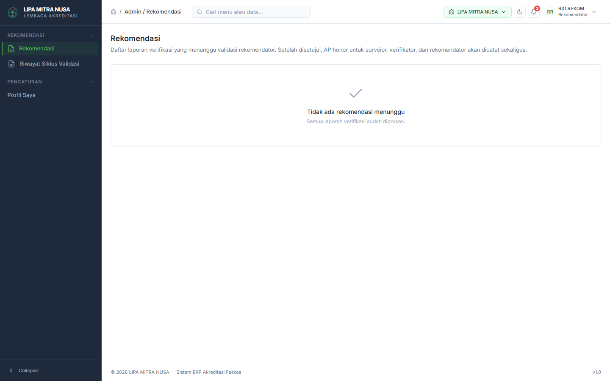
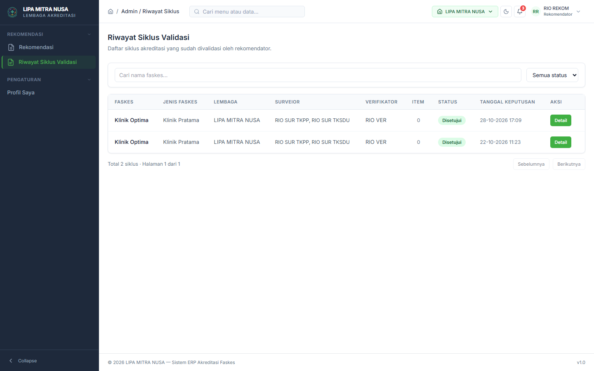

# Bab 04 — Rekomendasi

> Modul: Rekomendasi · Peran: Reksa (Rekomendator) · Rute: `/admin/rekomendasi`

Bab ini untuk Anda yang berperan sebagai **Reksa** — pihak yang
memutuskan hasil verifikasi. Alurnya sederhana: setelah Verifikator
menyelesaikan penilaiannya, laporan verifikasi otomatis muncul di menu
**Rekomendasi** untuk Anda. Anda reviewing, lalu **Setujui** atau
**Tolak**. Begitu Anda menyetujui, pencatatan AP honor untuk Surveior,
Verifikator, dan Reksa langsung dibuat — tidak ada langkah cater
terpisah.

Menu **Rekomendasi** dan **Riwayat Siklus Validasi** berada di sidebar
internal, di bawah grup **REKOMENDASI**.

---

## 4.1 Rekomendasi

**Alamat:** `/admin/rekomendasi` · **Peran:** Reksa (Rekomendator) · **Syarat akses:** Rekomendasi — Lihat

### Yang ditampilkan

- Judul **Rekomendasi** dengan subjudul **"Daftar laporan verifikasi
  yang menunggu validasi rekomendator. Setelah disetujui, AP honor untuk
  surveior, verifikator, dan rekomendator akan dicatat sekaligus."**
- Daftar laporan verifikasi yang menunggu keputusan Anda, ditampilkan
  sebagai tabel di dalam satu kartu dengan kolom:
  - **Faskes** — nama faskes yang diperiksa.
  - **Lembaga** — lembaga tempat faskes terdaftar.
  - **Verifikator** — nama tenaga ahli yang melakukan verifikasi.
  - **Tanggal Final** — waktu laporan verifikasi difinalisasi.
  - **Status** — lencana **Menunggu Rekomendasi**, **Disetujui**, atau
    **Ditolak**.
  - **Aksi** — tombol **Review**.
- Bila kolom Faskes, Lembaga, atau Verifikator kosong, tampil tanda
  **—** sebagai gantinya.
- Pada tangkapan layar di atas, daftar kosong dan menampilkan ikon
  centang hijau, judul **"Tidak ada rekomendasi menunggu"**, dan
  keterangan **"Semua laporan verifikasi sudah diproses."** — ini kondisi
  normal, bukan kesalahan. Kalau memang masih ada yang menunggu, tabel
  akan terisi.
- Saat daftar sedang dimuat, tampil teks **"Memuat..."**.

### Apa yang bisa dilakukan

- **Review** — membuka jendela **"Review Rekomendasi — {nama faskes}"**
  untuk menilai satu laporan. Jendela ini memuat:
  - Bagian **Dokumen Surveior**: satu kartu untuk setiap Surveior,
    berjudul **"Surveior {urutan}"** dan digabung keterangan jenis
    tenaga ahlinya bila tersedia. Tiap kartu berisi baris **Surveior**,
    **Nomor Induk Surveior**, **Status Penugasan**, **Tanggal Submit
    Laporan**, dan **Keterangan**. Bila Surveior belum mengirim dokumen,
    tertulis **"Tidak ada dokumen."**
  - Bagian **Dokumen Verifikator**: baris **Verifikator** dan **Tanggal
    Selesai Verifikasi**.
  - Bagian **Status Rekomendasi**: lencana status, baris **"Diputuskan:
    {waktu}"** bila keputusan sudah diambil, dan kotak berisi catatan
    rekomendasi bila ada.
  - Bagian **Catatan Rekomendator (opsional)** — hanya tampil bila Anda
    berhak menyetujui dan status detail masih **menunggu**. Isinya kolom
    teks bertiga baris dengan petunjuk **"Tambahkan catatan jika
    diperlukan (mis. untuk rekomendasi atau justifikasi penolakan)..."**,
    maksimal 2000 karakter, disertai pengingat **"Catatan wajib diisi
    (min. 5 karakter) hanya jika Anda memilih Tolak."**
  - Tombol **Tutup**, **Tolak** (merah), dan **Setujui** (hijau).
    Tombol Tolak dan Setujui hanya muncul bila Anda berhak menyetujui dan
    status detail masih **menunggu**.
  - Selama detail dimuat tampil teks **"Memuat detail..."**; bila detail
    tidak tersedia tampil **"Detail tidak tersedia."**
- **Setujui** — memunculkan konfirmasi peramban **"Setujui hasil
  verifikasi ini? AP honor untuk surveior, verifikator, dan rekomendator
  akan dicatat."** Setelah Anda setuju, server membalas **"Rekomendasi
  disetujui. AP honor untuk surveior, verifikator, dan rekomendator sudah
  dicatat."**, jendela ditutup, dan daftar dimuat ulang. Tombol
  menampilkan teks **"Memproses..."** selama proses berjalan.
- **Tolak** — memunculkan konfirmasi peramban **"Tolak hasil verifikasi
  ini?"** lalu mengirim catatan yang Anda ketik bersama keputusan
  penolakan. Server membalas **"Rekomendasi ditolak. Verifikator/admin
  perlu menindaklanjuti catatan."**, jendela ditutup, dan daftar dimuat
  ulang.
- **Tutup** — menutup jendela tanpa mengubah apa pun.

### Catatan

- Antrean rekomendasi terbentuk otomatis: begitu Verifikator
  menyelesaikan penugasan verifikasinya, laporan verifikasi masuk ke menu
  ini tanpa perlu ada yang mengirim manual.
- Saat Anda menekan **Setujui**, sistem sekaligus menandai siklus sebagai
  tuntas — tahap siklus naik ke tahap terakhir. Honor pun dicatat untuk
  Surveior, Verifikator, dan Reksa sekaligus.
- Bila **Tolak** dipilih tanpa catatan, atau catatan kurang dari 5
  karakter, sistem menampilkan pesan **"Catatan penolakan wajib diisi
  (min. 5 karakter)."** dan keputusan tidak dikirim. Catatan wajib diisi
  hanya bila Anda menolak; saat menyetujui, catatan bersifat opsional.
- Kolom **Status** pada daftar dapat menunjukkan **Ditolak** untuk laporan
  yang pernah ditolak. Laporan seperti ini masih terlihat di daftar,
  tetapi tombol **Tolak** dan **Setujui** tidak muncul di jendela
  review-nya — putuskanannya sudah tercatat.
- Pesan lain yang mungkin muncul:
  - **"Rekomendasi sudah disetujui sebelumnya."** bila Anda menyetujui
    rekomendasi yang decision-nya sudah tercatat.
  - **"Tidak dapat menolak rekomendasi yang sudah disetujui."** bila
    Anda menolak rekomendasi yang decision-nya sudah tercatat.
  - **"Rekomendasi disetujui, tetapi pencatatan AP honor gagal: {pesan
    error}"** bila rekomendasi berhasil disetujui tetapi pencatatan honor
    bermasalah. Rekomendasi tetap tercatat sebagai disetujui.
  - **"Hanya default reksa untuk lembaga {nama lembaga} yang dapat
    menyetujui."** atau **"Hanya default reksa untuk lembaga {nama
    lembaga} yang dapat menolak."** bila Anda bukan reksa yang sedang
    ditunjuk untuk lembaga tersebut.
  - **"Laporan verifikasi ini milik lembaga "{nama}". Anda sedang di
    lembaga lain."** bila laporan yang Anda buka berasal dari lembaga
    lain.
  - **"Anda tidak memiliki hak akses untuk aksi ini."** bila hak akses
    Anda tidak mencukupi.
- Daftar dan jendela review hanya menampilkan data lembaga yang sedang
  Anda gunakan. Bila Anda berpindah lembaga, isinya menyesuaikan.
- Pencatatan honor Reksa baru membawa nomor rekening bila akun Reksa
  tertaut ke tenaga ahli yang sudah punya data rekening. Bila rekening
  belum ada, sistem menampilkan peringatan **"Belum ada data rekening.
  Tautkan akun ini ke tenaga ahli di Manajemen Akun agar honor reksa
  membawa rekening saat pembayaran AP."** Pengaturan reksa ini berada
  pada menu **Rekomendator** di grup **PENGATURAN** dan dijelaskan di
  [Bab 08 — Pengaturan & Hak Akses](08-pengaturan.md).

---

## 4.2 Riwayat Siklus Validasi

**Alamat:** `/admin/riwayat-siklus` · **Peran:** Reksa (Rekomendator) · **Syarat akses:** Rekomendasi — Lihat

### Yang ditampilkan

- Judul **Riwayat Siklus Validasi** dengan subjudul **"Daftar siklus
  akreditasi yang sudah divalidasi oleh rekomendator."**
- Baris filter di atas tabel:
  - Kolom pencarian dengan contoh **"Cari nama faskes..."**.
  - Dropdown status dengan pilihan **Semua status**, **Disetujui**, dan
    **Ditolak**.
  - Tombol **Reset**, yang hanya tampil bila pencarian atau filter status
    sedang terisi.
- Tabel riwayat dengan kolom:
  - **Faskes** — nama faskes.
  - **Jenis Faskes** — jenis faskes.
  - **Lembaga** — lembaga tempat faskes terdaftar.
  - **Surveior** — nama Surveior yang bekerja di siklus itu, dipisah
    tanda koma.
  - **Verifikator** — nama Verifikator.
  - **Item** — jumlah item verifikasi yang diperiksa.
  - **Status** — lencana **Disetujui** atau **Ditolak**.
  - **Tanggal Keputusan** — waktu keputusan diambil.
  - **Aksi** — tombol **Detail**.
- Bila suatu kolom kosong, tampil tanda **—** sebagai gantinya.
- Baris paginasi di bawah tabel dengan teks **"Total {total} siklus ·
  Halaman {halaman} dari {jumlah halaman}"**, serta tombol
  **Sebelumnya** dan **Berikutnya**. Baris ini hanya tampil bila ada
  data.
- Bila riwayat masih kosong, tampil judul **"Belum ada riwayat"** dan
  keterangan **"Siklus yang sudah divalidasi akan tampil di sini."** —
  kondisi normal, bukan kesalahan.
- Saat daftar dimuat, tampil teks **"Memuat..."**.

### Apa yang bisa dilakukan

- **Mengetik di kolom pencarian** — menyaring riwayat berdasarkan sebagian
  nama faskes. Nomor halaman dikembalikan ke 1.
- **Memilih status** — menampilkan hanya riwayat yang berstatus
  **Disetujui** atau **Ditolak**. Nomor halaman dikembalikan ke 1.
- **Reset** — mengosongkan pencarian dan filter status, lalu menampilkan
  daftar dari halaman pertama.
- **Detail** — membuka jendela **"Detail Rekomendasi — {nama faskes}"**
  yang memuat bagian **Dokumen Surveior**, **Dokumen Verifikator**, dan
  **Status Rekomendasi** — sama persis dengan isi jendela review pada
  menu [Rekomendasi](#41-rekomendasi). Jendela ini **hanya-baca**: tidak
  ada catatan Reksa dan tidak ada tombol Tolak maupun Setujui. Tombol
  yang tersedia hanya **Tutup**.
- **Sebelumnya** dan **Berikutnya** — berpindah halaman daftar, 15 baris
  per halaman. Tombol **Sebelumnya** dinonaktifkan di halaman pertama dan
  tombol **Berikutnya** dinonaktifkan di halaman terakhir.
- Selama detail dimuat tampil teks **"Memuat detail..."**; bila detail
  tidak tersedia tampil **"Detail tidak tersedia."**

### Catatan

- Riwayat ini menampilkan **satu baris per siklus**, bukan satu baris
  per laporan verifikasi.
- Hanya siklus yang sudah diputuskan **Disetujui** atau **Ditolak** yang
  muncul di sini. Laporan yang masih menunggu keputusan Anda berada di
  menu [Rekomendasi](#41-rekomendasi).
- Catatan penolakan tetap tersimpan dan dapat dibaca di dalam jendela
  detail, pada bagian **Status Rekomendasi**.
- Tidak ada batasan minimum isian pada kolom pencarian maupun filter
  status; bila hasilnya kosong, tabel menampilkan kondisi "belum ada
  data".
- Pesan **"Anda tidak memiliki hak akses untuk aksi ini."** muncul bila
  hak akses Anda tidak mencukupi untuk membuka riwayat ini.
- Data dibatasi per lembaga aktif, sama seperti menu Rekomendasi.

---

## Layar terkait

- [Bab 00 — Alur Siklus Akreditasi](00-alur-siklus.md) — posisi
  rekomendasi dalam tujuh tahap siklus
- [Bab 03 — Surveior & Verifikator](03-surveior.md) — laporan
  pengerjaan dan verifikasi yang menjadi bahan keputusan Anda
- [Bab 02 — Operasional Internal](02-operasional.md) — penerbitan
  Surat Tugas dan penugasan tenaga ahli
- [Bab 05 — Keuangan](05-keuangan.md) — pencatatan dan pembayaran AP
  honor yang terbentuk setelah Anda menyetujui rekomendasi
- [Bab 08 — Pengaturan & Hak Akses](08-pengaturan.md) — penetapan reksa
  default per lembaga
