# Bab 05 — Keuangan

> Modul: Keuangan · Peran: Direktur/Keuangan · Alamat portal: `/admin`

Bab ini untuk Anda yang menangani keuangan di LIPA MITRA NUSA: dari
memantau tagihan yang belum dibayar Faskes, sampai membayar honor
tenaga ahli, menyetor pajak, dan menyusun rekonsiliasi.

Semua menu bab ini berada di sidebar internal, di bawah grup
**KEUANGAN**. Urutan kerjanya: **Dasbor Piutang** untuk melihat
tagihan yang belum lunas, lalu **Approval Refund** bila ada permintaan
pengembalian dana. Untuk sisi pengeluaran, alurnya
**Dasbor AP Honor → Bayar Honor → Kas Keluar Honor**, disusul
**Hutang Pajak** untuk setor PPh 21. **Rekonsiliasi**,
**Bukti Potong PPh**, **Ledger Journal**, dan **Slip Honorarium**
menyajikan hasil pencatatan itu, sedangkan **Konfigurasi Pajak**
menentukan tarif PPN dan PPh Pasal 21 yang berlaku.

---

## 5.1 Dasbor Piutang

**Alamat:** `/admin/piutang` · **Peran:** Direktur/Keuangan · **Syarat akses:** Dasbor Eksekutif — Lihat

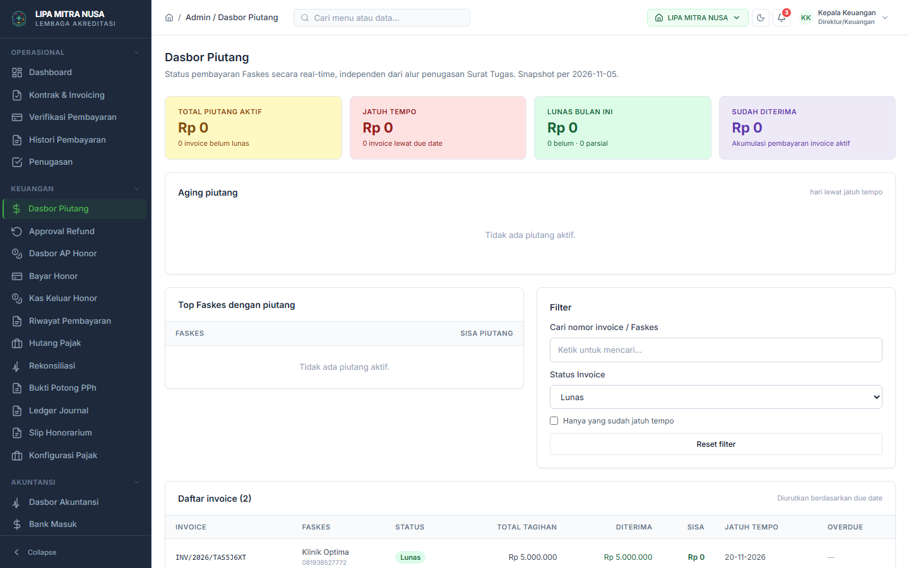

### Yang ditampilkan

- Judul **Dasbor Piutang** dengan subjudul **"Status pembayaran Faskes
  secara real-time, independen dari alur penugasan Surat Tugas.
  Snapshot per {tanggal}."**
- Empat kartu ringkasan di bagian atas:
  - **TOTAL PIUTANG AKTIF** — total nominal tagihan yang belum lunas,
    dengan keterangan jumlah invoice yang belum lunas.
  - **JATUH TEMPO** — total nominal tagihan yang sudah melewati tanggal
    jatuh tempo, dengan keterangan jumlah invoice yang lewat jatuh tempo.
  - **LUNAS BULAN INI** — jumlah invoice yang lunas bulan ini, dengan
    keterangan jumlah invoice yang belum bayar dan yang baru dibayar
    sebagian.
  - **SUDAH DITERIMA** — akumulasi pembayaran invoice yang masih aktif.
- Kartu **Aging piutang** dengan keterangan "hari lewat jatuh tempo".
  Isinya lima rentang usia piutang: **Belum jatuh tempo**, **0-30
  hari**, **31-60 hari**, **61-90 hari**, dan **>90 hari**.
- Kartu **Top Faskes dengan piutang** — kolom **FASKES** dan **SISA
  PIUTANG**. Di bawah nama Faskes tampil tipe Faskes dan jumlah
  invoice.
- Panel **Filter** berisi:
  - Kotak cari berlabel **Cari nomor invoice / Faskes** dengan contoh
    **"Ketik untuk mencari..."**.
  - Pilih **Status Invoice** dengan pilihan: Semua status, Belum Bayar,
    Jatuh Tempo, Parsial, Lunas, Kedaluwarsa, Refund.
  - Kotak centang **Hanya yang sudah jatuh tempo**.
  - Tombol **Reset filter**.
- Tabel **Daftar invoice (n)** dengan keterangan "Diurutkan berdasarkan
  due date". Kolomnya: **INVOICE**, **FASKES**, **STATUS**, **TOTAL
  TAGIHAN**, **DITERIMA**, **SISA**, **JATUH TEMPO**, **OVERDUE**.
  - Lencana status memakai label: Belum Bayar, Parsial, Jatuh Tempo,
    Lunas, Kedaluwarsa, Refund, Diganti.
  - Kolom **OVERDUE** berisi jumlah hari lewat jatuh tempo, atau **—**
    bila belum lewat jatuh tempo.
- Pada tangkapan layar di atas, kartu **Aging piutang** dan **Top Faskes
  dengan piutang** menampilkan **"Tidak ada piutang aktif."** karena
  seluruh invoice sudah lunas — ini kondisi normal, bukan kesalahan.
  Tabelnya sendiri tetap berisi satu invoice berstatus **Lunas**.
- Saat data sedang dimuat, tampil teks **"Memuat dasbor piutang..."**.

### Apa yang bisa dilakukan

- Mengetik di kotak cari, memilih status invoice, atau mencentang **Hanya
  yang sudah jatuh tempo** — daftar invoice dimuat ulang sesuai
  penyaringan yang Anda pilih.
- **Reset filter** — mengosongkan semua penyaringan dan memuat ulang
  daftar invoice tanpa penyaringan.
- Klik baris tabel invoice — Anda masuk ke
  [Detail Piutang](#52-detail-piutang) untuk satu invoice.

### Catatan

- **Piutang aktif** berarti invoice yang belum berstatus lunas, belum
  direfund, dan belum digantikan oleh invoice lain. Sisa piutang dihitung
  sebagai total tagihan dikurangi pembayaran yang statusnya sudah
  **Diterima**.
- Status yang tampil adalah turunan, bukan nilai yang disimpan
  terpisah: invoice yang sudah lewat jatuh tempo tampil sebagai
  **Jatuh Tempo**, yang sudah dibayar sebagian tampil sebagai
  **Parsial**, dan seterusnya.
- Umur piutang (aging) dihitung dari selisih hari terhadap tanggal
  jatuh tempo. Daftar **Top Faskes** menampilkan 20 Faskes dengan sisa
  piutang terbesar.
- Daftar invoice dibatasi 100 invoice teratas dan diurutkan berdasarkan
  tanggal jatuh tempo.
- Halaman ini berdiri sendiri dan tidak bergantung pada alur penugasan
  Surat Tugas. Tagihan Faskes tetap dipantau di sini meski survei sudah
  berjalan.
- Bila pemuatan gagal, pesan error dari server ditampilkan apa adanya di
  kartu merah, dengan tombol **Kembali**.

---

## 5.2 Detail Piutang

**Alamat:** `/admin/piutang/{id}` · **Peran:** Direktur/Keuangan · **Syarat akses:** Dasbor Eksekutif — Lihat

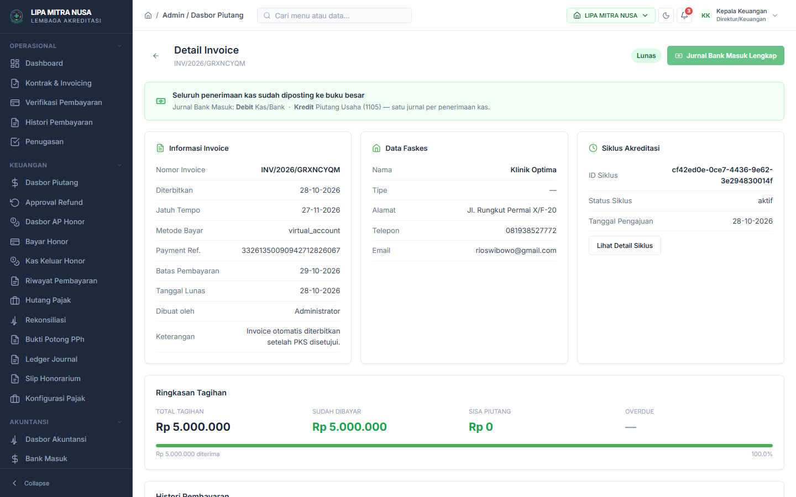

### Yang ditampilkan

- Judul **Detail Invoice** dengan nomor invoice di bawahnya.
- Tombol aksi di bagian atas:
  - **Buat Jurnal Bank Masuk** — tampil bila penerimaan kas pada invoice
    ini belum punya jurnal.
  - **Jurnal Bank Masuk Lengkap** — tampil bila seluruh penerimaan kas
    sudah memiliki jurnal. Tombol ini nonaktif dan diberi keterangan
    **"Seluruh penerimaan kas pada invoice ini sudah memiliki jurnal bank
    masuk"**.
- Pita ringkasan jurnal, berwarna hijau bila sudah lengkap, dengan teks
  **"Seluruh penerimaan kas sudah diposting ke buku besar"** dan
  keterangan bentuk jurnalnya: **"Jurnal Bank Masuk: Debit Kas/Bank ·
  Kredit Piutang Usaha (1105) — satu jurnal per penerimaan kas."**
- Kartu **Informasi Invoice** dengan baris: **Nomor Invoice**,
  **Diterbitkan**, **Jatuh Tempo**, **Metode Bayar**, **Payment Ref.**,
  **Batas Pembayaran**, **Tanggal Lunas**, **Dibuat oleh**, dan
  **Keterangan**.
- Kartu **Data Faskes** dengan baris **Nama**, **Tipe**, **Alamat**,
  **Telepon**, dan **Email**.
- Kartu **Siklus Akreditasi** dengan baris **ID Siklus**, **Status
  Siklus**, **Tanggal Pengajuan**, serta tombol **Lihat Detail Siklus**.
- Kartu **Ringkasan Tagihan** dengan empat angka besar: **TOTAL
  TAGIHAN**, **SUDAH DIBAYAR**, **SISA PIUTANG**, dan **OVERDUE**,
  disertai bilah kemajuan bertuliskan jumlah yang diterima dan
  persentasenya.
- Kartu **Histori Pembayaran** dengan kolom **Tanggal**, **Metode**,
  **Nominal**, **Status**, **Diverifikasi oleh**, dan **Keterangan**.
  Label metode yang tampil: Virtual Account, QRIS, Transfer Manual.
  Label status: Menunggu, Diterima, Ditolak.
- Panel **Jurnal Penerimaan Kas** yang menampilkan **Nomor Jurnal**,
  **Tanggal**, **Kategori**, dan tabel akun dengan kolom **AKUN**,
  **DEBIT**, **KREDIT** beserta baris totalnya.
- Pada tangkapan layar di atas, invoice berstatus **Lunas** dan seluruh
  penerimaan kasnya sudah diposting, sehingga yang tampil adalah tombol
  **Jurnal Bank Masuk Lengkap** yang nonaktif dan pita hijau di atas.

### Apa yang bisa dilakukan

- **Buat Jurnal Bank Masuk** — membuat satu jurnal untuk penerimaan kas
  yang terpilih. Bentuknya Debit Kas/Bank dan Kredit Piutang Usaha
  (1105). Setelah berhasil, sistem membalas **"Jurnal bank masuk berhasil
  dibuat"**. Bila tidak ada penerimaan kas yang belum dijurnal, sistem
  membalas **"Tidak ada jurnal baru"**.
- **Lihat Detail Siklus** — membuka rincian siklus akreditasi yang
  terkait dengan invoice ini.
- Klik baris histori pembayaran — tabel ini hanya menampilkan riwayat,
  tidak ada navigasi lebih lanjut.

### Catatan

- Jurnal Bank Masuk **tidak** dibuat otomatis saat pembayaran diterima.
  Anda sebagai pihak Keuangan yang menekan tombolnya. Satu penerimaan kas
  menghasilkan satu jurnal.
- Bila invoice tidak ditemukan, halaman menampilkan pesan error dari
  server beserta tombol **Kembali**.
- Bila pembuatan jurnal gagal, kartu merah menampilkan **"Gagal membuat
  jurnal bank masuk: {pesan}"**.
- Metode bayar pada kartu **Informasi Invoice** ditampilkan apa adanya
  dari sistem, misalnya `virtual_account`.
- Panel jurnal menampilkan rincian akun debit dan kredit beserta
  totalnya, sehingga Anda bisa mencocokkan angka di buku besar.

---

## 5.3 Approval Refund

**Alamat:** `/admin/refund-approval` · **Peran:** Direktur/Keuangan · **Syarat akses:** Kontrak & Invoicing — Setujui

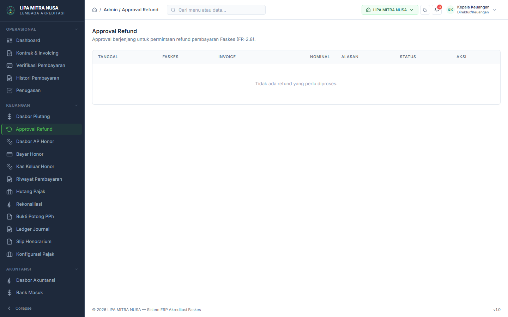

### Yang ditampilkan

- Judul **Approval Refund** dengan subjudul **"Approval berjenjang untuk
  permintaan refund pembayaran Faskes (FR-2.8)."**
- Tabel refund dengan kolom **TANGGAL**, **FASKES**, **INVOICE**,
  **NOMINAL**, **ALASAN**, **STATUS**, dan **AKSI**.
- Lencana status yang tampil: **Menunggu approval**, **Disetujui (siap
  eksekusi)**, **Sudah dieksekusi**, dan **Ditolak**.
- Kolom **AKSI** memuat tombol sesuai status:
  - Status menunggu approval — tombol **Setujui** dan **Tolak**.
  - Status disetujui — tombol **Eksekusi Sekarang**.
- Jendela **Detail Refund** memuat baris **Faskes**, **Nominal**, dan
  **Alasan**, kolom **Catatan approval** dengan contoh **"Catatan untuk
  approval / alasan penolakan..."**, serta tombol **Batal**, **Tolak**,
  **Setujui**, dan **Eksekusi Sekarang**.
- Pada tangkapan layar di atas, tabel menampilkan **"Tidak ada refund
  yang perlu diproses."** — ini kondisi normal, bukan kesalahan.

### Apa yang bisa dilakukan

- **Setujui** — menyetujui permintaan refund. Kolom **Catatan approval**
  bersifat opsional dan maksimal 1000 karakter.
- **Tolak** — menolak permintaan refund. Alasan penolakan wajib diisi
  pada kolom yang sama. Bila alasan kosong, sistem menampilkan peringatan
  **"Alasan penolakan wajib diisi."** dan permintaan tidak dikirim.
- **Eksekusi Sekarang** — menjalankan refund yang sudah disetujui. Sebelum
  dikirim, peramban meminta konfirmasi **"Eksekusi refund ini? Tindakan
  ini akan membuat Ledger Entry dan tidak dapat dibatalkan."**
- **Batal** — menutup jendela tanpa mengirim permintaan.

### Catatan

- Refund melalui tiga tahap: **Menunggu approval** → **Disetujui (siap
  eksekusi)** → **Sudah dieksekusi**, atau **Menunggu approval** →
  **Ditolak**. Daftar di halaman ini hanya memuat refund yang menunggu
  dan yang sudah disetujui.
- Eksekusi refund membuat satu entri buku besar bertipe refund dengan
  nilai negatif — pembalikan dari penerimaan kas — dan **tidak dapat
  dibatalkan**.
- Bila status refund berubah di luar layar ini, server menolak dengan
  pesan **"Refund tidak dalam status requested (saat ini: {status})."**,
  dan untuk eksekusi **"Refund belum disetujui (saat ini: {status})."**
- Pengajuan refund dari sisi lain (oleh Faskes) punya syarat sendiri:
  nominal minimal 1 dan alasan minimal 10 karakter. Bila nominal melebihi
  total tagihan invoice, pesan **"Nominal refund melebihi total tagihan
  invoice."** muncul.

---

## 5.4 Dasbor AP Honor

**Alamat:** `/admin/ap-honor` · **Peran:** Direktur/Keuangan · **Syarat akses:** Ledger/Keuangan — Lihat

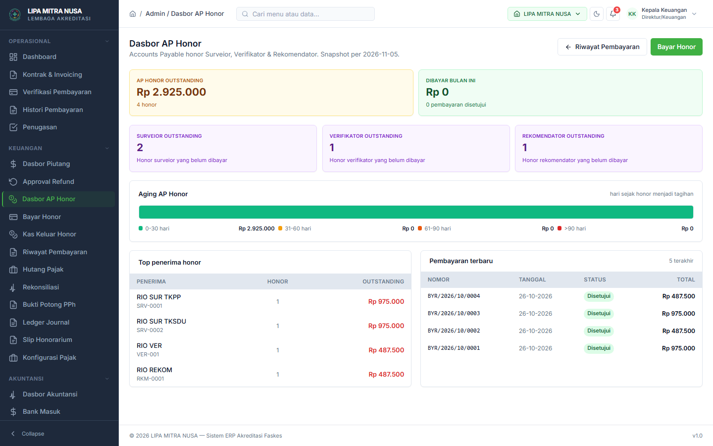

### Yang ditampilkan

- Judul **Dasbor AP Honor** dengan subjudul **"Accounts Payable honor
  Surveior, Verifikator & Rekomendator. Snapshot per {tanggal}."**
- Dua tombol di bagian atas: **Riwayat Pembayaran** dan **Bayar
  Honor**.
- Lima kartu ringkasan:
  - **AP HONOR OUTSTANDING** — total honor yang belum dibayar, dengan
    keterangan jumlah honor.
  - **DIBAYAR BULAN INI** — total honor yang sudah dibayar bulan ini,
    dengan keterangan jumlah pembayaran yang disetujui.
  - **SURVEIOR OUTSTANDING** — jumlah honor Surveior yang belum dibayar.
  - **VERIFIKATOR OUTSTANDING** — jumlah honor Verifikator yang belum
    dibayar.
  - **REKOMENDATOR OUTSTANDING** — jumlah honor Rekomendator yang belum
    dibayar.
- Kartu **Aging AP Honor** dengan keterangan "hari sejak honor menjadi
  tagihan". Isinya empat rentang: **0-30 hari**, **31-60 hari**, **61-90
  hari**, dan **>90 hari**.
- Kartu **Top penerima honor** dengan kolom **PENERIMA**, **HONOR**, dan
  **OUTSTANDING**. Di bawah nama penerima tampil nomor induk tenaga
  ahlinya.
- Kartu **Pembayaran terbaru** dengan keterangan "5 terakhir" dan kolom
  **NOMOR**, **TANGGAL**, **STATUS**, **TOTAL**. Lencana status
  pembayaran: Draft, Disetujui, Dibatalkan.
- Saat data sedang dimuat, tampil teks **"Memuat dasbor AP..."**.

### Apa yang bisa dilakukan

- **Riwayat Pembayaran** — membuka daftar seluruh pembayaran honor.
- **Bayar Honor** — membuka daftar honor yang belum dibayar untuk
  dipilih dan dibayar.
- Klik baris pada kartu **Pembayaran terbaru** — Anda masuk ke
  [Detail Pembayaran Honor](#57-detail-pembayaran-honor).

### Catatan

- **AP Honor** adalah honor Surveior, Verifikator, dan Rekomendator yang
  sudah menjadi tagihan tetapi belum dibayar. Honor masuk daftar ini
  setelah siklus penugasan selesai.
- Honor yang belum dibayar disebut *outstanding* — artinya belum
  lunas. Daftar honor yang belum dibayar tersedia di
  [Bayar Honor](#55-bayar-honor).
- Umur piutang AP honor diukur dari hari sejak honor menjadi tagihan,
  bukan dari tanggal jatuh tempo.
- Honor hanya masuk daftar outstanding bila laporan verifikasi sudah
  berstatus disetujui. Honor yang sudah termasuk dalam pembayaran aktif
  tidak ditampilkan lagi.
- Bila pemuatan data gagal, server dapat membalas **"Filter periode
  harus diisi lengkap (tahun dan bulan)."** dengan rincian
  **"tahun dan bulan harus diisi bersama-sama."**

---

## 5.5 Bayar Honor

**Alamat:** `/admin/ap-honor/list` · **Peran:** Direktur/Keuangan · **Syarat akses:** Ledger/Keuangan — Lihat

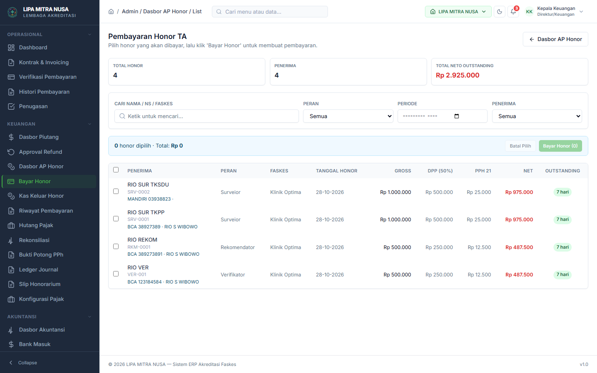

### Yang ditampilkan

- Judul **Pembayaran Honor TA** dengan subjudul **"Pilih honor yang akan
  dibayar, lalu klik 'Bayar Honor' untuk membuat pembayaran."**
- Tombol **Dasbor AP Honor** di bagian atas.
- Dua kartu ringkasan: **TOTAL HONOR** (jumlah entri honor) dan **TOTAL
  NETO OUTSTANDING** (total sisa yang harus dibayar).
- Panel penyaringan berisi:
  - Kotak cari berlabel **Cari nama / NS / Faskes** dengan contoh
    **"Ketik untuk mencari..."**.
  - Pilih **Peran** dengan pilihan: Semua, Surveior, Verifikator,
    Rekomendator.
  - Pilih **Periode** untuk menyaring bulan.
  - Pilih **Penerima** untuk menyaring penerima honor.
  - Tombol **Reset filter**.
- Baris status pemilihan berbunyi **"{n} honor dipilih · Total: {rupiah}"**,
  beserta tombol **Batal Pilih** dan **Bayar Honor ({n})**.
- Tabel honor dengan kolom centang di kiri, lalu **PENERIMA**, **PERAN**,
  **FASKES**, **TANGGAL HONOR**, **GROSS**, **DPP (50%)**, **PPH 21**,
  **NET**, dan **OUTSTANDING**.
  - Label peran: Surveior, Verifikator, Rekomendator.
  - Kolom **OUTSTANDING** memuat lencana umur, misalnya **"7 hari"** —
    merah bila lebih dari 90 hari, kuning bila lebih dari 30 hari, hijau
    untuk sisanya.
- Pada tangkapan layar di atas, baris status berbunyi **"0 honor dipilih ·
  Total: Rp 0"** dan tombol **Bayar Honor (0)** masih nonaktif.

### Apa yang bisa dilakukan

- Mengubah salah satu penyaringan — daftar honor dimuat ulang sesuai
  penyaringan.
- **Reset filter** — mengembalikan penyaringan ke keadaan awal dan memuat
  ulang daftar.
- Mencentang baris honor, atau centang kotak pada kepala tabel — pilihan
  Anda tercermin pada baris "{n} honor dipilih · Total: {rupiah}".
- **Batal Pilih** — mengosongkan seluruh pilihan.
- **Bayar Honor ({n})** — melanjutkan ke formulir pembuatan pembayaran
  untuk honor yang Anda centang.

### Catatan

- **DPP (50%)** adalah dasar pengenaan PPh 21 Bukan Pegawai, yaitu 50%
  dari honor bruto. **Net** adalah nominal yang benar-benar diterima
  penerima honor.
- Kolom **OUTSTANDING** menampilkan sisa tagihan per entri honor, karena
  satu honor bisa dibayar sebagian.
- Tombol **Bayar Honor** tidak aktif bila tidak ada baris yang Anda
  centang. Tidak ada peringatan yang muncul, tombolnya tetap nonaktif.
- Honor baru dapat dibayar setelah siklus penugasan selesai, dan hanya
  honor yang statusnya belum lunas.
- Honor yang statusnya belum lunas tampil di daftar ini; honor yang sudah
  termasuk dalam pembayaran aktif tidak ditampilkan lagi.
- Bila penyaringan periode tidak lengkap, server membalas **"Filter periode
  harus diisi lengkap (tahun dan bulan)."**

---

## 5.6 Buat Pembayaran Honor

**Alamat:** `/admin/ap-honor/bayar` · **Peran:** Direktur/Keuangan · **Syarat akses:** Ledger/Keuangan — Tambah

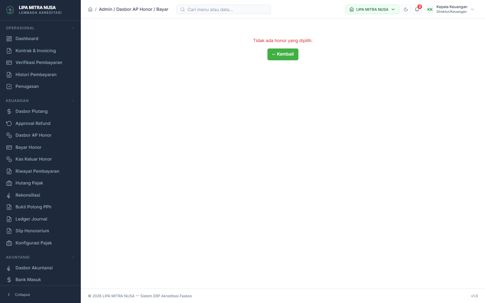

### Yang ditampilkan

- Halaman ini punya dua mode. Pada mode buat, judulnya **Buat
  Pembayaran Honor** dengan subjudul **"Draft pembayaran dapat
  diedit/dibatalkan sebelum disetujui. Setelah disetujui, honor berubah
  status menjadi lunas."** Pada mode edit, judulnya **Edit Pembayaran
  Honor** dengan subjudul **"Hanya pembayaran berstatus draft yang dapat
  diedit. Line item honor tidak berubah saat edit."**
- Kartu **Detail Pembayaran** berisi:
  - **Tanggal Pembayaran *** — kolom tanggal.
  - **Metode Pembayaran *** — pilihan Transfer Bank, Tunai, Lainnya.
  - Saat metode **Transfer Bank**, muncul tiga kolom tambahan: **Bank
    Pengirim** (contoh **"BCA, Mandiri, dll"**), **No. Rekening Tujuan**
    (contoh **"1234567890"**), dan **Atas Nama** (contoh **"Nama
    penerima"**).
  - **Catatan** dengan contoh **"Catatan internal (opsional)"**.
  - **Bukti Transfer** — area unggah berkas.
- Kartu **Ringkasan** berisi **Jumlah line item**, **Penerima**, dan
  **Total Neto**, lalu tabel line item dengan kolom **Penerima**,
  **Peran**, **Faskes**, **Tgl Honor**, **Gross**, **DPP**, **PPh 21**,
  dan **Net**.
- Tombol di bagian bawah: **Batal**, serta **Simpan sebagai Draft**
  (mode buat) atau **Simpan Perubahan** (mode edit). Saat menyimpan,
  tombol berubah menjadi **"Menyimpan..."**.
- Pada tangkapan layar di atas, halaman menampilkan pesan **"Tidak ada
  honor yang dipilih."** dan tombol **← Kembali**. Ini muncul karena
  halaman ini dibuka tanpa daftar honor terpilih, dan merupakan kondisi
  normal.

### Apa yang bisa dilakukan

- **Simpan sebagai Draft** — menyimpan pembayaran sebagai draft.
  Pembayaran yang baru dibuat selalu berstatus draft dan belum mengubah
  status honor menjadi lunas.
- **Simpan Perubahan** — menyimpan perubahan pada pembayaran berstatus
  draft. Line item honor tidak dapat diubah lewat mode ini.
- **Batal** — keluar dari formulir tanpa menyimpan.
- Mengunggah bukti transfer sebagai lampiran pembayaran.

### Catatan

- Kolom **Tanggal Pembayaran** dan **Metode Pembayaran** wajib diisi.
  Bila kosong, pesan **"Tanggal wajib diisi"** atau **"Metode wajib
  dipilih"** muncul.
- Berkas bukti transfer diunggah sebagai bagian dari formulir, dengan
  jenis berkas gambar JPEG/PNG atau PDF.
- Nomor pembayaran dibuat otomatis oleh server dengan pola
  `BYR/YYYY/MM/NNNN`.
- Line item honor bersifat permanen setelah draft dibuat. Untuk
  menggantinya, batalkan pembayaran ini lalu buat pembayaran baru.
- Pesan error yang mungkin muncul dari server:
  - **"Pilih minimal satu honor entry untuk dibayar."**
  - **"Sebagian honor entry tidak ditemukan atau bukan AP honor."**
  - **"Sebagian entry sudah lunas: {daftar id}"**
  - **"Sebagian honor sudah termasuk dalam pembayaran lain yang masih
    aktif. Batalkan pembayaran tersebut terlebih dahulu."**
  - **"Hanya pembayaran berstatus draft yang dapat diedit. Batalkan
    pembayaran terlebih dahulu."**
- Bila total pembayaran tidak sama dengan jumlah line item, tampil
  pita peringatan **"Total pembayaran ({total}) tidak sesuai dengan
  jumlah line item ({total}). Line item honor tidak bisa diubah saat
  edit — batalkan pembayaran ini lalu buat pembayaran baru."**

---

## 5.7 Detail Pembayaran Honor

**Alamat:** `/admin/ap-honor/payment/{id}` · **Peran:** Direktur/Keuangan · **Syarat akses:** Ledger/Keuangan — Lihat

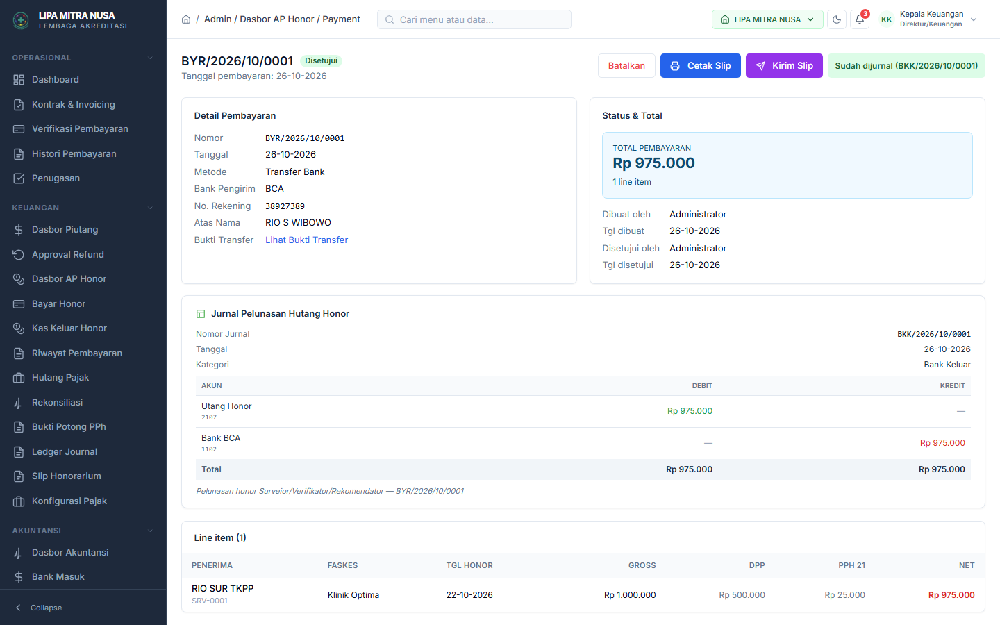

### Yang ditampilkan

- Nomor pembayaran sebagai judul halaman, dengan lencana status:
  **Draft**, **Disetujui**, atau **Dibatalkan**.
- Tombol aksi di bagian atas:
  - **✓ Setujui** — hanya tampil untuk status draft.
  - **Edit** — hanya tampil untuk status draft.
  - **Hapus Draft** (status draft) atau **Batalkan** (status disetujui).
  - **Cetak Slip** dan **Kirim Slip**.
  - **Buat Bank Keluar** — bila jurnal sudah ada, tampil lencana
    **"Sudah dijurnal ({nomor jurnal)}"**.
- Kartu **Detail Pembayaran** dengan baris **Nomor**, **Tanggal**,
  **Metode**, **Bank Pengirim**, **No. Rekening**, **Atas Nama**,
  **Catatan**, dan tombol **Lihat Bukti Transfer**.
- Kartu **Status & Total** dengan baris **Total Pembayaran**, jumlah
  line item, **Dibuat oleh**, **Tgl dibuat**, **Disetujui oleh**, **Tgl
  disetujui**, **Dibatalkan oleh**, **Tgl dibatalkan**, dan **Alasan**.
- Tabel line item dengan kolom **PENERIMA**, **FASKES**, **TGL HONOR**,
  **GROSS**, **DPP**, **PPH 21**, dan **NET**.
- Panel **Kirim Slip Honorarium** dengan teks
  `"Kirim slip honor ke tenaga ahli via WhatsApp atau Email."` Panel ini
  memuat ringkasan
  **No. Pembayaran**, **Penerima**, **Total Neto**, **Bruto**, **PPN**,
  **PPh 21**, dan **AC-7** (**✓ Valid** atau **✕ Selisih**), label
  **Pilih Channel Pengiriman** dengan pilihan `WhatsApp`, `Email`,
  `Keduanya`, dan tombol **Kirim via {channel}**.
- Panel **Jurnal Pelunasan Hutang Honor** yang menampilkan rincian akun
  debit dan kredit beserta totalnya.
- Pada tangkapan layar di atas, pembayaran berstatus **Disetujui**,
  sudah punya jurnal **BKK/2026/10/0001**, dan lencana **"Sudah
  dijurnal"** sudah tampil.

### Apa yang bisa dilakukan

- **✓ Setujui** — menyetujui pembayaran. Peramban meminta konfirmasi
  **"Setujui pembayaran {nomor}? Honor akan berubah status menjadi
  lunas."**
- **Edit** — membuka formulir edit untuk pembayaran ini.
- **Hapus Draft** / **Batalkan** — membatalkan pembayaran. Anda wajib
  menulis alasan pembatalan; bila kosong atau kurang dari 3 karakter,
  pesan **"Alasan minimal 3 karakter."** muncul.
- **Buat Bank Keluar** — membuat jurnal Bank Keluar untuk pembayaran ini.
  Peramban meminta konfirmasi **"Buat jurnal Bank Keluar untuk {nomor}?"**
- **Cetak Slip** — membuka jendela **Preview Slip Honorarium** dengan
  tombol **Cetak** dan **Tutup**.
- **Kirim Slip** — mengirim slip honorarium lewat `WhatsApp`, `Email`, atau
  keduanya sesuai pilihan Anda.
- **Lihat Bukti Transfer** — membuka berkas bukti pembayaran.
- Klik baris line item — tabel hanya menampilkan rincian, tanpa navigasi.

### Catatan

- Alur honor: entri honor dibuat otomatis — Surveior saat laporan
  survei ditandai selesai, Verifikator saat verifikasi difinalkan, dan
  Rekomendator saat rekomendasi disetujui.
- Pembayaran berstatus draft → setelah disetujui, status honor menjadi
  **lunas**, dan hutang PPh 21 otomatis dibuat untuk setiap penerima
  dengan PPh lebih dari 0, dengan jatuh tempo akhir bulan berikutnya.
- Jurnal pelunasan **tidak** dibuat otomatis. Anda yang membuat jurnal
  Bank Keluar lewat tombol **Buat Bank Keluar** (Debit Utang Honor,
  Kredit Kas-Bank).
- Pembatalan pembayaran yang sudah disetujui mengembalikan status honor
  ke belum dibayar.
- Bila pratinjau slip gagal dimuat, pesan **"Preview gagal dimuat (HTTP
  {status})."** muncul.
- Pesan error dari server yang mungkin muncul saat menyetujui:
  - **"Pembayaran sudah dibatalkan, tidak dapat disetujui."**
  - **"Pembayaran tidak memiliki line item honor."**
  - **"Total pembayaran (Rp X) tidak sesuai dengan jumlah line item
    (Rp Y). Perbaiki draft pembayaran sebelum menyetujui."**
  - **"Sebagian honor pada pembayaran ini sudah tidak ditemukan.
    Batalkan pembayaran lalu buat ulang."**
  - **"Sebagian honor sudah lunas sehingga tidak dapat disetujui lagi:
    {daftar id}"**
- Bila total pembayaran tidak sesuai dengan jumlah line item, tampil pita
  peringatan **"Total pembayaran ({total}) tidak sesuai dengan jumlah
  line item ({total_detail}). Pembayaran ini tidak dapat disetujui
  sampai selaras."**

---

## 5.8 Kas Keluar Honor

**Alamat:** `/admin/ap-honor/kas-keluar` · **Peran:** Direktur/Keuangan · **Syarat akses:** Ledger/Keuangan — Lihat

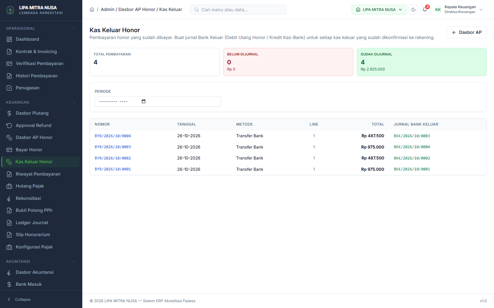

### Yang ditampilkan

- Judul **Kas Keluar Honor** dengan subjudul **"Pembayaran honor yang
  sudah dibayar. Buat jurnal Bank Keluar (Debit Utang Honor / Kredit
  Kas-Bank) untuk setiap kas keluar yang sudah dikonfirmasi ke
  rekening."**
- Tombol **Dasbor AP** di bagian atas.
- Tiga kartu ringkasan:
  - **TOTAL PEMBAYARAN** — jumlah pembayaran.
  - **BELUM DIJURNAL** — jumlah dan nominal pembayaran yang belum punya
    jurnal kas keluar.
  - **SUDAH DIJURNAL** — jumlah dan nominal yang sudah punya jurnal.
- Panel penyaringan **Periode** (pemilihan bulan) dan tombol **Reset
  filter**.
- Tabel dengan kolom **NOMOR**, **TANGGAL**, **METODE**, **LINE**,
  **TOTAL**, dan **JURNAL BANK KELUAR**.
  - Kolom **LINE** berisi jumlah line item honor pada pembayaran.
  - Kolom **JURNAL BANK KELUAR** memuat tombol **Buat Bank Keluar** bila
    jurnal belum ada, atau lencana **"Belum dijurnal"** bila Anda tidak
    memiliki hak untuk membuat jurnal. Bila jurnal sudah ada, nomor
    jurnalnya tampil.
- Pada tangkapan layar di atas, seluruh pembayaran sudah dijurnal, jadi
  kartu **BELUM DIJURNAL** bernilai nol.

### Apa yang bisa dilakukan

- Memilih periode — daftar kas keluar dimuat ulang untuk periode
  tersebut.
- **Reset filter** — menghapus pilihan periode dan memuat ulang seluruh
  data.
- **Buat Bank Keluar** — membuat jurnal kas keluar untuk satu
  pembayaran yang sudah dikonfirmasi masuk ke rekening.

### Catatan

- Jurnal Bank Keluar untuk honor berbentuk Debit Utang Honor dan Kredit
  Kas-Bank, dan dibuat eksplisit satu per kas keluar.
- Bila jurnal untuk sumber yang sama sudah pernah dibuat, sistem
  menampilkan **"Jurnal bank keluar sudah ada untuk hutang pajak ini."**
- Bila pembuatan jurnal gagal, kartu merah menampilkan **"Gagal membuat
  jurnal bank keluar: {pesan}"**. Bila berhasil, sistem membalas
  **"Jurnal bank keluar berhasil dibuat."**
- Nomor jurnal dapat dilihat juga pada panel jurnal di
  [Detail Pembayaran Honor](#57-detail-pembayaran-honor).

---

## 5.9 Riwayat Pembayaran

**Alamat:** `/admin/ap-honor/history` · **Peran:** Direktur/Keuangan · **Syarat akses:** Ledger/Keuangan — Lihat

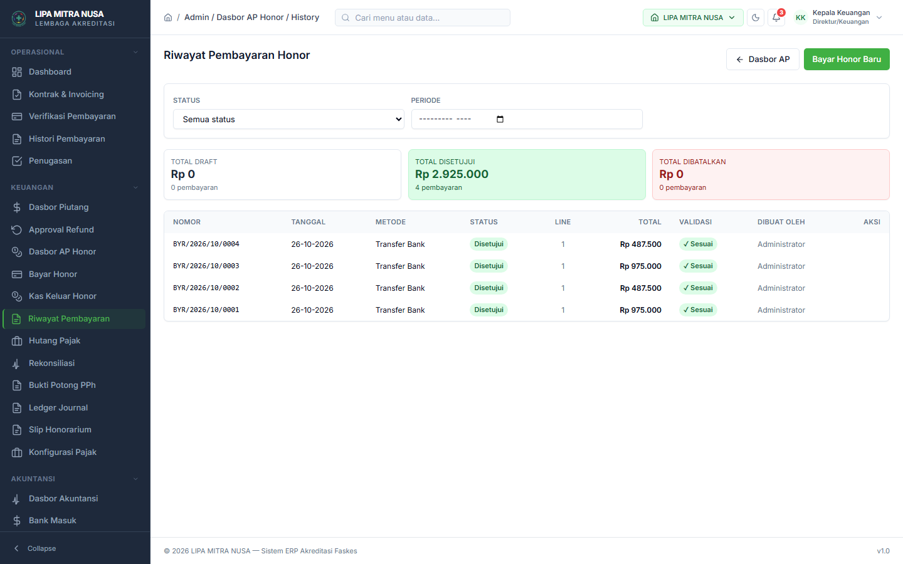

### Yang ditampilkan

- Judul **Riwayat Pembayaran Honor**.
- Dua tombol di bagian atas: **Kembali** (ke Dasbor AP) dan **Bayar Honor
  Baru**.
- Panel penyaringan berisi:
  - Pilih **Status** dengan pilihan: Semua status, Draft, Disetujui,
    Dibatalkan.
  - Pilih **Periode** untuk menyaring bulan.
  - Tombol **Reset**.
- Tiga kartu ringkasan:
  - **TOTAL DRAFT** — jumlah nominal pembayaran berstatus draft, dengan
    jumlah pembayarannya.
  - **TOTAL DISETUJUI** — jumlah nominal pembayaran berstatus disetujui,
    dengan jumlah pembayarannya.
  - **TOTAL DIBATALKAN** — jumlah nominal pembayaran berstatus
    dibatalkan, dengan jumlah pembayarannya.
- Tabel riwayat dengan kolom **NOMOR**, **TANGGAL**, **METODE**,
  **STATUS**, **LINE**, **TOTAL**, **VALIDASI**, **DIBUAT OLEH**, dan
  **AKSI**.
  - Kolom **STATUS** memakai lencana Draft, Disetujui, Dibatalkan.
  - Kolom **VALIDASI** memakai lencana **✓ Sesuai** atau **! Total tidak
    sesuai** dengan keterangan **"Total pembayaran tidak sama dengan
    jumlah line item honor"**.
  - Kolom **AKSI** memuat tombol **Edit** untuk pembayaran berstatus
    draft. Tombol ini nonaktif bila total pembayaran tidak sesuai
    jumlah line item, dengan keterangan **"Total pembayaran tidak sesuai
    jumlah line item — batalkan pembayaran ini lalu buat ulang"**.
- Pada tangkapan layar di atas, keempat pembayaran berstatus
  **Disetujui** dan lencana **VALIDASI** semuanya **✓ Sesuai**.

### Apa yang bisa dilakukan

- Mengubah penyaringan status atau periode — daftar riwayat dimuat ulang.
- **Reset** — mengosongkan penyaringan dan memuat ulang daftar.
- Klik baris tabel — Anda masuk ke
  [Detail Pembayaran Honor](#57-detail-pembayaran-honor).
- **Edit** — membuka formulir edit untuk pembayaran tersebut.

### Catatan

- Kolom **LINE** berisi jumlah line item honor pada pembayaran.
- Pembayaran yang totalnya tidak selaras dengan jumlah line item tidak
  dapat disetujui. Perbaikannya dengan membatalkan pembayaran tersebut
  lalu membuat pembayaran baru.
- Status pembayaran hanya ada tiga: draft, disetujui, dan dibatalkan.
- Bila pemuatan gagal, kartu merah menampilkan **"Gagal memuat riwayat
  pembayaran: {pesan}"**.
- Bila penyaringan periode tidak lengkap, server membalas **"Filter periode
  harus diisi lengkap (tahun dan bulan)."** dengan rincian **"tahun dan
  bulan harus diisi bersama-sama."**

---

## 5.10 Hutang Pajak

**Alamat:** `/admin/hutang-pajak` · **Peran:** Direktur/Keuangan · **Syarat akses:** Ledger/Keuangan — Lihat

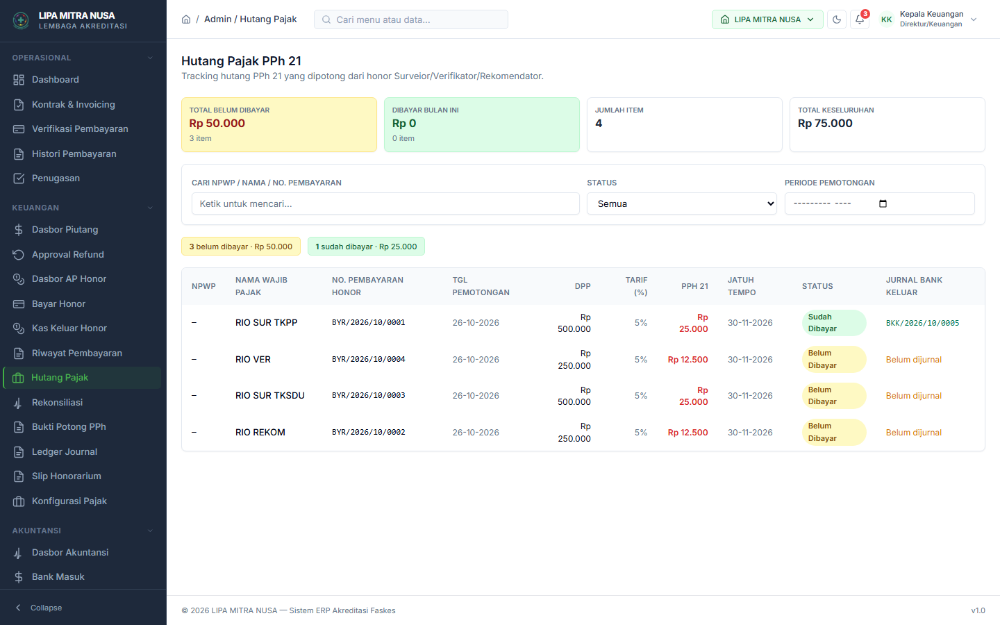

### Yang ditampilkan

- Judul **Hutang Pajak PPh 21** dengan subjudul **"Tracking hutang PPh 21
  yang dipotong dari honor Surveior/Verifikator/Rekomendator."**
- Empat kartu ringkasan:
  - **TOTAL BELUM DIBAYAR** — jumlah nominal hutang yang belum dibayar,
    dengan jumlah itemnya.
  - **DIBAYAR BULAN INI** — jumlah nominal hutang yang dibayar bulan ini,
    dengan jumlah itemnya.
  - **JUMLAH ITEM** — jumlah seluruh item hutang pajak.
  - **TOTAL KESELURUHAN** — total nominal seluruh hutang pajak.
- Panel penyaringan berisi:
  - Kotak cari berlabel **Cari NPWP / Nama / No. Pembayaran** dengan
    contoh **"Ketik untuk mencari..."**.
  - Pilih **Status** dengan pilihan: Semua, Belum Dibayar, Sudah Dibayar.
  - Pilih **Periode Pemotongan** untuk menyaring bulan pemotongan.
  - Tombol **Reset**.
- Baris ringkasan penyaringan, misalnya **"3 belum dibayar · Rp 50.000"** dan
  **"1 sudah dibayar · Rp 25.000"**.
- Tabel dengan kolom **NPWP**, **NAMA WAJIB PAJAK**, **NO. PEMBAYARAN
  HONOR**, **TGL PEMOTONGAN**, **DPP**, **TARIF (%)**, **PPH 21**,
  **JATUH TEMPO**, **STATUS**, dan **JURNAL BANK KELUAR**.
  - Lencana status: **Belum Dibayar** dan **Sudah Dibayar**.
  - Kolom **JURNAL BANK KELUAR** memuat tombol **Buat Bank Keluar** bila
    jurnal belum ada, atau nomor jurnal bila sudah ada.
- Pada tangkapan layar di atas, kolom NPWP kosong dan tampil tanda **—**
  karena data pajak tenaga ahli belum dilengkapi.

### Apa yang bisa dilakukan

- Mengetik di kotak cari atau mengubah penyaringan status dan periode
  pemotongan — daftar hutang pajak dimuat ulang.
- **Reset** — mengosongkan penyaringan dan memuat ulang daftar.
- **Buat Bank Keluar** — membuat jurnal kas keluar untuk setor pajak
  tersebut.
- Klik baris tabel — Anda masuk ke
  [Detail Hutang Pajak](#511-detail-hutang-pajak).

### Catatan

- Hutang PPh 21 dibuat otomatis begitu pembayaran honor disetujui,
  untuk setiap penerima honor dengan PPh lebih dari 0. Jatuh temponya
  adalah akhir bulan berikutnya.
- **Tarif (%)** adalah tarif efektif yang dipakai sistem saat menghitung
  hutang pajak.
- PPN **tidak** muncul di layar ini. PPN adalah pajak output yang
  dipungut dari Faskes melalui invoice, bukan dipotong dari honor.
- Bila jurnal kas keluar untuk hutang pajak yang sama pernah dibuat,
  sistem menampilkan **"Jurnal bank keluar sudah ada untuk hutang pajak
  ini."** Bila gagal, kartu merah menampilkan **"Gagal membuat jurnal
  bank keluar: {pesan}"**.

---

## 5.11 Detail Hutang Pajak

**Alamat:** `/admin/hutang-pajak/{id}` · **Peran:** Direktur/Keuangan · **Syarat akses:** Ledger/Keuangan — Lihat

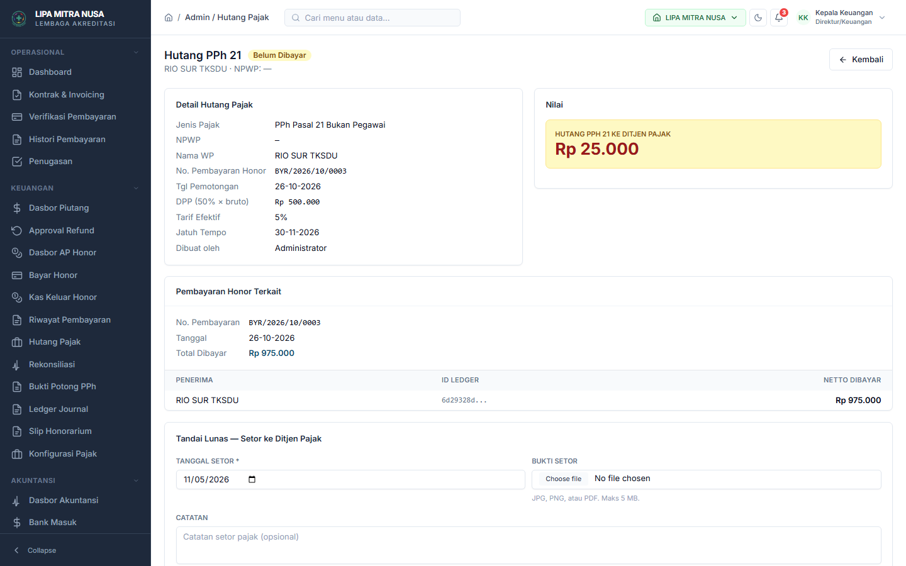

### Yang ditampilkan

- Judul **Hutang PPh 21** dengan lencana status **Belum Dibayar** atau
  **Sudah Dibayar**, lalu nama wajib pajak dan NPWP di bawahnya.
- Tombol **← Kembali** di bagian atas.
- Kartu **Detail Hutang Pajak** dengan baris **Jenis Pajak** (nilai
  **PPh Pasal 21 Bukan Pegawai**), **NPWP**, **Nama WP**, **No. Pembayaran
  Honor**, **Tgl Pemotongan**, **DPP (50% × bruto)**, **Tarif Efektif**,
  **Jatuh Tempo**, dan **Dibuat oleh**.
- Kartu **Nilai** berisi judul **HUTANG PPH 21 KE DITJEN PAJAK** dan
  nominal hutang. Bila sudah dibayar, kartu ini juga memuat **Tgl
  Dibayar**, **Dibayar oleh**, **Catatan**, dan tombol **Lihat Bukti
  Setor**.
- Kartu **Pembayaran Honor Terkait** dengan baris **No. Pembayaran**,
  **Tanggal**, **Total Dibayar**, lalu tabel **PENERIMA**, **ID LEDGER**,
  dan **NETTO DIBAYAR**.
- Formulir **Tandai Lunas — Setor ke Ditjen Pajak** berisi:
  - **Tanggal Setor *** — kolom tanggal.
  - **Bukti Setor** — area unggah berkas dengan keterangan **"JPG, PNG,
    atau PDF. Maks 5 MB."**
  - **Catatan** dengan contoh **"Catatan setor pajak (opsional)"**.
  - Tombol **Tandai Lunas**. Saat menyimpan, tombol berubah menjadi
    **"Menyimpan..."**.
- Panel **Jurnal Setor PPh 21** yang menampilkan rincian akun debit dan
  kredit beserta totalnya, atau pesan bahwa jurnal belum dibuat.
- Pada tangkapan layar di atas, hutang pajak berstatus **Belum Dibayar**
  dan panel jurnal belum memuat rincian akun.

### Apa yang bisa dilakukan

- **Tandai Lunas** — mencatat bahwa setor PPh 21 sudah dibayarkan ke
  Ditjen Pajak, lengkap dengan tanggal setor, berkas bukti setor, dan
  catatan.
- **Buat Bank Keluar** — membuat jurnal Bank Keluar untuk setor pajak
  ini (Debit Utang PPh 21, Kredit Kas-Bank).
- **Lihat Bukti Setor** — membuka berkas bukti setor yang pernah
  diunggah.
- **← Kembali** — kembali ke daftar hutang pajak.

### Catatan

- Kolom **Tanggal Setor** wajib diisi. Bila kosong, pesan **"Tanggal
  wajib diisi"** muncul.
- Bila hutang pajak tidak ditemukan, halaman menampilkan **"Hutang pajak
  tidak ditemukan."**
- Bila hutang pajak sudah pernah ditandai lunas, server menolak dengan
  pesan **"Sudah lunas."**
- Jurnal setor PPh 21 dibuat eksplisit lewat tombol, bukan otomatis saat
  Anda menandai lunas.
- **DPP (50% × bruto)** adalah dasar pengenaan PPh 21 Bukan Pegawai,
  yaitu 50% dari honor bruto.
- Tarif efektif pada layar ini berasal dari perhitungan hutang pajak.
  Perlu dicatat, perhitungan PPh pada entri honor memakai bracket tarif
  yang berbeda — hal ini perlu konfirmasi ke tim devs bila Anda perlu
  mencocokkan angka keduanya secara rinci.

---

## 5.12 Rekonsiliasi

**Alamat:** `/admin/rekonsiliasi` · **Peran:** Direktur/Keuangan · **Syarat akses:** Dasbor Eksekutif — Lihat

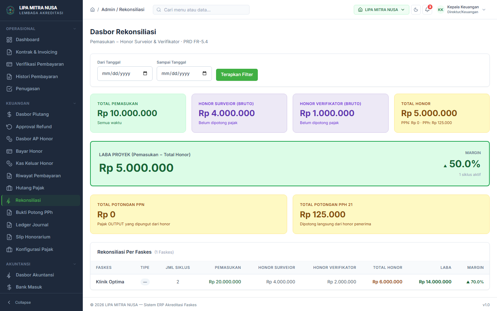

### Yang ditampilkan

- Judul **Dasbor Rekonsiliasi** dengan subjudul **"Pemasukan − Honor
  Surveior & Verifikator · PRD FR-5.4."**
- Panel penyaringan tanggal berisi **Dari Tanggal**, **Sampai Tanggal**,
  tombol **Terapkan Filter**, dan tombol **Reset**.
- Kartu ringkasan:
  - **TOTAL PEMASUKAN** — total pemasukan pada periode terpilih, dengan
    keterangan rentang tanggal atau **"Semua waktu"** bila penyaringan
    tanggal belum diisi.
  - **HONOR SURVEIOR (BRUTO)** — total honor Surveior, dengan keterangan
    **"Belum dipotong pajak"**.
  - **HONOR VERIFIKATOR (BRUTO)** — sama seperti di atas untuk honor
    Verifikator.
  - **TOTAL HONOR** — total honor, dengan keterangan nominal PPN dan PPh.
- Blok **LABA PROYEK (Pemasukan − Total Honor)** yang menampilkan nilai
  laba dan **MARGIN** dengan indikator naik atau turun, serta jumlah
  siklus aktif.
- Dua kartu pajak:
  - **TOTAL POTONGAN PPN** dengan keterangan **"Pajak OUTPUT yang dipungut
    dari honor"**.
  - **TOTAL POTONGAN PPH 21** dengan keterangan **"Dipotong langsung dari
    honor penerima"**.
- Tabel **Rekonsiliasi Per Faskes ({n} Faskes)** dengan kolom **FASKES**,
  **TIPE**, **JML SIKLUS**, **PEMASUKAN**, **HONOR SURVEIOR**, **HONOR
  VERIFIKATOR**, **TOTAL HONOR**, **LABA**, dan **MARGIN**.
- Pada tangkapan layar di atas, penyaringan tanggal belum diisi sehingga
  keterangan **TOTAL PEMASUKAN** berbunyi **"Semua waktu"**.

### Apa yang bisa dilakukan

- Mengisi **Dari Tanggal** dan **Sampai Tanggal**, lalu **Terapkan
  Filter** — seluruh angka dimuat ulang untuk rentang tersebut.
- **Reset** — menghapus rentang tanggal dan memuat ulang seluruh
  periode.

### Catatan

- **Pemasukan** dihitung dari penerimaan kas yang tercatat pada buku
  besar, termasuk penyesuaian PKS dan refund.
- **Total Honor** pada layar ini hanya menghitung honor Surveior dan
  Verifikator. Honor Rekomendator tidak termasuk dalam KPI total honor
  di sini, meskipun tetap tercatat di buku besar.
- **Laba** = Pemasukan − Total Honor, dan **Margin** = Laba ÷ Pemasukan ×
  100.
- Keterangan **"Pajak OUTPUT yang dipungut dari honor"** pada kartu
  **TOTAL POTONGAN PPN** perlu dibaca dengan hati-hati: dari sisi
  akuntansi, PPN adalah pajak output yang dibebankan ke Faskes lewat
  invoice.
- Bila pemuatan gagal, kartu merah menampilkan **"Gagal memuat data:
  {pesan}"**. Bila periode tidak diisi, server memakai rentang default.

---

## 5.13 Bukti Potong PPh

**Alamat:** `/admin/bukti-potong` · **Peran:** Direktur/Keuangan · **Syarat akses:** Ledger/Keuangan — Lihat

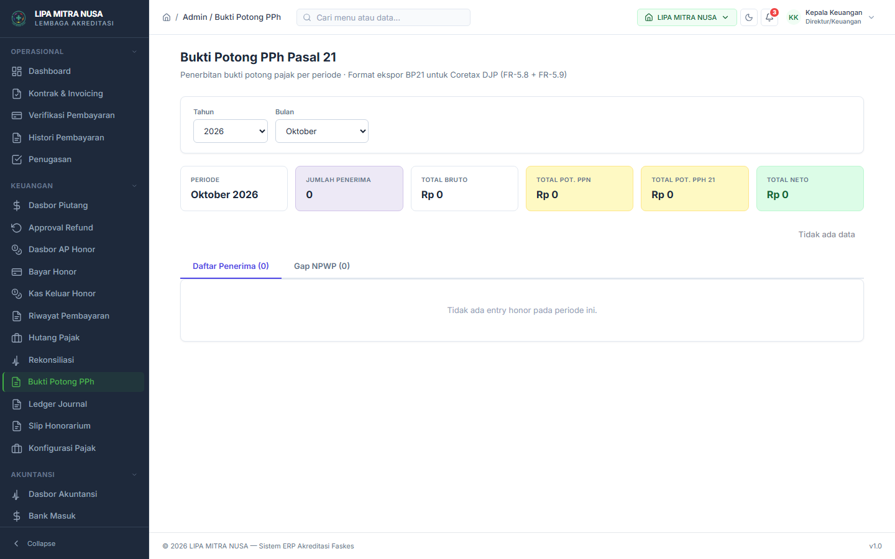

### Yang ditampilkan

- Judul **Bukti Potong PPh Pasal 21** dengan subjudul **"Penerbitan bukti
  potong pajak per periode · Format ekspor BP21 untuk Coretax DJP
  (FR-5.8 + FR-5.9)."**
- Panel penyaringan berisi pilih **Tahun** dan pilih **Bulan** (Januari sampai
  Desember).
- Kartu ringkasan: **PERIODE**, **JUMLAH PENERIMA**, **TOTAL BRUTO**,
  **TOTAL POT. PPN**, **TOTAL POT. PPH 21**, dan **TOTAL NETO**.
- Tombol **Ekspor XML BP21 (Coretax)**. Saat proses mengunduh, tombol
  berubah menjadi **"Mengunduh..."**. Tombol ini nonaktif bila tidak ada
  data atau belum ada tenaga ahli yang siap diekspor, dengan keterangan
  **"Lengkapi identitas pajak (NPWP, PTKP, KPP) terlebih dahulu"**.
- Dua tab: **Daftar Penerima ({n})** dan **Gap NPWP ({n})**.
- Tabel rekap pada tab **Daftar Penerima** dengan kolom **PENERIMA**,
  **NPWP / NIK**, **PTKP**, **KPP**, **Jml Penugasan**, **Total Bruto**,
  **Pot. PPN**, **Pot. PPh 21**, **Total Neto**, dan **STATUS**.
  - Kolom **NPWP / NIK** dan **PTKP** dapat diperluas untuk menampilkan
    rincian per penugasan: **Tanggal**, **Tipe**, **Faskes**, **Bruto**,
    **Pot. PPN**, **Pot. PPh**, **Neto**.
  - Lencana status: **SIAP** atau **GAP**.
- Tabel pada tab **Gap NPWP** dengan kolom **Tenaga Ahli**, **Nomor
  Induk**, **NPWP**, **PTKP**, **KPP**, **Kode Pajak**, **Masalah**, dan
  **Total Neto**. Label masalah yang tampil: **NPWP & NIK kosong**,
  **NPWP placeholder (00/11)**, **NPWP tidak valid**, **Nama pajak
  kosong**, **Status PTKP kosong (BP21)**, **Kode KPP kosong (BP21)**,
  dan **Kode objek pajak kosong (BP21)**.
- Pada tangkapan layar di atas, periode terpilih Oktober 2026 belum punya
  entry honor, sehingga kedua tab kosong dan tampil **"Tidak ada entry
  honor pada periode ini."** — ini kondisi normal.

### Apa yang bisa dilakukan

- Mengubah tahun atau bulan — rekap periode dimuat ulang.
- **Ekspor XML BP21 (Coretax)** — mengunduh berkas rekap bukti potong
  untuk diunggah ke Coretax DJP. Nama berkasnya mengikuti periode,
  misalnya `Bp21-2026-10.xml`.
- Klik baris rekap — rincian entry honor pada baris tersebut terbuka.
- Beralih ke tab **Gap NPWP** — melihat daftar tenaga ahli yang identitas
  pajaknya belum lengkap.

### Catatan

- Hanya entry honor yang sudah berstatus lunas yang masuk rekap bukti
  potong.
- Syarat tenaga ahli siap diekspor: nama pajak tersedia; NPWP 15 sampai
  16 digit atau NIK 16 digit; awalan NPWP bukan 00 atau 11; status PTKP,
  kode KPP, dan kode objek pajak tersedia.
- Bila ada tenaga ahli yang belum siap, tampil peringatan **"{n} tenaga
  ahli belum siap export — lihat tab "Gap NPWP" untuk detail & lengkapi
  via Master Tenaga Ahli."** Nama menu **Master Tenaga Ahli** ditulis
  demikian di pesan sistem.
- Bila ekspor gagal, tampil pesan **"Gagal mengekspor XML: {pesan}"**.
- Bila bulan yang dipilih di luar rentang 1 sampai 12, server menolak
  dengan pesan **"Bulan harus antara 1 dan 12."**
- Perbedaan tarif PPh yang berlaku perlu dipahami: perhitungan PPh pada
  entry honor memakai bracket progresif atas dasar 50% dari honor bruto,
  sedangkan hutang PPh 21 memakai bracket tarif efektif. Keduanya dipakai
  pada layar berbeda, jadi angka PPh pada rekap bukti potong tidak
  selalu sama dengan PPh pada hutang pajak.

---

## 5.14 Ledger Journal

**Alamat:** `/admin/ledger-journal` · **Peran:** Direktur/Keuangan · **Syarat akses:** Ledger/Keuangan — Lihat

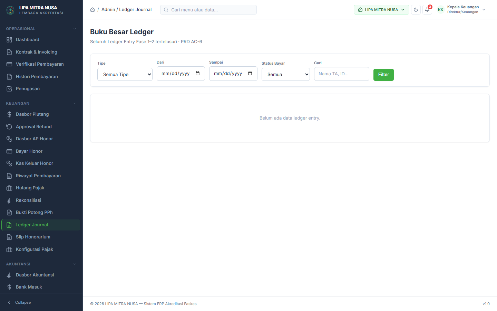

### Yang ditampilkan

- Judul **Buku Besar Ledger** dengan subjudul **"Seluruh Ledger Entry
  Fase 1–2 tertelusuri · PRD AC-6."**
- Panel penyaringan berisi:
  - Pilih **Tipe** dengan pilihan: Semua Tipe, Piutang Lunas, Honor
    Surveior, Honor Verifikator, Penyesuaian PKS, Refund.
  - **Dari** dan **Sampai** (tanggal).
  - Pilih **Status Bayar** dengan pilihan: Semua, Lunas, Belum Dibayar,
    Sebagian.
  - Kotak cari berlabel **Cari** dengan contoh **"Nama TA, ID..."**.
  - Tombol **Filter** dan **Reset**.
- Baris **Saldo Awal Periode: {rupiah}**.
- Tabel dengan kolom **Tanggal**, **Tipe**, **Faskes**, **Penerima**,
  **Debit (Honor)**, **Credit (Pemasukan)**, **Saldo**, **AC-7**,
  **Status**, dan **(Detail →)**.
  - Lencana AC-7: **✓ AC-7** bila sesuai, atau **! SELISIH {rupiah}**
    bila ada selisih.
  - Lencana status: Lunas, Belum Dibayar, Sebagian.
- Paginasi di bagian bawah tabel: **← Prev**, **Halaman {c} / {l}**,
  dan **Next →**.
- Jendela **Detail Ledger Entry** memuat:
  - Blok AC-7 — **"✓ AC-7 TERPENUHI — Invariant berlaku"** atau **"✕
    AC-7 GAGAL — Selisih terdeteksi!"** — beserta kartu nilai **BRUTO**,
    **− PPN**, **− PPh 21**, dan **= NETO**.
  - Kartu informasi: **Tipe**, **Status Pembayaran**, **Nominal Bruto**,
    **Nominal Neto**, **Potongan PPN**, dan **Potongan PPh 21**.
  - Bagian **TRACE (AC-6)** — daftar langkah bernomor dengan baris
    kejadian, sumber, dan detail.
  - Bagian **SIKLUS / FASKES** dengan baris **Siklus**, **Faskes**, dan
    **Status**.
  - Bagian **ENTRY TERKAIT (Siklus Sama)** — entri lain pada siklus yang
    sama.
  - Bagian **AUDIT TRAIL (AC-6)** — riwayat perubahan entri. Tiap baris
    dapat diklik untuk membuka rincian berisi **Data**, **Source**, dan
    **IP**. Bila tidak ada, tampil **"Tidak ada audit trail."**
- Pada tangkapan layar di atas, tabel kosong dan menampilkan **"Belum ada
  data ledger entry."** — ini kondisi normal, bukan kesalahan.

### Apa yang bisa dilakukan

- **Filter** — memuat daftar sesuai tipe, rentang tanggal, status bayar,
  dan kata kunci pencarian.
- **Reset** — mengosongkan penyaringan dan memuat ulang daftar.
- **(Detail →)** — membuka rincian satu entri, termasuk jejak auditnya.
- **← Prev** dan **Next →** — berpindah halaman.

### Catatan

- Ledger Entry adalah tulang punggung pencatatan keuangan. Tipenya
  mencakup piutang lunas, honor Surveior, honor Verifikator, honor
  Rekomendator, penyesuaian PKS, dan refund.
- Saldo berjalan bertambah untuk entri piutang lunas dan refund, serta
  berkurang untuk tipe lainnya. **Saldo Awal Periode** adalah saldo
  kumulatif seluruh entri yang dibuat sebelum tanggal awal periode.
- Pemeriksaan **AC-7** memakai rumus `neto = bruto − PPN − PPh`. Lencana
  **! SELISIH** menandakan angka pada entri tidak konsisten.
- **Audit trail** bersifat hanya-tambah: setiap entri dapat ditelusuri ke
  aksi, pelaku, data sebelum dan sesudah, alamat IP, serta informasi
  peramban yang dipakai.
- Kata kunci pencarian dicocokkan dengan id penugasan, id tenaga ahli, id
  entri, nama penerima, dan nama Faskes.
- Bila entri yang Anda cari tidak ditemukan, server membalas pesan
  kesalahan dan halaman menampilkan kartu error *(perilaku perlu
  konfirmasi ke tim devs)*.

---

## 5.15 Slip Honorarium

**Alamat:** `/admin/slip-honor` · **Peran:** Direktur/Keuangan · **Syarat akses:** Ledger/Keuangan — Lihat

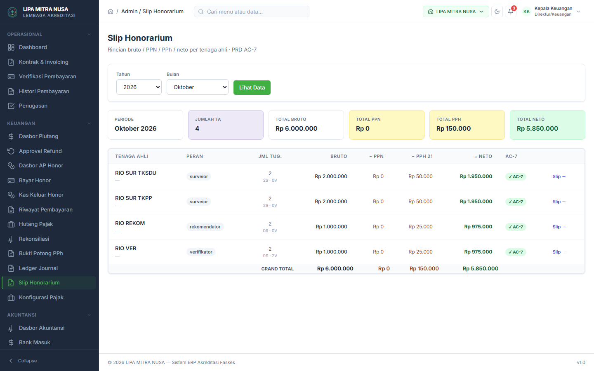

### Yang ditampilkan

- Judul **Slip Honorarium** dengan subjudul **"Rincian bruto / PPN / PPh /
  neto per tenaga ahli · PRD AC-7."**
- Panel penyaringan berisi pilih **Tahun**, pilih **Bulan**, dan tombol
  **Lihat Data**.
- Kartu ringkasan: **PERIODE**, **JUMLAH TA**, **TOTAL BRUTO**, **TOTAL
  PPN**, **TOTAL PPH**, dan **TOTAL NETO**.
- Tabel slip dengan kolom **TENAGA AHLI**, **PERAN**, **JML TUG.**,
  **BRUTO**, **− PPN**, **− PPH 21**, **= NETO**, **AC-7**, dan
  **(Slip →)**. Baris paling bawah bernama **GRAND TOTAL**.
- Jendela **Slip Honorarium** memuat lencana **Periode {periode}** dan
  jumlah penugasan, lalu:
  - Tabel entry dengan kolom **Jenis**, **Faskes / Siklus**, **Bruto**,
    **−PPN**, **−PPh**, **= Neto**, **AC-7**, dan **Status**, dengan baris
    total **TOTAL**.
  - Kotak AC-7 — **"✓ VERIFIKASI AC-7 LULUS"** atau **"✕ SELISIH PADA
    AC-7"** — beserta baris **Rumus** dan **Selisih**.
  - Bagian **SNAPSHOT TARIF (saat entry dibuat)** yang memuat tarif PPN
    dan tarif PPh 21 beserta tanggal berlakunya.
- Pada tangkapan layar di atas, slip periode Oktober 2026 memuat empat
  tenaga ahli, dan seluruh lencana **AC-7** tampil **✓ AC-7**.

### Apa yang bisa dilakukan

- Mengubah **Tahun** atau **Bulan**, lalu **Lihat Data** — slip untuk
  periode tersebut dimuat ulang.
- **(Slip →)** — membuka rincian slip untuk satu tenaga ahli beserta
  entry-entry honor di dalamnya.

### Catatan

- Sumber data slip adalah entry honor Surveior, Verifikator, dan
  Rekomendator yang dibuat di dalam bulan periode terpilih.
- Kolom **JML TUG.** adalah jumlah penugasan milik tenaga ahli pada
  periode tersebut.
- **SNAPSHOT TARIF** adalah tarif pajak yang berlaku saat entry dibuat,
  bukan tarif terkini. Bandingkan dengan menu
  [Konfigurasi Pajak](#516-konfigurasi-pajak) bila perlu melihat tarif
  yang berlaku saat ini.
- Pemeriksaan **AC-7** memakai rumus `neto = bruto − PPN − PPh`, baik
  untuk entry maupun untuk totalnya.
- Bila tidak ada entry honor untuk tenaga ahli dan periode tersebut,
  server membalas **"Tidak ada entry honor untuk periode ini."**

---

## 5.16 Konfigurasi Pajak

**Alamat:** `/admin/konfigurasi-pajak` · **Peran:** Direktur/Keuangan · **Syarat akses:** Ledger/Keuangan — Lihat

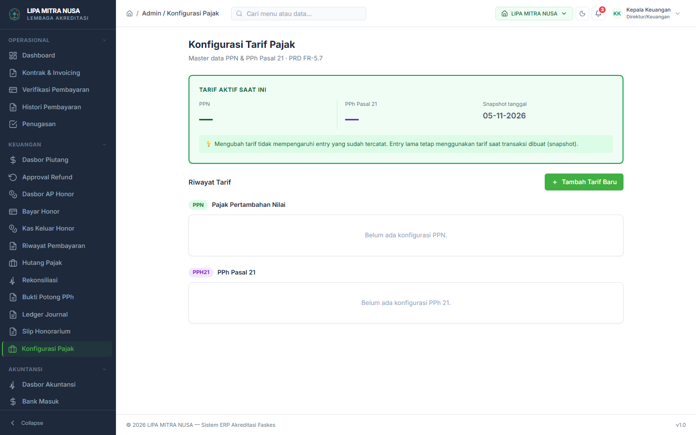

### Yang ditampilkan

- Judul **Konfigurasi Tarif Pajak** dengan subjudul **"Master data PPN &
  PPh Pasal 21 · PRD FR-5.7."**
- Kartu **Tarif Aktif Saat Ini** yang menampilkan:
  - **PPN** — nilai tarif persen, dengan keterangan **"Berlaku sejak
    {tanggal}"**.
  - **PPh Pasal 21** — nilai tarif persen, dengan keterangan **"Berlaku
    sejak {tanggal}"**.
  - Baris **Snapshot tanggal {tanggal}**.
  - Catatan **"Mengubah tarif tidak mempengaruhi entry yang sudah
    tercatat. Entry lama tetap menggunakan tarif saat transaksi dibuat
    (snapshot)."**
- Kartu **Riwayat Tarif** dengan tombol **Tambah Tarif Baru**.
- Dua tabel riwayat, satu untuk PPN dan satu untuk PPh 21, dengan kolom
  **Tarif**, **Berlaku Sejak**, **Keterangan**, **Dibuat Oleh**, dan
  **Status**. Lencana status: **AKTIF** untuk tarif terbaru, atau
  **Histori**.
- Pada tangkapan layar di atas, belum ada konfigurasi PPN maupun PPh 21,
  sehingga kedua bagian menampilkan **"Belum ada konfigurasi PPN."** dan
  **"Belum ada konfigurasi PPh 21."** — ini kondisi normal.

### Apa yang bisa dilakukan

- **Tambah Tarif Baru** — membuka formulir **Tambah Tarif Pajak Baru**
  dengan teks **"Tarif baru akan berlaku untuk transaksi mulai tanggal
  yang ditentukan. Tarif lama tidak berubah."** Formulirnya memuat:
  - Pilih **Jenis Pajak *** dengan pilihan **PPN (Pajak Pertambahan
    Nilai)** dan **PPh Pasal 21**.
  - Kolom **Tarif (%) *** dengan contoh **"Contoh: 11.00"**.
  - Kolom **Berlaku Sejak *** (tanggal).
  - Kolom **Keterangan (opsional)** dengan contoh **"Contoh: PPN naik 12%
    mulai 1 April 2026"**.
  - Blok simulasi **"Simulasi contoh honor Rp 2.500.000:"** yang
    menampilkan perhitungan **PPN {tarif}% = {rupiah}** dan **PPh 21
    {tarif}% = {rupiah}**.
  - Tombol **Simpan Tarif** dan **Batal**. Saat menyimpan, tombol berubah
    menjadi **"Menyimpan..."**.
- Memilih jenis pajak dan mengisi tarif — blok simulasi menghitung ulang
  nilai PPN dan PPh 21 secara otomatis.
- **Batal** — menutup formulir tanpa menyimpan.

### Catatan

- Tarif bersifat historis. Entri ledger yang sudah tercatat **tidak**
  berubah bila tarif diubah — setiap entri menyimpan snapshot tarif saat
  transaksinya dibuat.
- Tarif baru hanya berlaku untuk transaksi dengan tanggal transaksi
  sama dengan atau setelah tanggal berlakunya.
- Syarat server: jenis pajak wajib diisi dan harus PPN atau PPh 21; tarif
  wajib diisi, berupa angka, minimal 0 dan maksimal 100; tanggal berlaku
  wajib diisi dengan format tanggal; keterangan opsional maksimal 500
  karakter.
- PPN pada honor bernilai 0 pada implementasi saat ini. PPN adalah pajak
  output yang dipungut dari Faskes melalui invoice, bukan dipotong dari
  honor.
- Bila penyimpanan gagal, pesan error dari server ditampilkan pada kartu
  merah.

---

## Layar terkait

- [Bab 00 — Alur Siklus Akreditasi](00-alur-siklus.md) — tujuh tahap
  siklus dan hubungan tagihan dengan Tahap 4
- [Bab 02 — Operasional Internal](02-operasional.md) — penerbitan invoice
  dan verifikasi pembayaran dari Faskes
- [Bab 03 — Surveior & Verifikator](03-surveior.md) — asal-usul honor
  yang tercatat di AP Honor
- [Bab 04 — Rekomendasi](04-rekomendasi.md) — persetujuan yang
  memunculkan entry honor
- [Bab 06 — Akuntansi & Laporan Keuangan](06-akuntansi.md) — jurnal
  umum, buku besar, dan laporan keuangan
- [Bab 09 — Glosarium & Pertanyaan Umum](09-glosarium.md) — istilah
  keuangan seperti piutang, AP honor, PPh 21, dan settlement

