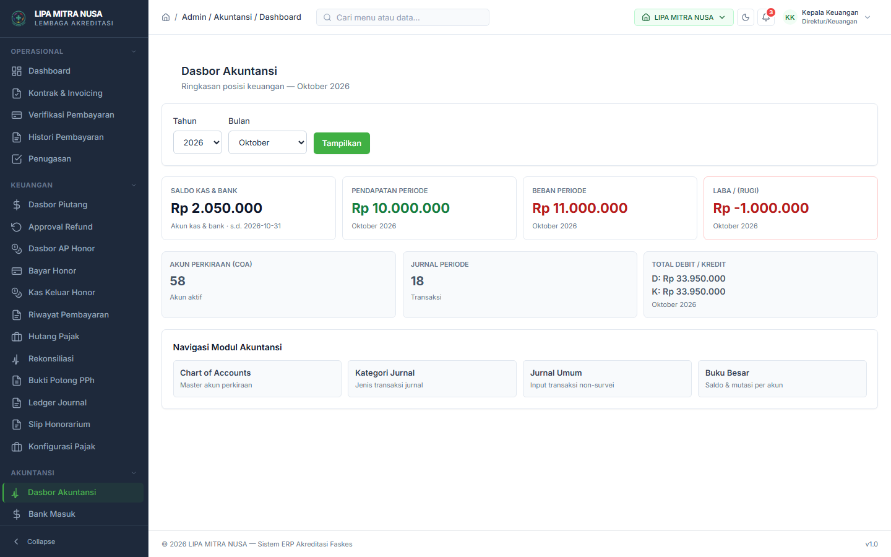
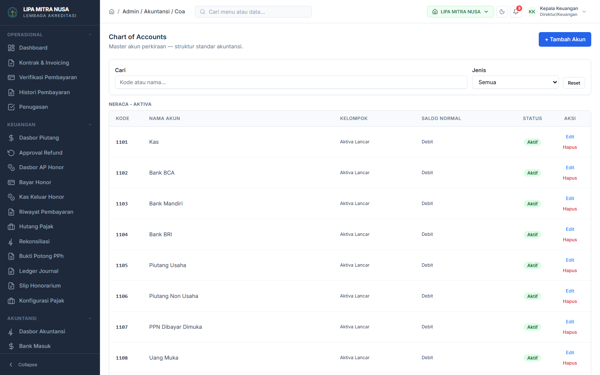
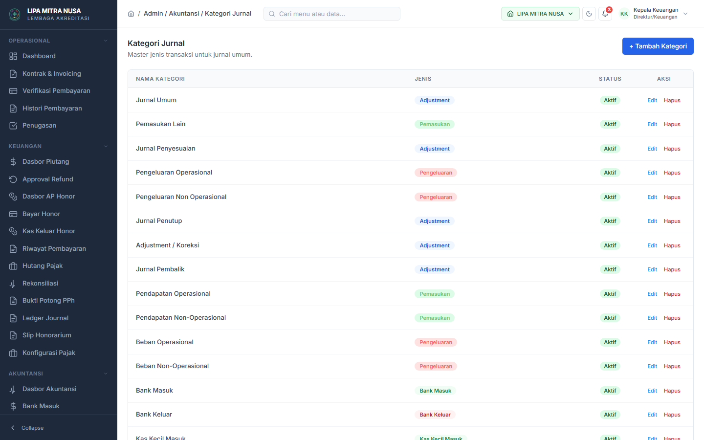
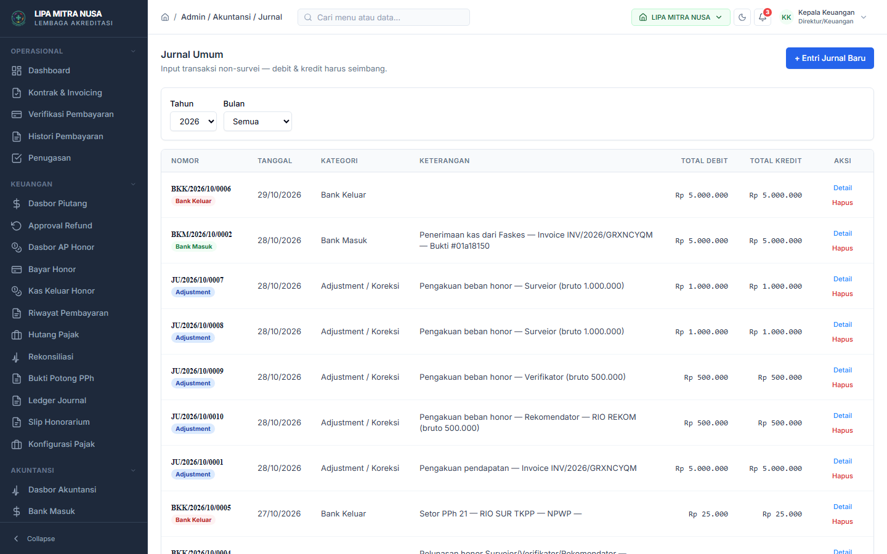
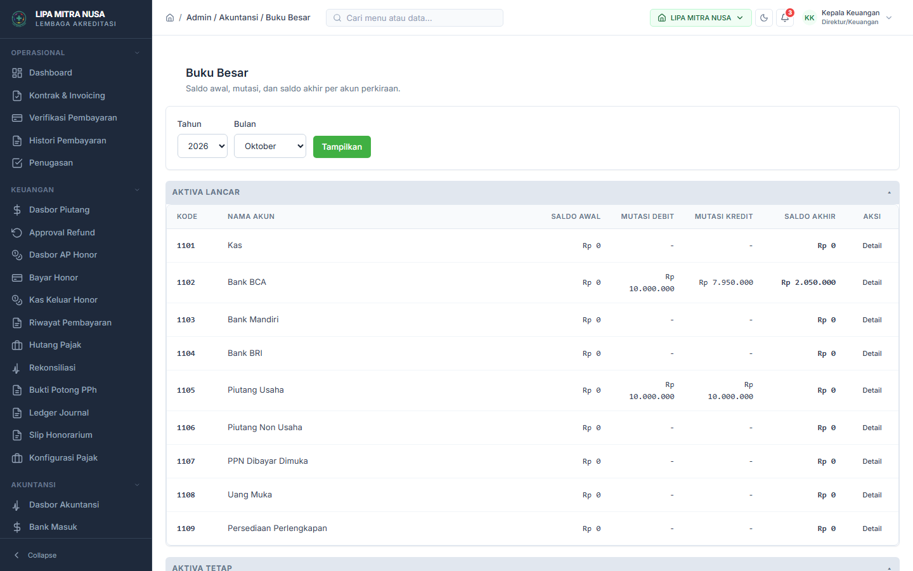
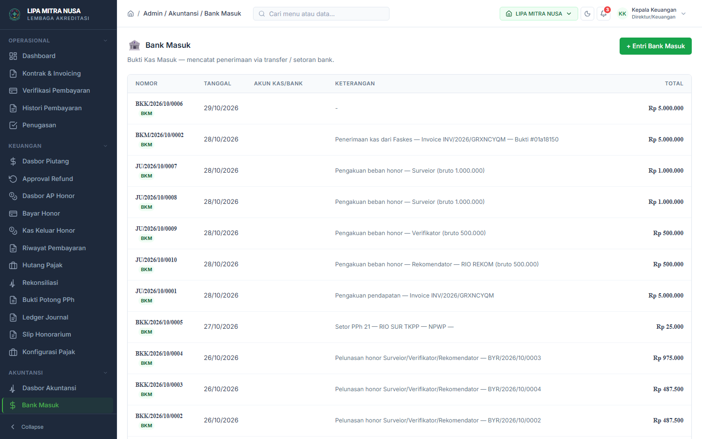
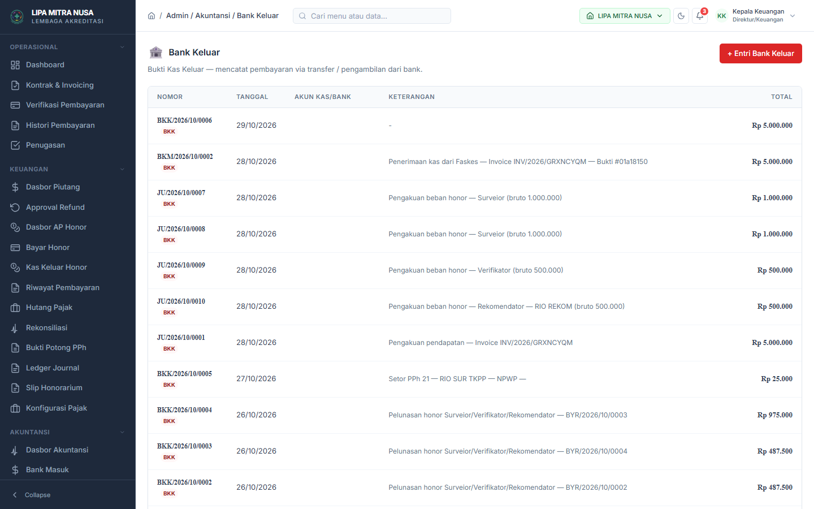
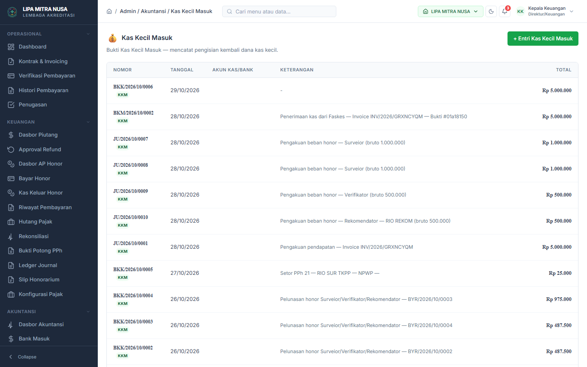
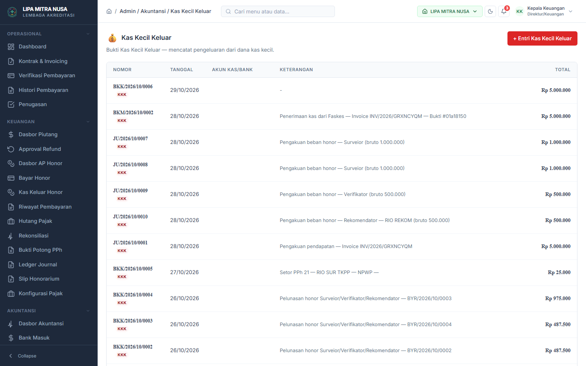
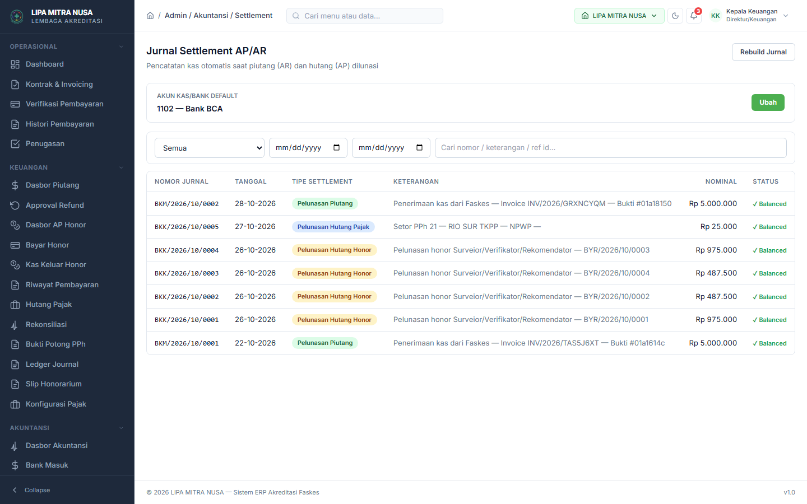

# Bab 06 — Akuntansi & Laporan Keuangan

> Modul: Akuntansi · Peran: Direktur/Keuangan, Administrator · Alamat portal: `/admin`

Bab ini untuk Anda yang bekerja di bagian keuangan. Di sini Anda mencatat
setiap perpindahan uang, melihat saldo kas dan bank, dan membaca hasil
akhir bisnis dari satu tempat.

Semua angka di bab ini **tidak** berasal dari tabel ringkasan yang
disimpan terpisah. Setiap angka dihitung langsung dari daftar jurnal
(transaksi akuntansi). Karena itu, angka pada layar selalu sama dengan
isi jurnal — tidak ada selisih antara "laporan" dan "jurnalnya".

---

## Angka di Laporan Keuangan

Bagian ini menjelaskan arti angka yang Anda temukan di
[Dasbor Akuntansi](#61-dasbor-akuntansi) dan [Buku Besar](#65-buku-besar),
supaya Anda tidak salah membaca.

### Dua sisi yang harus dibedakan

Ada dua jenis pencatatan di sistem ini, dan keduanya memakai halaman
yang berbeda:

| Jenis | Apa artinya | Kapan terjadi | Terlihat di |
|---|---|---|---|
| **Jurnal kas (settlement)** | Uang benar-benar berpindah: masuk atau keluar rekening | Setelah bukti pembayaran diterima, atau setelah pembayaran honor/pajak dilakukan | [Jurnal Settlement](#610-jurnal-settlement-apar), [Bank Masuk](#66-bank-masuk), [Bank Keluar](#67-bank-keluar) |
| **Jurnal akrual** | Pengakuan pendapatan dan beban, **tanpa** uang berpindah saat itu | Otomatis saat invoice terbit, saat honor terakru, dan saat PKS direvisi | [Jurnal Umum](#64-jurnal-umum) |

Contoh agar mudah dibedakan: Faskes membayar Rp 5.000.000 pada Oktober.
Saat pembayaran itu dicatat, sistem membuat jurnal settlement — sisi debit
masuk ke Bank, sisi kredit keluar dari Piutang Usaha. Pada saat itu Rp
5.000.000 itu **sudah keluar** dari Piutang Usaha, karena uangnya sudah
berpindah ke rekening. Di bulan yang sama sistem juga membuat jurnal
akrual pendapatan, supaya akun Pendapatan terisi sejak jasa itu
disepakati — bukan baru setelah uang diterima.

Keduanya saling melengkapi. Tanpa jurnal akrual, akun pendapatan dan
beban akan kosong sehingga laba/rugi selalu nol.

### Istilah yang perlu Anda kenal

| Istilah di layar | Artinya dalam bahasa awam |
|---|---|
| **Debit** | Sisi kiri. Untuk aset, kas, dan beban: menambah saldo. Untuk pendapatan dan kewajiban: mengurangi saldo. |
| **Kredit** | Sisi kanan. Untuk pendapatan dan kewajiban: menambah saldo. Untuk aset, kas, dan beban: mengurangi saldo. |
| **Saldo normal** | Sisi tempat saldo akun itu cenderung berada. Aset dan beban: debit. Pendapatan dan kewajiban: kredit. |
| **Saldo awal** | Saldo akun sebelum periode yang Anda pilih — ibarat sisa bawaan dari periode sebelumnya. |
| **Mutasi debit / mutasi kredit** | Total transaksi debit dan kredit **di dalam** periode terpilih saja. |
| **Saldo akhir** | Saldo awal ditambah mutasi periode ini. Inilah saldo akun saat periode berakhir. |
| **Total debit / kredit** | Seluruh nominal debit dan kredit di semua akun dalam periode. Kalau keduanya sama, jurnal seimbang. |

### Cara membaca laba/rugi

Pada [Dasbor Akuntansi](#61-dasbor-akuntansi):

- **Pendapatan Periode** — total pendapatan yang diakui pada periode
  yang Anda pilih. Angka ini hanya berlaku untuk bulan/tahun yang
  terlihat, bukan akumulasi sejak awal tahun.
- **Beban Periode** — total beban yang diakui pada periode yang sama.
- **Laba / (Rugi)** — selisih pendapatan dikurangi beban. Angka positif
  berarti untung; angka negatif (dengan tanda kurung) berarti rugi.
  Kartu dengan border hijau berarti untung, border merah berarti rugi.

### Cara membaca saldo kas dan bank

Angka **Saldo Kas & Bank** adalah saldo kumulatif seluruh akun kas dan
bank sampai tanggal potong perhitungan. Akun yang dihitung adalah akun
berkode 1101 sampai 1104 (Kas, Bank BCA, Bank Mandiri, Bank BRI) serta
akun aktif apa pun yang namanya mengandung kata "kas" atau "bank".

Perhatikan keterangan di bawah angka tersebut, yang menyebut tanggal
potong, misalnya "Akun kas & bank s.d. 2026-10-31". Bila periode yang
Anda pilih masih berjalan, tanggal potong ini bisa lebih awal dari akhir
periode.

### Memeriksa angka secara silang

Anda tidak perlu percaya begitu saja pada angka dasbor, karena semuanya
berasal dari jurnal. Dua pemeriksaan silang yang mudah:

1. **Total Debit harus sama dengan Total Kredit.** Bila berbeda, ada
   jurnal yang tidak seimbang di periode itu. Ini juga yang dicek sistem
   sebelum menyimpan jurnal baru.
2. **Saldo akhir di Buku Besar harus cocok dengan saldo kas di dasbor.**
   Buka akun 1102 Bank BCA di [Buku Besar](#65-buku-besar), bandingkan
   kolom Saldo Akhir dengan total saldo kas dan bank di dasbor.

---

## 6.1 Dasbor Akuntansi

**Alamat:** `/admin/accounting/dashboard` · **Peran:** Direktur/Keuangan, Administrator · **Syarat akses:** Ledger/Keuangan — Lihat

### Yang ditampilkan

- Judul **Dasbor Akuntansi** dengan subjudul
  **"Ringkasan posisi keuangan — Oktober 2026"**. Bagian dalam kurung
  adalah periode yang sedang Anda lihat.
- Kartu filter berisi dua pilihan:
  - **Tahun** — lima pilihan, mulai tahun berjalan ditambah satu tahun
    ke depan.
  - **Bulan** — pilihan **Semua Bulan** dan dua belas nama bulan.
  - Tombol **Tampilkan**.
- Empat kartu ringkasan utama:
  - **Saldo Kas & Bank** — saldo uang di seluruh akun kas dan bank,
    dengan keterangan "Akun kas & bank s.d. 2026-10-31".
  - **Pendapatan Periode** — writanya hijau.
  - **Beban Periode** — writanya merah.
  - **Laba / (Rugi)** — kartu diberi border hijau bila untung dan border
    merah bila rugi.
- Tiga kartu informasi tambahan:
  - **Akun Perkiraan (COA)** — jumlah akun yang aktif, keterangan
    "Akun aktif".
  - **Jurnal Periode** — jumlah transaksi jurnal pada periode itu.
  - **Total Debit / Kredit** — dua baris, "D:" untuk total debit dan
    "K:" untuk total kredit.
- Kartu **Navigasi Modul Akuntansi** berisi empat tautan:
  **Chart of Accounts** ("Master akun perkiraan"), **Kategori Jurnal**
  ("Jenis transaksi jurnal"), **Jurnal Umum** ("Input transaksi
  non-survei"), dan **Buku Besar** ("Saldo & mutasi per akun").
- Saat data masih dimuat, teks **"Memuat dasbor akuntansi..."** tampil di
  bawah judul.

### Apa yang bisa dilakukan

- **Mengubah Tahun atau Bulan** lalu menekan **Tampilkan** — dasbor
  dihitung ulang untuk periode yang dipilih. Memilih **Semua Bulan**
  berarti seluruh tahun tersebut.
- **Menekan Tampilkan** — memuat ulang angka periode yang sedang
  dipilih. Selama proses berjalan, teks tombol berubah menjadi
  **"Memuat..."**.
- **Klik salah satu tautan di Navigasi Modul Akuntansi** — berpindah ke
  halaman master akun, kategori jurnal, jurnal umum, atau buku besar.

### Catatan

- Angka **Pendapatan Periode** dan **Beban Periode** hanya menghitung
  akun berjenis Pendapatan, Pendapatan Lain, Beban, dan Beban Lain.
  Forma lain — misalnya Piutang Usaha atau Utang Honor — **tidak**
  masuk ke laba/rugi.
- **Total Debit / Kredit** menghitung *seluruh* jenis akun, bukan hanya
  pendapatan dan beban. Karena itu angkanya selalu lebih besar dari
  total pendapatan ditambah total beban.
- **Jurnal Periode** menghitung semua jenis jurnal: yang Anda input
  manual, jurnal settlement, dan jurnal akrual. Bukan hanya jurnal
  manual.
- **Akun Perkiraan (COA)** hanya menghitung akun yang aktif. Akun
  nonaktif disembunyikan dari daftar COA dan tidak bisa diaktifkan
  kembali lewat halaman [Chart of Accounts](#62-chart-of-accounts).
- Angka **Saldo Kas & Bank** bersifat kumulatif — ia menjumlahkan
  seluruh jurnal sejak awal, bukan saldo awal ditambah mutasi bulan ini.
  Akun kas/bank yang dinonaktifkan **tetap** dihitung karena saldo
  historisnya masih ada.
- Bila pemuatan gagal, teks "Memuat dasbor akuntansi..." tetap tampil
  *(perilaku perlu konfirmasi ke tim devs)*.

---

## 6.2 Chart of Accounts

**Alamat:** `/admin/accounting/coa` · **Peran:** Direktur/Keuangan, Administrator · **Syarat akses:** Ledger/Keuangan — Lihat

### Yang ditampilkan

- Judul **Chart of Accounts** dengan subjudul
  **"Master akun perkiraan — struktur standar akuntansi."**
- Tombol **+ Tambah Akun** di kanan atas.
- Kartu filter:
  - **Cari** — kolom pencarian dengan petunjuk "Kode atau nama...".
  - **Jenis** — pilihan **Semua** dan sembilan jenis akun: Aktiva
    Lancar, Aktiva Tetap, Kewajiban Lancar, Kewajiban Jangka Panjang,
    Modal, Pendapatan, Pendapatan Lain, Beban, Beban Lain.
  - Tombol **Reset**.
- Tabel akun yang dikelompokkan dalam empat bagian besar: **NERACA -
  AKTIVA**, **NERACA - KEWAJIBAN & MODAL**, **LABA RUGI - PENDAPATAN**,
  dan **LABA RUGI - BEBAN**. Pada tangkapan layar di atas, bagian
  **NERACA - AKTIVA** menampilkan akun 1101 Kas sampai 1108 Uang Muka.
- Kolom tabel: **Kode**, **Nama Akun**, **Kelompok**, **Saldo Normal**,
  **Status**, **Aksi**.
  - **Kelompok** berisi jenis akun, misalnya "Aktiva Lancar".
  - **Saldo Normal** berisi "Debit", "Kredit", atau "Debit / Kredit".
  - **Status** berupa lencana **Aktif** atau **Nonaktif**. Baris
    nonaktif tampil redup.
  - **Aksi** memuat tombol **Edit** dan **Hapus**.

### Apa yang bisa dilakukan

- **Mencari akun** — mengetik di kolom **Cari** menyaring tabel sesuai
  kode atau nama akun.
- **Memilih Jenis** — menyaring tabel agar hanya menampilkan akun dari
  satu jenis.
- **Reset** — mengosongkan kembali kolom Cari dan mengembalikan pilihan
  Jenis ke "Semua".
- **+ Tambah Akun** — membuka jendela **Tambah Akun** dengan isian:
  - **Kode Akun *** (petunjuk "mis. 1101"). Kolom ini terkunci saat
    Anda menyunting akun yang sudah ada.
  - **Nama Akun *** (petunjuk "mis. Bank BCA").
  - **Jenis *** — daftar pilihan yang diawali "— Pilih Jenis —".
  - **Kelompok / Saldo Normal** — pilihan "Debit / Kredit", "Debit",
    atau "Kredit".
  - Kotak centang **Akun aktif**.
  - Tombol **Batal** dan **Simpan**.
- **Edit** — membuka jendela **Edit Akun** dengan isi akun terpilih.
- **Hapus** — menghapus akun, setelah Anda mengonfirmasi dengan
  pesan "Hapus akun {kode} - {nama}?".

### Catatan

- **Kode akun harus unik di dalam lembaga Anda.** Dua lembaga yang
  berbeda boleh memakai kode yang sama, misalnya 1101.
- Kolom **Kode Akun** tidak bisa diubah setelah akun dibuat. Bila kode
  salah, buat akun baru dengan kode yang benar.
- Akun yang sudah dipakai di jurnal umum **tidak bisa dihapus**. Server
  menolak dengan pesan "Akun sudah digunakan di jurnal umum.
  Nonaktifkan saja." Bila akun tidak ditemukan, pesannya "Akun tidak
  ditemukan."
- Penghapusan yang berhasil membalas "Akun berhasil dihapus." Bila
  gagal, pesan tampil di jendela peramban.
- Akun **nonaktif tidak muncul lagi** di daftar ini. Artinya, akun yang
  pernah dinonaktifkan tidak bisa diaktifkan kembali lewat halaman ini.
- Pencarian di kolom **Cari** berjalan di sisi peramban, bukan di server.
  Ia tidak mencari lewat catatan jurnal.
- Ada kolom kategori jurnal pada data akun, tetapi kolom itu tidak
  tersedia di formulir, jadi tidak bisa diisi dari halaman ini
  *(perilaku perlu konfirmasi ke tim devs)*.

---

## 6.3 Kategori Jurnal

**Alamat:** `/admin/accounting/kategori-jurnal` · **Peran:** Direktur/Keuangan, Administrator · **Syarat akses:** Ledger/Keuangan — Lihat

### Yang ditampilkan

- Judul **Kategori Jurnal** dengan subjudul
  **"Master jenis transaksi untuk jurnal umum."**
- Tombol **+ Tambah Kategori** di kanan atas.
- Tabel dengan kolom **Nama Kategori**, **Jenis**, **Status**, **Aksi**.
  - **Jenis** berupa lencana berwarna: Adjustment, Pemasukan,
    Pengeluaran, Bank Masuk, Bank Keluar, Kas Kecil Masuk, atau Kas
    Kecil Keluar.
  - **Status** berupa lencana **Aktif** atau **Nonaktif**.
  - **Aksi** memuat tombol **Edit** dan **Hapus**.
- Pada tangkapan layar di atas, daftar memuat kategori seperti Jurnal
  Umum, Pemasukan Lain, Jurnal Penyesuaian, Pengeluaran Operasional,
  Jurnal Penutup, Adjustment / Koreksi, Jurnal Pembalik, Pendapatan
  Operasional, Beban Operasional, Bank Masuk, dan Bank Keluar.
- Bila belum ada kategori sama sekali, tabel menampilkan pesan
  **"Belum ada kategori. Tambahkan minimal 1."**

### Apa yang bisa dilakukan

- **+ Tambah Kategori** — membuka jendela **Tambah Kategori** dengan
  isian:
  - **Nama Kategori *** (petunjuk "mis. Pengeluaran Operasional").
  - **Jenis *** — daftar pilihan berisi tujuh jenis: Adjustment,
    Pemasukan, Pengeluaran, Bank Masuk, Bank Keluar, Kas Kecil Masuk,
    dan Kas Kecil Keluar.
  - Kotak centang **Aktif**.
  - Tombol **Batal** dan **Simpan**.
- **Edit** — menyunting kategori terpilih.
- **Hapus** — menghapus kategori setelah konfirmasi dengan pesan
  "Hapus kategori "{nama}"?".

### Catatan

- **Kategori** adalah label jenis transaksi yang menempel pada jurnal.
  Kategori menentukan juga awalan nomor jurnal: Bank Masuk menjadi
  "BKM/", Bank Keluar "BKK/", Kas Kecil Masuk "KKM/", Kas Kecil Keluar
  "KKK/", Pemasukan "JU-PM/", Pengeluaran "JU-PK/", dan sisanya "JU/".
- Kategori yang sudah dipakai di jurnal **tidak bisa dihapus**. Server
  menolak dengan pesan "Kategori sudah digunakan di jurnal. Nonaktifkan
  saja."
- Kategori **nonaktif tetap tampil** di daftar dan masih bisa dipilih
  di [Jurnal Umum](#64-jurnal-umum).
- Bila nama kategori kosong, pesan "Nama kategori wajib diisi" muncul
  di bawah kolom.
- **Perhatian:** formulir menawarkan tujuh jenis, tetapi server hanya
  menerima tiga di antaranya — Adjustment, Pemasukan, dan Pengeluaran.
  Memilih Bank Masuk, Bank Keluar, Kas Kecil Masuk, atau Kas Kecil
  Keluar akan ditolak dengan pesan "Kolom jenis yang dipilih tidak
  valid." *(perilaku perlu konfirmasi ke tim devs)*

---

## 6.4 Jurnal Umum

**Alamat:** `/admin/accounting/jurnal` · **Peran:** Direktur/Keuangan, Administrator · **Syarat akses:** Ledger/Keuangan — Lihat

### Yang ditampilkan

- Judul **Jurnal Umum** dengan subjudul
  **"Input transaksi non-survei — debit & kredit harus seimbang."**
- Tombol **+ Entri Jurnal Baru** di kanan atas.
- Kartu filter berisi **Tahun** dan **Bulan** (pilihan **Semua** dan dua
  belas nama bulan). Tidak ada tombol Tampilkan di sini — memilih
  langsung memuat ulang daftar.
- Tabel dengan kolom **Nomor**, **Tanggal**, **Kategori**, **Keterangan**,
  **Total Debit**, **Total Kredit**, **Aksi**.
  - **Nomor** ditulis dengan format "PREFIX/TAHUN/BULAN/URUT", misalnya
    "JU/2026/10/0007", dan di bawahnya ada lencana jenis kategori.
  - **Total Debit** dan **Total Kredit** selalu bernilai sama pada
    jurnal yang seimbang.
  - **Aksi** memuat tombol **Detail** dan **Hapus**.
- Pada tangkapan layar di atas, Anda dapat melihat jurnal dengan
  keterangan seperti "Penerimaan kas dari Faskes — Invoice
  INV/2026/GRXNCYQM — Bukti #01a18150" dan "Pengakuan beban honor —
  Surveior (bruto 1.000.000)". Keterangan kedua berasal dari jurnal
  akrual, bukan dari input manual.
- Bila belum ada jurnal, tabel menampilkan pesan **"Belum ada jurnal.
  Klik "Entri Jurnal Baru" untuk mulai."**

### Apa yang bisa dilakukan

- **+ Entri Jurnal Baru** — membuka jendela **Entri Jurnal Umum**:
  - **Tanggal *** — kalender.
  - **Kategori *** — daftar pilihan diawali "— Pilih —" yang memuat
    seluruh kategori, termasuk kategori nonaktif.
  - **Keterangan** — kolom teks dengan petunjuk "Uraian transaksi".
  - Tabel **Rincian Jurnal** dengan kolom **#**, **Akun Perkiraan**,
    **Debit**, **Kredit**, **Keterangan**. Pilihan akun ditulis
    "{kode} — {nama}", diawali "— Pilih Akun —". Kolom Debit dan Kredit
    hanya menerima angka positif.
  - Tombol **+ Tambah Baris** untuk menambah baris, dan tombol **×**
    untuk menghapus baris.
  - Panel ringkasan yang menampilkan **Total Debit**, **Total Kredit**,
    dan status **"✓ Seimbang"** atau **"✗ Tidak Seimbang"**.
  - Tombol **Batal** dan **Simpan Jurnal**.
- **Detail** — membuka jendela **Jurnal {nomor}** berisi baris informasi
  tanggal, kategori, dan keterangan, lalu tabel rincian dengan kolom
  **Kode**, **Akun**, **Debit**, **Kredit**, **Keterangan**, ditutup baris
  **TOTAL**.
- **Hapus** — menghapus jurnal setelah konfirmasi dengan pesan
  "Hapus jurnal {nomor}?".

### Catatan

- **Aturan main jurnal umum: total Debit harus sama dengan total Kredit.**
  Bila tidak sama, aplikasi menampilkan "Total Debit harus sama dengan
  Total Kredit." Bila benar-benar disimpan, server menolak dengan
  pesan "Total debit ({nominal}) harus sama dengan total kredit
  ({nominal})."
- Minimal dua baris, dan total transaksi tidak boleh nol. Pesannya:
  "Minimal 2 baris dengan akun dan nominal." dan "Total transaksi tidak
  boleh nol."
- Mengisi kolom **Debit** otomatis mengosongkan kolom **Kredit** pada
  baris yang sama, dan sebaliknya. Ini membantu Anda agar tidak
  mengisi dua-duanya.
- Akun yang tidak ditemukan atau sudah nonaktif ditolak dengan pesan
  "Sebagian akun tidak ditemukan atau tidak aktif."
- **Jurnal akrual dan jurnal settlement tidak bisa dihapus** dari
  sini. Server menolak dengan pesan "Jurnal berasal dari transaksi
  sistem. Tidak dapat dihapus." Jurnal akrual muncul di halaman ini
  dengan awalan nomor "JU/" dan kategori Adjustment / Koreksi.
- **Perbedaan filter dengan dasbor.** Bila **Bulan** disetel ke "Semua",
  daftar menampilkan jurnal dari **semua tahun**, bukan satu tahun
  penuh. Dasbor Akuntansi berperilaku berbeda: "Semua Bulan" di sana berarti
  satu tahun penuh.
- Nomor jurnal tersusun berurutan per awalan, jadi nomor pada bulan
  yang sama selalu berlanjut.

---

## 6.5 Buku Besar

**Alamat:** `/admin/accounting/buku-besar` · **Peran:** Direktur/Keuangan, Administrator · **Syarat akses:** Ledger/Keuangan — Lihat

### Yang ditampilkan

- Judul **Buku Besar** dengan subjudul
  **"Saldo awal, mutasi, dan saldo akhir per akun perkiraan."**
- Kartu filter berisi **Tahun**, **Bulan**, dan tombol **Tampilkan**.
  Berbeda dari halaman lain, pilihan **Bulan** di sini tidak memiliki
  opsi "Semua".
- Tabel yang dikelompokkan menurut jenis akun, misalnya **AKTIVA
  LANCAR**. Setiap kelompok bisa dilipat dan dibuka.
- Kolom tabel: **Kode**, **Nama Akun**, **Saldo Awal**, **Mutasi
  Debit**, **Mutasi Kredit**, **Saldo Akhir**, **Aksi**.
  - **Mutasi Debit** ditulis hijau dan **Mutasi Kredit** ditulis merah.
    Bila nilainya nol, keduanya menampilkan "-".
  - **Saldo Akhir** ditulis tebal, dengan warna menurut sisi saldo
    akun: hijau untuk akun berkredit, merah untuk akun berdebit.
  - **Aksi** memuat tombol **Detail**.
- Tombol **Detail** membuka jendela **Buku Besar — {kode} {nama}** yang
  memuat:
  - Empat kartu ringkasan: **Saldo Awal**, **Total Debit**, **Total
    Kredit**, dan **Saldo Akhir**.
  - Tabel dengan kolom **Tanggal**, **Nomor Jurnal**, **Keterangan**,
    **Debit**, **Kredit**, **Saldo**.
  - Baris pertama bernama **Saldo Awal** dan baris terakhir bernama
    **Saldo Akhir**.
  - Bila tidak ada transaksi pada periode itu, tabel menampilkan
    "Tidak ada transaksi pada periode ini."

### Apa yang bisa dilakukan

- **Mengubah Tahun atau Bulan** lalu **Tampilkan** — tabel dimuat ulang
  untuk periode tersebut. Mengganti pilihan tahun atau bulan saja
  sudah memicu pemuatan baru.
- **Detail** — membuka rincian mutasi satu akun: tanggal, nomor jurnal,
  keterangan, nilai debit dan kredit, serta saldo berjalan.
- Menutup jendela rincian untuk kembali ke daftar.

### Catatan

- **Saldo Awal** adalah akumulasi seluruh jurnal yang tanggalnya
  **sebelum** awal periode yang Anda pilih. Bayangkan seperti saldo
  bawaan dari periode sebelumnya.
- **Mutasi Debit** dan **Mutasi Kredit** hanya menghitung transaksi
  **di dalam** periode terpilih, bukan akumulasi sepanjang waktu.
- **Saldo Akhir** = Saldo Awal + Mutasi Debit − Mutasi Kredit. Angka ini
  bisa negatif bila transaksi di periode tersebut lebih besar ke arah
  kredit.
- Hanya akun yang **aktif** yang tampil. Akun nonaktif disembunyikan,
  tetapi saldo historisnya masih ikut terhitung di kartu **Saldo Kas &
  Bank** pada dasbor.
- Halaman ini **hanya untuk dibaca**. Tidak ada tombol tambah, ubah,
  atau hapus jurnal di sini.
- Hanya akun kas dan bank yang dikelola (kode 1101 sampai 1104) yang
  bisa dipilih sebagai kas/bank pada menu kas dan bank *(perilaku perlu
  konfirmasi ke tim devs)*.
- Pada jendela rincian, kolom **Keterangan** per baris dan kolom
  **Saldo** berjalan dapat tampil kosong, dan kartu **Total Debit** /
  **Total Kredit** dapat tampil kosong atau nol. Yang terisi pasti:
  Saldo Awal, Saldo Akhir, Tanggal, Nomor Jurnal, Debit, dan Kredit
  *(perilaku perlu konfirmasi ke tim devs)*.

---

## 6.6 Bank Masuk

**Alamat:** `/admin/accounting/bank-masuk` · **Peran:** Direktur/Keuangan, Administrator · **Syarat akses:** Ledger/Keuangan — Tambah

### Yang ditampilkan

- Judul **Bank Masuk** dengan subjudul
  **"Bukti Kas Masuk — mencatat penerimaan via transfer / setoran
  bank."**
- Tombol **+ Entri Bank Masuk** di kanan atas.
- Tabel riwayat dengan kolom **Nomor**, **Tanggal**, **Akun Kas/Bank**,
  **Keterangan**, **Total**.
  - **Nomor** berawalan "BKM/" dan di bawahnya ada lencana **BKM**.
  - **Akun Kas/Bank** menampilkan kode dan nama akun kas/bank yang
    dipakai, misalnya "1102 Bank BCA".
  - **Total** menampilkan nominal rupiah.
- Pada tangkapan layar di atas, kolom Akun Kas/Bank dan Keterangan
  sebagian terisi "-". Ini terjadi karena daftar di halaman ini dirangkum
  dari jurnal kategori terkait, dan tidak semua jurnal memiliki
  keterangan *(perilaku perlu konfirmasi ke tim devs)*.
- Bila belum ada data, tabel menampilkan **"Belum ada data Bank
  Masuk."**
- Setelah berhasil menyimpan, muncul banner hijau **"Berhasil! Bank
  Masuk berhasil direkam — {nomor}"** yang hilang sendiri setelah lima
  detik.

### Apa yang bisa dilakukan

- **+ Entri Bank Masuk** — membuka jendela **Entri Bank Masuk** dengan
  isian:
  - **Tanggal *** — terisi otomatis dengan hari ini.
  - **No. Referensi** — kolom teks dengan petunjuk "mis. RV-2026-001".
  - **Akun Kas/Bank *** — daftar pilihan yang memuat empat akun: 1101
    Kas, 1102 Bank BCA, 1103 Bank Mandiri, dan 1104 Bank BRI.
  - Petunjuk arah transaksi, misalnya "Kas/bank akan di-DEBIT dari
    1102 Bank BCA".
  - Tabel rincian dengan kolom **#**, **Akun Counterpart**, **Deskripsi /
    Keterangan**, dan **KREDIT (Rp)**. Daftar akun sudah tidak memuat
    akun kas/bank yang sedang dipilih.
  - Tombol **+ Tambah Baris** dan tombol **×** untuk menghapus baris.
  - Baris kaki tabel yang menunjukkan akun kas/bank dengan penanda
    **[DEBIT]** dan total nominal.
  - **Keterangan / Catatan** — kolom teks dua baris dengan petunjuk
    "Catatan umum transaksi...".
  - Panel bawah berisi **Jumlah Baris** dan **Total KREDIT**.
  - Tombol **Batal** dan **Simpan Bank Masuk**.
- **Simpan Bank Masuk** — menyimpan bukti kas masuk sebagai jurnal baru.
- **Batal** — menutup jendela tanpa menyimpan.

### Catatan

- **Arah pencatatan Bank Masuk:** uang masuk, sehingga akun kas/bank
  di sisi **DEBIT** (bertambah) dan seluruh akun counterpart di sisi
  **KREDIT** (berkurang).
- Kategori dan awalan nomor jurnal dibuat otomatis: kategori Bank Masuk
  dan nomor berawalan "BKM/".
- Minimal satu baris rincian dengan akun dan nominal. Pesannya
  "Minimal 1 baris detail dengan akun dan nominal." Bila totalnya nol,
  pesannya "Total nominal harus lebih dari nol."
- Akun kas/bank atau akun counterpart yang tidak aktif ditolak dengan
  pesan "Akun kas/bank tidak ditemukan atau tidak aktif." dan
  "Sebagian akun di rincian tidak valid atau tidak aktif."
- Tanggal dan akun kas/bank wajib diisi. Bila kosong, pesan "Tanggal
  wajib diisi" atau "Akun kas/bank wajib dipilih" muncul.
- Jurnal hasil Bank Masuk **boleh dihapus** dari
  [Jurnal Umum](#64-jurnal-umum), berbeda dengan jurnal settlement.
- Daftar pada halaman ini hanya menampilkan 50 baris terbaru.
- Kolom nominal menerima digit angka saja; tanda baca dan huruf
  diabaikan.

---

## 6.7 Bank Keluar

**Alamat:** `/admin/accounting/bank-keluar` · **Peran:** Direktur/Keuangan, Administrator · **Syarat akses:** Ledger/Keuangan — Tambah

### Yang ditampilkan

- Judul **Bank Keluar** dengan subjudul
  **"Bukti Kas Keluar — mencatat pembayaran via transfer / pengambilan
  dari bank."**
- Tombol **+ Entri Bank Keluar** di kanan atas.
- Tabel riwayat dengan kolom **Nomor**, **Tanggal**, **Akun Kas/Bank**,
  **Keterangan**, **Total**. Di bawah nomor jurnal ada lencana **BKK**.
- Pada tangkapan layar di atas, Anda dapat melihat jurnal dengan
  keterangan "Setor PPh 21 — RIO SUR TKPP — NPWP —".
- Bila belum ada data, tabel menampilkan **"Belum ada data Bank
  Keluar."**
- Setelah berhasil menyimpan, muncul banner hijau **"Berhasil! Bank
  Keluar berhasil direkam — {nomor}"**.

### Apa yang bisa dilakukan

- **+ Entri Bank Keluar** — membuka jendela **Entri Bank Keluar** dengan
  isian yang sama seperti Bank Masuk, dengan tiga perbedaan:
  - Petunjuk arahnya berbunyi "Kas/bank akan di-KREDIT dari {kode}
    {nama}".
  - Kolom nominal rincian bernama **DEBIT (Rp)**, bukan KREDIT.
  - Baris kaki tabel menandai akun kas/bank dengan **[KREDIT]**, dan
    panel bawah menampilkan **Total DEBIT**.
- **Simpan Bank Keluar** — menyimpan bukti kas keluar sebagai jurnal
  baru.
- **Batal** — menutup jendela tanpa menyimpan.

### Catatan

- **Arah pencatatan Bank Keluar:** uang keluar, sehingga akun kas/bank
  di sisi **KREDIT** (berkurang) dan seluruh akun counterpart di sisi
  **DEBIT** (bertambah).
- Kategori dan awalan nomor jurnal dibuat otomatis: kategori Bank Keluar
  dan nomor berawalan "BKK/".
- Aturan validasi, pesan error, dan syarat minimal baris sama dengan
  [Bank Masuk](#66-bank-masuk).
- Jurnal hasil Bank Keluar **boleh dihapus** dari
  [Jurnal Umum](#64-jurnal-umum).
- Daftar pada halaman ini hanya menampilkan 50 baris terbaru.

---

## 6.8 Kas Kecil Masuk

**Alamat:** `/admin/accounting/kas-kecil-masuk` · **Peran:** Direktur/Keuangan, Administrator · **Syarat akses:** Ledger/Keuangan — Tambah

### Yang ditampilkan

- Judul **Kas Kecil Masuk** dengan subjudul
  **"Bukti Kas Kecil Masuk — mencatat pengisian kembali dana kas
  kecil."**
- Tombol **+ Entri Kas Kecil Masuk** di kanan atas.
- Tabel riwayat dengan kolom **Nomor**, **Tanggal**, **Akun Kas/Bank**,
  **Keterangan**, **Total**. Di bawah nomor jurnal ada lencana **KKM**.
- Bila belum ada data, tabel menampilkan **"Belum ada data Kas Kecil
  Masuk."**
- Setelah berhasil menyimpan, muncul banner hijau **"Berhasil! Kas
  Kecil Masuk berhasil direkam — {nomor}"**.

### Apa yang bisa dilakukan

- **+ Entri Kas Kecil Masuk** — membuka jendela dengan isian yang sama
  seperti [Bank Masuk](#66-bank-masuk): Tanggal, No. Referensi, Akun
  Kas/Bank, tabel rincian dengan kolom **KREDIT (Rp)**, baris kaki
  **[DEBIT]**, Keterangan / Catatan, panel **Jumlah Baris** dan **Total
  KREDIT**, serta tombol **Batal** dan **Simpan Kas Kecil Masuk**.
- **Simpan Kas Kecil Masuk** — menyimpan bukti kas kecil masuk sebagai
  jurnal baru.

### Catatan

- **Arah pencatatan Kas Kecil Masuk:** uang masuk ke dana kas kecil,
  sehingga akun kas/bank di sisi **DEBIT** dan akun counterpart di sisi
  **KREDIT** — sama seperti Bank Masuk.
- Yang membedakan hanya kategori (**Kas Kecil Masuk**) dan awalan
  nomor jurnal ("KKM/").
- Akun kas/bank yang dapat dipilih tetap berasal dari kelompok 1101 sampai
  1104 *(perilaku perlu konfirmasi ke tim devs)*.
- Aturan validasi, pesan error, dan syarat minimal baris sama dengan
  [Bank Masuk](#66-bank-masuk).
- Daftar pada halaman ini hanya menampilkan 50 baris terbaru.

---

## 6.9 Kas Kecil Keluar

**Alamat:** `/admin/accounting/kas-kecil-keluar` · **Peran:** Direktur/Keuangan, Administrator · **Syarat akses:** Ledger/Keuangan — Tambah

### Yang ditampilkan

- Judul **Kas Kecil Keluar** dengan subjudul
  **"Bukti Kas Kecil Keluar — mencatat pengeluaran dari dana kas
  kecil."**
- Tombol **+ Entri Kas Kecil Keluar** di kanan atas.
- Tabel riwayat dengan kolom **Nomor**, **Tanggal**, **Akun Kas/Bank**,
  **Keterangan**, **Total**. Di bawah nomor jurnal ada lencana **KKK**.
- Pada tangkapan layar di atas, Anda dapat melihat jurnal dengan
  keterangan "Pengakuan beban honor — Verifikator (bruto 500.000)".
- Bila belum ada data, tabel menampilkan **"Belum ada data Kas Kecil
  Keluar."**
- Setelah berhasil menyimpan, muncul banner hijau **"Berhasil! Kas
  Kecil Keluar berhasil direkam — {nomor}"**.

### Apa yang bisa dilakukan

- **+ Entri Kas Kecil Keluar** — membuka jendela dengan isian yang sama
  seperti [Bank Keluar](#67-bank-keluar): Tanggal, No. Referensi, Akun
  Kas/Bank, tabel rincian dengan kolom **DEBIT (Rp)**, baris kaki
  **[KREDIT]**, Keterangan / Catatan, panel **Jumlah Baris** dan
  **Total DEBIT**, serta tombol **Batal** dan **Simpan Kas Kecil
  Keluar**.
- **Simpan Kas Kecil Keluar** — menyimpan bukti kas kecil keluar sebagai
  jurnal baru.

### Catatan

- **Arah pencatatan Kas Kecil Keluar:** uang keluar dari dana kas kecil,
  sehingga akun kas/bank di sisi **KREDIT** dan akun counterpart di sisi
  **DEBIT** — sama seperti Bank Keluar.
- Yang membedakan hanya kategori (**Kas Kecil Keluar**) dan awalan
  nomor jurnal ("KKK/").
- Aturan validasi, pesan error, dan syarat minimal baris sama dengan
  [Bank Masuk](#66-bank-masuk).
- Daftar pada halaman ini hanya menampilkan 50 baris terbaru.

---

## 6.10 Jurnal Settlement AP/AR

**Alamat:** `/admin/accounting/settlement` · **Peran:** Direktur/Keuangan, Administrator · **Syarat akses:** Ledger/Keuangan — Lihat

### Yang ditampilkan

- Judul **Jurnal Settlement AP/AR** dengan subjudul
  **"Pencatatan kas otomatis saat piutang (AR) dan hutang (AP)
  dilunasi"**.
- Panel **Akun Kas/Bank Default** dengan nilai "1102 — Bank BCA" dan
  tombol **Ubah**. Bila belum diatur, panel menampilkan "Belum diatur —
  akan fallback ke Bank BCA (1102) atau Kas (1101)".
- Tombol **Rebuild Jurnal** di kanan atas.
- Baris filter:
  - **Tipe Settlement** — pilihan **Semua**, Pelunasan Piutang, Pelunasan
    Hutang Honor, dan Pelunasan Hutang Pajak.
  - Dua kolom tanggal, untuk rentang awal dan akhir.
  - Kolom pencarian dengan petunjuk "Cari nomor / keterangan / ref id...".
- Tabel dengan kolom **Nomor Jurnal**, **Tanggal**, **Tipe Settlement**,
  **Keterangan**, **Nominal**, **Status**.
  - **Tipe Settlement** berupa lencana berwarna: Pelunasan Piutang,
    Pelunasan Hutang Honor, atau Pelunasan Hutang Pajak.
  - **Nominal** menampilkan rupiah.
  - **Status** menampilkan **"✓ Balanced"** atau **"✗ Tidak balance"**.
- Pada tangkapan layar di atas, Anda dapat melihat jurnal pelunasan
  piutang dari Faskes, setor PPh 21, dan pelunasan honor Surveior,
  Verifikator, serta Rekomendator.
- Bila belum ada jurnal settlement, tabel menampilkan pesan
  **"Belum ada jurnal settlement. Settlement jurnal otomatis dibuat
  setiap kali bukti pembayaran Faskes diterima atau pembayaran hutang
  dilakukan."**
- Bila pemuatan gagal, teks merah **"Gagal memuat: {pesan}"** tampil.

### Apa yang bisa dilakukan

- **Ubah** — mengganti akun kas/bank default. Anda memilih akun dari
  daftar (kode 1101 sampai 1104) lalu menekan **Simpan**. Bila belum
  diatur, tombol **Batal** tersedia untuk membatalkan.
- **Rebuild Jurnal** — membuat ulang jurnal settlement dan jurnal akrual
  untuk seluruh data historis. Sebelum jalan, aplikasi meminta
  konfirmasi:
  > Rebuild jurnal settlement + jurnal akrual (pendapatan & beban)
  > untuk seluruh data historis? (aman dijalankan berulang)

  Setelah selesai, server membalas "Rebuild selesai. {jumlah} jurnal
  baru dibuat, {jumlah} dilewati (sudah ada)." dan halaman dimuat
  ulang.
- **Memilih tipe settlement, rentang tanggal, atau mengetik di kolom
  pencarian** — menyaring tabel jurnal.
- **Simpan** pada panel pengaturan — menyimpan akun kas/bank default,
  dengan balasan "Pengaturan akun kas/bank default berhasil
  disimpan."

### Catatan

- **Jurnal settlement dibuat eksplisit, bukan otomatis.** Tombolnya
  berada di halaman lain:
  - Pelunasan piutang: tombol "Buat Jurnal Bank Masuk" di
    [Detail Piutang](05-keuangan.md#52-detail-piutang).
  - Pelunasan honor: tombol "Buat Jurnal Bank Keluar" di
    [Detail Pembayaran Honor](05-keuangan.md#57-detail-pembayaran-honor)
    dan di [Kas Keluar Honor](05-keuangan.md#58-kas-keluar-honor).
  - Pelunasan pajak: tombol "Buat Jurnal Bank Keluar" di
    [Hutang Pajak](05-keuangan.md#510-hutang-pajak).
- **Menekan tombol berkali-kali aman.** Satu sumber pembayaran hanya
  menghasilkan satu jurnal. Jurnal yang sudah ada dilewati.
- **Halaman ini tidak memuat jurnal akrual.** Jurnal akrual (pengakuan
  pendapatan dan beban) hanya terlihat di
  [Jurnal Umum](#64-jurnal-umum).
- Akun kas/bank yang dipakai untuk jurnal settlement mengikuti urutan:
  akun kas/bank default lembaga, lalu Bank BCA (1102), lalu Kas (1101).
  Bila ketiganya tidak tersedia, server membalas "Akun kas/bank atau
  piutang usaha belum tersedia. Set akun kas/bank default pada menu
  Pengaturan Settlement."
- Satu tipe settlement — pembatalan pelunasan honor — tetap muncul di
  tabel, tetapi tidak tersedia di pilihan filter
  *(perilaku perlu konfirmasi ke tim devs)*.
- Bila hak akses Anda hanya mencakup "Lihat", menekan **Rebuild Jurnal**
  atau **Simpan** akan ditolak dengan pesan "Anda tidak memiliki hak
  akses untuk aksi ini."

---

## Layar terkait

- [Bab 00 — Alur Siklus Akreditasi](00-alur-siklus.md) — posisi siklus
  dan peta tahap ke menu
- [Bab 04 — Rekomendasi](04-rekomendasi.md) —Recomendasi yang menjadi
  dasar pengakuan pendapatan honor
- [Bab 05 — Keuangan](05-keuangan.md) — invoice, pembayaran, honor,
  pajak, dan sumber jurnal settlement
- [Bab 09 — Glosarium](09-glosarium.md) — istilah akuntansi yang
  dipakai di bab ini
