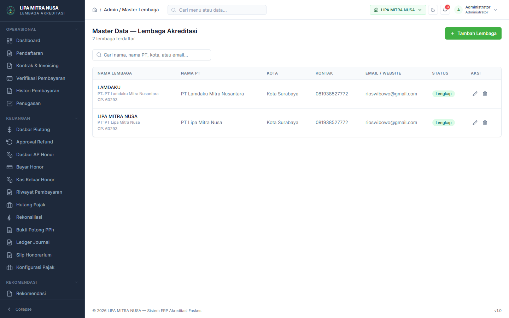
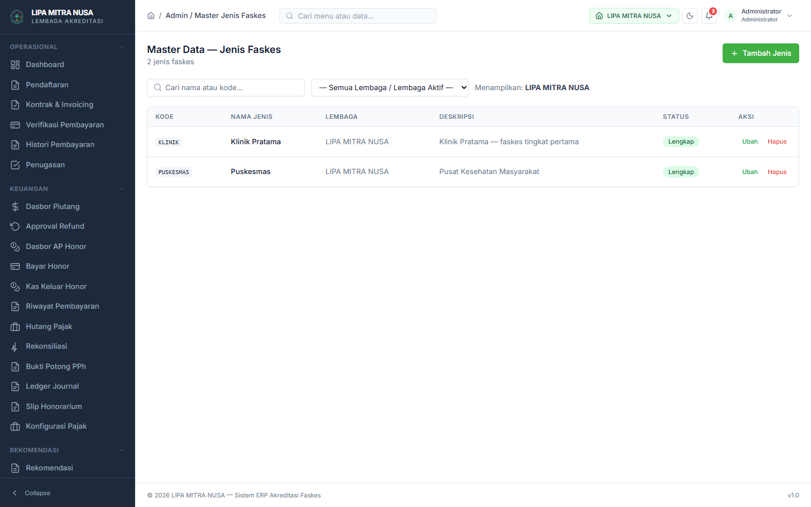
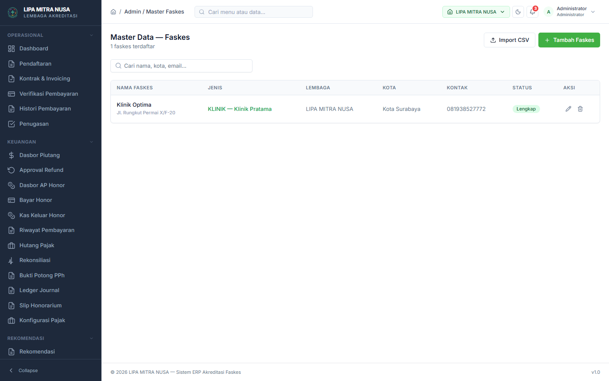
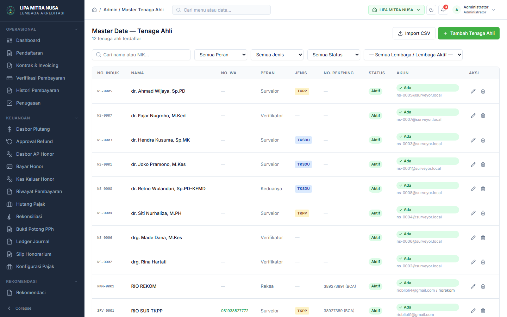
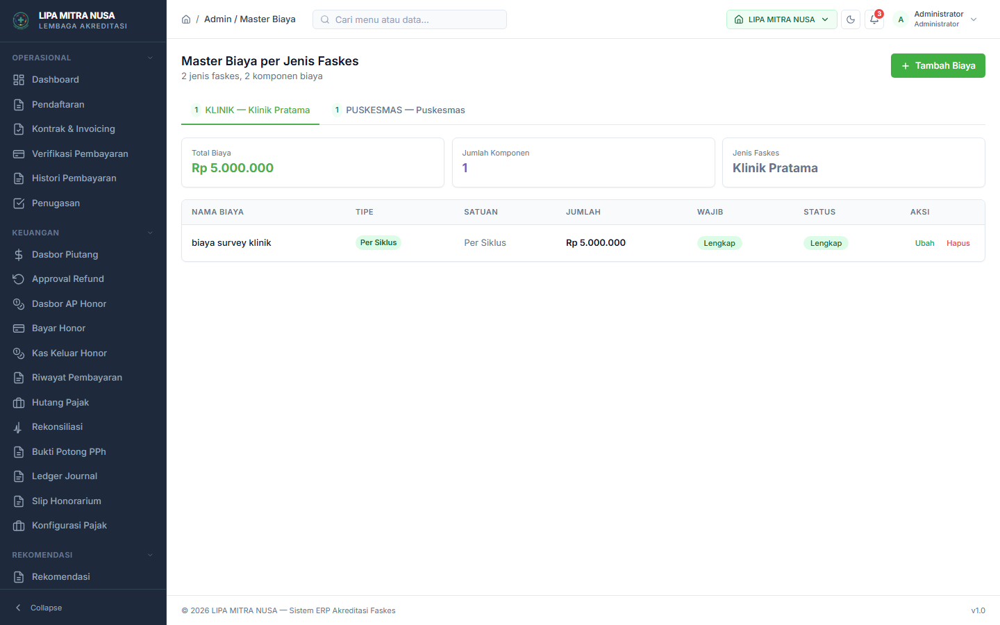
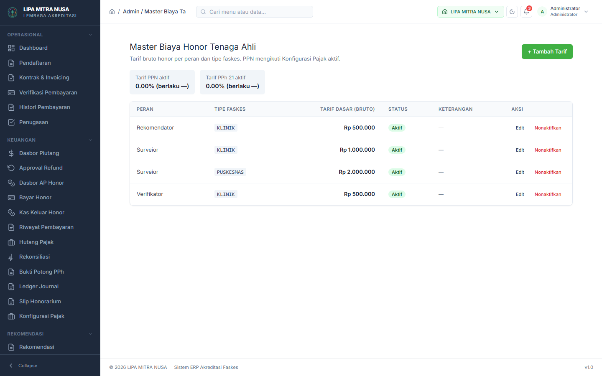
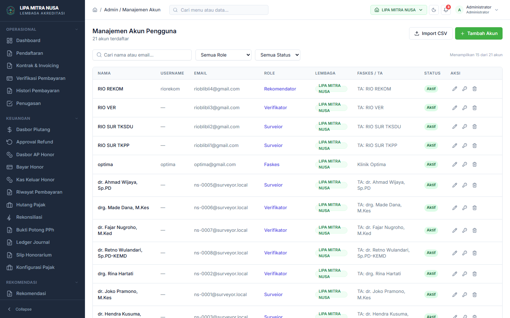
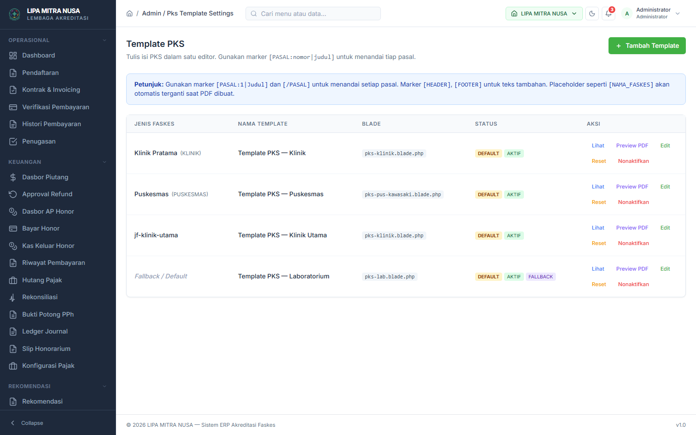

# Bab 07 — Master Data

> Modul: Master Data · Peran: Administrator, Admin Lembaga · Alamat portal: `/admin`

Bab ini untuk Anda yang mengurus data induk di lingkungan internal ERP
Akreditasi. Isinya delapan layar **Master Data** yang menjadi sumber
tunggal bagi seluruh alur akreditasi: dari identitas lembaga yang
meneretakkan pengguna, sampai naskah Perjanjian Kerja Sama yang ditandatangani
Faskes.

Semua layar bab ini berada di portal internal (`/admin`) dan tampil di
sidebar pada grup **Master Data**. Setiap layar punya hak akses sendiri:
menu muncul bila peran Anda memiliki **Master Data — Lihat**, dan tiap
aksi (tambah, ubah, hapus) diperiksa terpisah. Peran yang memiliki
hak akses ini adalah **Administrator** dan **Admin Lembaga**; peran lain
tidak melihat menu ini sama sekali.

## Peran Master Data dalam Alur Siklus

| Layar | Apa yang dienusulkan | Dipakai di tahap siklus |
|-------|----------------------|------------------------|
| Master Lembaga | Identitas lembaga, logo, pejabat penandatangan, NPWP | Seluruh siklus — dan dasar pemisahan data antarlembaga |
| Master Jenis Faskes | Kategori faskes (RS, Klinik, Puskesmas, Laboratorium) | Pendaftaran, Kontrak, Penugasan |
| Master Faskes | Data الطلبer: nama, alamat, jenis, sertifikat | Pendaftaran, Validasi Dokumen, Kontrak & Invoicing |
| Master Tenaga Ahli | Surveior, Verifikator, Reksa, beserta rekening dan data pajak | Survei, Verifikasi, Rekomendasi, pencatatan honor |
| Master Biaya | Komponen biaya layanan per jenis faskes | Kontrak & Invoicing, penerbitan invoice |
| Master Biaya Honor TA | Tarif bruto honor per peran dan tipe faskes | Penugasan, Dasbor AP Honor, Slip Honorarium |
| Manajemen Akun | Akun pengguna, peran, dan lembaga yang boleh diakses | Seluruh siklus — dasar siapa yang boleh bekerja |
| Template PKS | Naskah PKS per jenis faskes | Kontrak — sumber draf yang dikirim ke Faskes |

---

## 7.1 Master Lembaga

**Alamat:** `/master-lembaga` · **Peran:** Administrator, Admin Lembaga · **Syarat akses:** Master Data — Lihat

### Yang ditampilkan

- Judul layar **Master Data — Lembaga Akreditasi** dan subjudul
  **{jumlah} lembaga terdaftar**.
- Kotak pencarian dengan contoh isian `Cari nama, nama PT, kota, atau email...`.
- Tombol **Tambah Lembaga** di kanan atas.
- Tabel data dengan kolom **Nama Lembaga**, **Nama PT**, **Kota**,
  **Kontak**, **Email / Website**, **Status**, dan **Aksi**.
  - Di bawah nama lembaga tampil baris kecil `PT: {nama_pt}` dan
    `CP: {nama_cp}` bila keduanya terisi.
  - Kolom **Kontak** memakai nomor telepon; bila kosong, dipakai nomor
    telepon kontak; bila kosong juga, ditulis `—`.
  - Kolom **Status** berupa lencana **Lengkap** untuk lembaga aktif.
  - Kolom **Aksi** berisi dua ikon: pensil (**Ubah**) dan tong sampah
    (**Hapus**).
- Bila tabel kosong, tampil pesan **Belum ada lembaga.** Bila pencarian
  tidak menghasilkan apa pun, tampil **Tidak ada hasil**.
- Sesaat data dimuat, tampil **Memuat...**.

### Apa yang bisa dilakukan

- **Tambah Lembaga** — membuka jendela **Tambah Lembaga Baru** yang dibagi
  menjadi empat seksi:
  - **Identitas & Logo** — `Nama Lembaga *` (contoh isian
    `Lembaga Akreditasi Mandiri X`), `Nama PT (Perusahaan)` (contoh isian
    `PT. Lembaga Akreditasi Indonesia`), `Logo` dengan pratinjau kotak dan
    tombol **Pilih Logo** / **Ganti Logo** / **Hapus**, serta keterangan
    `PNG/JPG/SVG, maks 2MB`; `Status` dengan pilihan **Aktif** dan
    **Nonaktif**.
  - **Kontak & Kontak Person** — `Alamat`, `Kota`, `Telepon`, `Email`,
    `Website`, `Nama CP`, `Telepon CP`, `Deskripsi`.
  - **Pejabat Penandatangan** — `Nama Pejabat` dan `Jabatan`.
  - **Informasi Pajak (untuk bukti potong PPh 21)** — `NPWP Lembaga`
    (contoh isian `00.000.000.0-000.000`), `Kode KPP`, `Alamat Pajak`,
    `Kota Pajak`, `Nama Pejabat Pajak`, `Jabatan Pejabat Pajak`.
  - Tombol **Batal** dan tombol simpan yang berubah menjadi **Menyimpan...**
    selagi mengirim, lalu **Tambah Lembaga**.
- **Ubah** (ikon pensil) — membuka jendela **Ubah Lembaga** yang sudah
  terisi; tombol simpannya **Simpan Perubahan**.
- **Hapus** (ikon tong sampah) — memunculkan konfirmasi
  **Hapus lembaga "{nama}"?** sebelum data dihapus.
- **Pilih Logo** / **Ganti Logo** — membuka pemilih berkas. Berkas logo
  disimpan bersama data lembaga; bila logo lama ditandai dihapus, berkas
  lama ikut dibersihkan dari penyimpanan.

### Catatan

- Master Lembaga adalah akar data di sistem ini. Saat sebuah lembaga
  baru dibuat, master akuntansi (daftar akun dan kategori jurnal) ikut
  disalin ke lembaga baru, sehingga modul akuntansi langsung dapat
  dipakai tanpa persiapan tambahan.
- Logo disimpan melalui layanan lampiran dengan modul `lembaga/logo`,
  dan berkas lamanya dihapus dari penyimpanan cloud saat logo diganti
  atau dihapus.
- Pejabat penandatangan yang diisi di sini dipakai saat sistem membuat
  dokumen kontrak.
- `NPWP` dipakai untuk menandai waktu verifikasi pajak; setiap kali
  nilainya berubah, sistem mencatat waktu tersebut.
- Berkas logo dapat dibuka langsung lewat alamatnya tanpa perlu masuk
  lebih dulu, agar logo di kop aplikasi selalu tampil.
- Pesan yang mungkin muncul:
  - **Nama lembaga wajib diisi** bila kolom nama kosong.
  - **Format email tidak valid** bila alamat email tidak sesuai pola.
  - **Format NPWP: 00.000.000.0-000.000** bila NPWP tidak sesuai pola.
  - **File logo tidak ditemukan di storage.** bila berkas logo sudah
    tidak ada di penyimpanan.
  - **Gagal mengambil file logo: {pesan}** bila penyimpanan gagal dibaca.
  - **Anda tidak memiliki hak akses untuk aksi ini.** bila hak akses
    Anda tidak mencukupi untuk aksi tersebut.
- Ukuran berkas logo dibatasi 2 MB dan hanya format PNG, JPG, dan SVG
  yang diterima.

---

## 7.2 Master Jenis Faskes

**Alamat:** `/master-jenis-faskes` · **Peran:** Administrator, Admin Lembaga · **Syarat akses:** Master Data — Lihat

### Yang ditampilkan

- Judul layar **Master Data — Jenis Faskes** dan subjudul
  **{jumlah} jenis faskes**.
- Kotak pencarian dengan contoh isian `Cari nama atau kode...`.
- Kotak pilihan lembaga dengan pilihan pertama
  **— Semua Lembaga / Lembaga Aktif —**.
- Indikator filter di bawahnya: **Menampilkan: {nama lembaga}** (nama
  lembaga dicetak tebal).
- Tombol **Tambah Jenis** di kanan atas.
- Tabel data dengan kolom **Kode**, **Nama Jenis**, **Lembaga**,
  **Deskripsi**, **Status**, dan **Aksi**.
  - **Kode** ditampilkan sebagai lencana, atau `—` bila kosong.
  - **Status** berupa lencana **Lengkap** untuk yang aktif.
  - **Aksi** berisi ikon pensil (**Ubah**) dan tong sampah (**Hapus**).
- Bila tabel kosong, tampil **Belum ada data.** Bila pencarian tidak
  menghasilkan apa pun, tampil **Tidak ada hasil**.
- Sesaat data dimuat, tampil **Memuat...**.

### Apa yang bisa dilakukan

- **Tambah Jenis** — membuka jendela **Tambah Jenis Faskes** dengan
  isian:
  - `Nama Jenis *` (contoh isian `Rumah Sakit`).
  - `Kode` (contoh isian `RS`) — hurufnya otomatis dipaksa menjadi
    kapital.
  - `Status` — **Aktif** atau **Nonaktif**.
  - `Lembaga *` dengan pilihan pertama **— Pilih Lembaga —**.
  - `Deskripsi`.
  - Tombol **Batal** dan **Tambah** (menjadi **Menyimpan...** saat
    mengirim).
- **Ubah** — membuka jendela **Ubah Jenis Faskes** yang terisi; tombol
  simpannya **Simpan**.
- **Hapus** — konfirmasi **Hapus jenis faskes "{nama}"?**.
- **Mencari dan memfilter** — pencarian dan pilihan lembaga mengubah
  isi tabel: kata kunci dicari pada nama dan kode, sedangkan filter
  lembaga membatasi jenis faskes yang berasal dari satu lembaga saja.

### Catatan

- Setiap jenis faskes terikat pada satu lembaga, dan tidak bisa
  dipindahkan ke lembaga lain lewat layar ini. Label **(Aktif)** pada
  daftar lembaga menandai lembaga yang sedang dipakai di header
  aplikasi.
- Jenis faskes dipakai sebagai filter wajib pada [Master Faskes](#73-master-faskes)
  dan [Master Biaya](#75-master-biaya). Karena itu, jenis faskes baru
  sebaiknya dibuat sebelum Anda mengisi kedua layar tersebut.
- Nama jenis faskes ikut terbawa pada template PKS dan tarif honor
  tenaga ahli.
- Pesan yang mungkin muncul:
  - **Nama wajib diisi** bila kolom nama jenis kosong.
  - **Lembaga wajib dipilih** bila belum ada lembaga yang dipilih.
  - **Anda tidak memiliki hak akses untuk aksi ini.** bila hak akses
    Anda tidak mencukupi.

---

## 7.3 Master Faskes

**Alamat:** `/master-faskes` · **Peran:** Administrator, Admin Lembaga · **Syarat akses:** Master Data — Lihat

### Yang ditampilkan

- Judul layar **Master Data — Faskes** dan subjudul
  **{jumlah} faskes terdaftar**.
- Tombol **Import CSV** dan tombol **Tambah Faskes** di kanan atas.
- Kotak pencarian dengan contoh isian `Cari nama, kota, email...`.
- Tabel data dengan kolom **Nama Faskes**, **Jenis**, **Lembaga**,
  **Kota**, **Kontak**, **Status**, dan **Aksi**.
  - Di bawah nama faskes tampil baris alamat kecil bila alamatnya
    terisi.
  - **Jenis** ditulis `{kode} — {nama}` dalam warna hijau, atau `—` bila
    belum ditentukan.
  - **Kontak** memakai nomor telepon; bila kosong, dipakai alamat
    email; bila keduanya kosong, ditulis `—`.
  - **Status** berupa lencana **Lengkap** untuk yang aktif.
  - **Aksi** berisi ikon pensil (**Ubah**) dan tong sampah (**Hapus**).
- Bila tabel kosong, tampil **Belum ada data.** Bila pencarian tidak
  menghasilkan apa pun, tampil **Tidak ada hasil**.
- Sesaat data dimuat, tampil **Memuat...**.

### Apa yang bisa dilakukan

- **Tambah Faskes** — membuka jendela **Tambah Faskes Baru** dengan
  isian: `Nama Faskes *`, `Jenis Faskes` (pilihan pertama
  **— Pilih Jenis —**, isi `{kode} — {nama}`), `No. Sertifikat`,
  `No. Surat Faskes`, `Lembaga` (pilihan pertama **— Pilih Lembaga —**),
  `Alamat`, `Kota`, `Provinsi`, `Kode Pos`, `Telepon`, `Email`,
  `Website`, `Nama Pimpinan`, `Telepon Pimpinan`, `Status`, dan
  `Deskripsi`.
  - Di bawah kolom **Lembaga** tampil bantuan
    **Lembaga otomatis terikat dengan jenis faskes "{nama jenis}".**
  - Tombol **Batal** dan **Tambah** (menjadi **Menyimpan...** saat
    mengirim).
- **Memilih Jenis Faskes** — mengisi kolom **Lembaga** secara otomatis
  mengikuti jenis faskes yang dipilih.
- **Ubah** — membuka jendela **Ubah Faskes** yang terisi; tombol
  simpannya **Simpan**.
- **Hapus** — konfirmasi **Hapus faskes "{nama}"?**.
- **Import CSV** — membuka jendela **Import Faskes dari CSV** dengan
  uraian **Upload file CSV berisi data faskes.**, tombol untuk
  mengunduh templat berkas `template_faskes.csv`, area unggah berkas,
  dan catatan berhasil **Daftar faskes telah diperbarui.** Hasil
  impor ditampilkan dalam kolom **Nama Faskes**.

### Catatan

- Master Faskes adalah sumber daftar Faskes (requester) untuk form
  **Pendaftaran**, komponen biaya pada [Master Biaya](#75-master-biaya),
  dan pemilihan Faskes pada [Manajemen Akun](#77-manajemen-akun).
  Data Faskes yang belum ada di sini tidak akan bisa dipilih saat
  membuat pendaftaran.
- Nama Jenis Faskes pada tabel menampilkan kode dan nama sekaligus,
  misalnya `KLINIK — Klinik Pratama`.
- Pencarian pada kotak pencarian dibuat tertunda sebentar sebelum
  data dikirim ke server.
- Bila kolom Jenis Faskes atau Lembaga dikosongkan saat menyimpan,
  nilainya dikirim kosong dan sistem menandainya sebagai belum diisi.
- Pesan yang mungkin muncul:
  - **Nama faskes wajib diisi** bila kolom nama kosong.
  - **Format email tidak valid** bila alamat email tidak sesuai pola.
  - **File harus berekstensi .csv atau .txt.** bila berkas yang
    diunggah bukan CSV atau TXT.
  - **Maksimal 5MB** bila berkas unggahan melebihi 5 MB. Keterangan
    yang tampil: **Ekstensi yang didukung: .csv · Maksimal 5MB**.
  - **Anda tidak memiliki hak akses untuk aksi ini.** bila hak akses
    Anda tidak mencukupi.

---

## 7.4 Master Tenaga Ahli

**Alamat:** `/master-tenaga-ahli` · **Peran:** Administrator, Admin Lembaga · **Syarat akses:** Master Data — Lihat

### Yang ditampilkan

- Judul layar **Master Data — Tenaga Ahli** dan subjudul
  **{jumlah} tenaga ahli terdaftar**.
- Tombol **Import CSV** dan tombol **Tambah Tenaga Ahli** di kanan atas.
- Baris pencarian dan filter:
  - Kotak pencarian dengan contoh isian `Cari nama atau NIK...`.
  - Kotak pilihan peran: **Semua Peran**, **Surveior**, **Verifikator**,
    **Keduanya**, **Reksa**.
  - Kotak pilihan jenis: **Semua Jenis**, **TKPP**, **TKSDU**.
  - Kotak pilihan status: **Semua Status**, **Aktif**, **Nonaktif**,
    **Cuti**, **Resign**.
  - Kotak pilihan lembaga: **— Semua Lembaga / Lembaga Aktif —**.
  - Tombol **Reset** muncul bila pencarian atau filter sedang aktif.
- Tabel data dengan kolom **No. Induk**, **Nama**, **No. WA**, **Peran**,
  **Jenis**, **No. Rekening**, **Status**, **Akun**, dan **Aksi**.
  - **No. WA** menjadi tautan ke aplikasi pesan bila nomornya tersedia.
  - **Peran** ditulis **Surveior**, **Verifikator**, **Reksa**, atau
    **Keduanya**.
  - **Jenis** berupa lencana **TKPP** atau **TKSDU**.
  - **Status** berupa lencana **Aktif**, **Nonaktif**, **Cuti**, atau
    **Resign**.
  - **Akun** menampilkan lencana **Ada** beserta nama akun dan nama
    pengguna, atau lencana **Belum ada** bila belum punya akun.
  - **Aksi** berisi ikon pensil (**Ubah**) dan tong sampah (**Hapus**).
- Paginasi di bawah tabel: **Menampilkan {x}–{y} dari {total} tenaga
  ahli** dengan tombol `«`, `‹`, nomor halaman, `›`, dan `»`.
  Tiap halaman memuat 10 baris.
- Bila tabel kosong, tampil **Belum ada data.** Bila pencarian atau
  filter tidak menghasilkan apa pun, tampil **Tidak ada hasil**.
- Sesaat data dimuat, tampil **Memuat...**.

### Apa yang bisa dilakukan

- **Tambah Tenaga Ahli** — membuka jendela **Tambah Tenaga Ahli Baru**
  dengan tiga seksi:
  - **Data Tenaga Ahli** — `Nomor Induk *`, `Nama Lengkap *`,
    `No. WhatsApp`, `Peran *` (**Surveior**, **Verifikator**,
    **Keduanya (Surveior & Verifikator)**, **Reksa (Rekomendator)**),
    `Jenis` (**TKPP**, **TKSDU**), `Status Aktif *`, `Lembaga *`,
    `Batas Penugasan per Periode`, `No. Rekening`, `Nama Bank`,
    `Atas Nama Rekening`.
    - Bila peran yang dipilih Verifikator atau Reksa, kolom **Jenis**
      dinonaktifkan dengan catatan **Jenis hanya berlaku untuk
      surveior.**
  - **Identitas Pajak · Bukti Potong BP21** — `NPWP`, `NIK (fallback)`,
    `Kode Objek Pajak`, `Kode KPP`, `Nama Sesuai NPWP/NIK`,
    `Status PTKP` (pilihan mulai `TK/0 — Tidak Kawin, 0 tanggungan`
    sampai `K/3 — Kawin, 3 tanggungan`).
  - **Akun Login** — sakelar **Buat Akun Login** dengan keterangan
    **Buat sekaligus agar tidak perlu input dua kali.** Bila sakelar
    aktif, tampil `Username Login`, `Email Login *`, `Role Akun *`, dan
    `Password *` lengkap dengan tombol lihat/sembunyikan. Bila sakelar
    nonaktif, tampil kotak **Toggle "Buat Akun Login" untuk membuat akun
    login sekaligus.**
  - Untuk peran Reksa tampil catatan: **Akun Reksa yang dibuat dari
    tenaga ahli ini tertaut ke data rekening di atas, sehingga honor
    reksa otomatis membawa informasi rekening saat pembayaran AP.**
  - Tombol **Batal** dan **Tambah** (menjadi **Menyimpan...** saat
    mengirim).
- **Ubah** — membuka jendela **Ubah Tenaga Ahli** yang terisi.
- **Hapus** — konfirmasi **Hapus tenaga ahli "{nama}"?**.
- **Import CSV** — membuka jendela **Import Tenaga Ahli dari CSV** dengan
  uraian **Upload file CSV berisi data tenaga ahli.**, templat berkas
  `template_tenaga_ahli.csv`, area unggah, dan catatan berhasil
  **Daftar tenaga ahli telah diperbarui.**
- **Menyaring daftar** — memilih peran, jenis, status, atau lembaga
  menyaring isi tabel.

### Catatan

- Nomor induk wajib diisi dan dipakai sebagai identitas tenaga ahli pada
  surat tugas dan slip honor. Karena itu, nomor induk sebaiknya dibuat
  berurutan dan tidak diubah setelah dipakai.
- Saat menyunting tenaga ahli yang sudah punya akun, muncul peringatan
  **Tenaga ahli ini sudah memiliki akun login: {email}. Akun tidak akan
  dibuat ulang.**
- Bila tenaga ahli dibuat lengkap dengan akunnya, sistem menampilkan
  pesan **Akun berhasil dibuat!** diikuti **Password: {password}** dan
  **Segera informasikan ke tenaga ahli dan minta diganti.** Simpan
  password itu baik-baik — hanya ditampilkan sekali.
- Peran Reksa (Rekomendator) boleh ditautkan ke tenaga ahli supaya
  honor reksa membawa informasi rekening saat pembayaran honor.
- Daftar pilihan peran pada seksi Akun Login disaring mengikuti peran
  tenaga ahli. Peran **Admin** dan **Faskes** tidak pernah muncul di
  daftar itu.
- Pilihan peran **Reksa** di tabel ditulis sebagai `Reksa`, bukan
  `Rekomendator`.
- Pesan yang mungkin muncul:
  - **Nomor induk wajib diisi**, **Nama wajib diisi**, dan
    **Lembaga wajib dipilih** bila kolom yang wajib belum terisi.
  - **Jenis wajib dipilih untuk surveior** bila peran Surveior atau
    Keduanya tanpa jenis.
  - **Password minimal 8 karakter** bila sakelar buat akun aktif dan
    password kurang dari 8 karakter.
  - **Role akun wajib dipilih.** bila sakelar buat akun aktif tetapi
    peran akun belum dipilih. Dalam keadaan ini permintaan tidak
    dikirim.
  - **File harus berekstensi .csv atau .txt.** dan **Maksimal 5MB**
    pada impor.
  - **Anda tidak memiliki hak akses untuk aksi ini.** bila hak akses
    Anda tidak mencukupi.

---

## 7.5 Master Biaya

**Alamat:** `/master-biaya` · **Peran:** Administrator, Admin Lembaga · **Syarat akses:** Master Data — Lihat

### Yang ditampilkan

- Judul layar **Master Biaya per Jenis Faskes** dan subjudul
  **{jumlah} jenis faskes, {jumlah} komponen biaya**.
- Deretan tab, satu tab untuk tiap jenis faskes. Tiap tab memuat
  lencana jumlah komponen lalu `{kode} — {nama}`. Bila jenis faskes
  milik lembaga lain, tabnya memakai lencana tambahan berisi nama
  lembaga.
- Tiga kartu ringkasan: **Total Biaya**, **Jumlah Komponen**, dan
  **Jenis Faskes**.
- Tabel biaya dengan kolom **Nama Biaya**, **Tipe**, **Satuan**,
  **Jumlah**, **Wajib**, **Status**, dan **Aksi**.
  - **Tipe** berupa lencana **Per Siklus**, **Per Sertifikat**, atau
    **Tetap**.
  - **Satuan** berisi **Per Siklus**, **Per Sertifikat**, **Per
    Periksa**, **Per Tahun**, atau **Sekali Bayar**.
  - **Jumlah** ditulis dalam format rupiah, misalnya `Rp 5.000.000`.
  - **Wajib** berupa lencana **Lengkap** bila komponen itu wajib.
  - **Status** berupa lencana **Lengkap** untuk yang aktif.
  - **Aksi** berisi **Ubah** dan **Hapus**.
- Tombol **Tambah Biaya** di kanan atas.
- Bila tab yang dipilih belum punya biaya, tampil **Belum ada data
  biaya untuk jenis faskes ini.**
- Sesaat data dimuat, tampil **Memuat...**.

### Apa yang bisa dilakukan

- **Mengklik tab jenis faskes** — berganti daftar biaya yang tampil
  beserta ringkasan totalnya.
- **Tambah Biaya** — membuka jendela **Tambah Komponen Biaya** dengan
  isian:
  - `Jenis Faskes *` (pilihan pertama **— Pilih Jenis Faskes —**, isi
    `{kode} — {nama} ({nama lembaga})`).
  - `Nama Biaya *`.
  - `Jumlah (Rp) *`.
  - `Tipe`, `Satuan`, `Status`.
  - Kotak centang **Wajib (tidak bisa dihapus saat ada kontrak aktif)**.
  - `Deskripsi`.
  - Tombol **Batal** dan **Tambah** (menjadi **Menyimpan...** saat
    mengirim).
- **Ubah** — membuka jendela **Ubah Komponen Biaya** yang terisi.
- **Hapus** — konfirmasi **Hapus biaya "{nama_biaya}"?**.

### Catatan

- Komponen biaya di layar ini adalah **biaya layanan akreditasi** yang
  masuk ke invoice, bukan honor tenaga ahli. Tarif honor tenaga ahli
  diatur terpisah pada [Master Biaya Honor TA](#76-master-biaya-honor-ta).
- Komponen yang ditandai **Wajib** tidak bisa dihapus selama masih ada
  kontrak aktif. Bila Anda ingin mengganti nominal, ubah komponennya
  alih-alih menghapusnya.
- Besaran komponen yang berlaku untuk satu siklus, satu sertifikat,
  atau satu kali bayar ditentukan oleh kolom **Tipe** dan **Satuan**.
- Rincian biaya ini dipakai saat invoice terbit, jadi perbarui sebelum
  siklus masuk ke tahap Kontrak.
- Pesan yang mungkin muncul:
  - **Jenis faskes wajib dipilih**, **Nama biaya wajib diisi**, dan
    **Jumlah wajib diisi** bila kolom yang wajib belum terisi.
  - **Anda tidak memiliki hak akses untuk aksi ini.** bila hak akses
    Anda tidak mencukupi.

---

## 7.6 Master Biaya Honor TA

**Alamat:** `/master-biaya-ta` · **Peran:** Administrator, Admin Lembaga · **Syarat akses:** Master Data — Lihat

### Yang ditampilkan

- Judul layar **Master Biaya Honor Tenaga Ahli** dan subjudul **Tarif
  bruto honor per peran dan tipe faskes. PPN mengikuti Konfigurasi Pajak
  aktif.**
- Dua kotak informasi pajak:
  - **Tarif PPN aktif** — `{persen}% (berlaku {tanggal})`, atau `—`
    bila belum ada tarif aktif.
  - **Tarif PPh 21 aktif** — `{persen}% (berlaku {tanggal})`, atau `—`.
- Tombol **+ Tambah Tarif** di kanan atas.
- Tabel tarif dengan kolom **Peran**, **Tipe Faskes**, **Tarif Dasar
  (Bruto)**, **Status**, **Keterangan**, dan **Aksi**.
  - **Peran** ditulis **Surveior**, **Verifikator**, atau
    **Rekomendator**.
  - **Tipe Faskes** ditampilkan sebagai kode dalam bentuk lencana.
  - **Tarif Dasar (Bruto)** ditulis `Rp {angka}`, misalnya
    `Rp 1.000.000`.
  - **Status** berupa lencana **Aktif** atau **Nonaktif**.
  - **Keterangan** ditulis `—` bila kosong.
  - **Aksi** berisi **Edit** dan **Nonaktifkan** (atau **Aktifkan**).
- Bila tabel kosong, tampil **Belum ada master biaya. Klik + Tambah Tarif
  untuk mulai.**
- Sesaat data dimuat, tampil **Memuat...**.
- Bila gagal memuat atau menyimpan, muncul kotak merah berisi pesan
  dari server.

### Apa yang bisa dilakukan

- **+ Tambah Tarif** — membuka formulir **Tambah Tarif** dengan isian:
  - `Peran *` — **Surveior**, **Verifikator**, **Rekomendator**.
  - `Tipe Faskes *`.
  - `Tarif Dasar (Bruto) *` — isian angka, nilai paling kecil 0, naik
    kelipatan 1000.
  - `Keterangan` dengan contoh isian `Catatan opsional` (maksimal 500
    karakter).
  - Bantuan di bawah tarif: **Bruto honor per penugasan. PPN tidak
    dipotong (penerima individu/non-PKP), PPh 21 dihitung progresif per
    PP 58/2023 — lihat `HonorCalculator`.**
  - Tombol **Batal** dan **Simpan** (menjadi **Menyimpan...** saat
    mengirim).
- **Edit** — membuka formulir **Edit Tarif** yang terisi. Pada mode ini
  pilihan **Peran** dan **Tipe Faskes** dinonaktifkan, karena tarif
  ditautkan ke kombinasi keduanya.
- **Nonaktifkan** — konfirmasi **Nonaktifkan tarif untuk {peran} /
  {tipe_faskes}?**.
- **Aktifkan** — konfirmasi **Aktifkan tarif untuk {peran} /
  {tipe_faskes}?**

### Catatan

- Tarif yang berstatus nonaktif tidak dipakai lagi untuk menghitung
  honor baru. Sesi yang sedang berjalan tidak ikut berubah.
- Nilai PPN dan PPh 21 yang ditampilkan hanyalah acuan tarif aktif.
  PPN tidak dipotong dari honor, dan PPh 21 dihitung secara progresif
  saat honor dihitung.
- Tarif honor akan dipakai saat pencatatan honor pada modul keuangan.
  Lihat [Bab 05 — Keuangan](05-keuangan.md).
- Kolom **Peran** pada tabel memakai sebutan **Rekomendator**,
  sedangkan di [Master Tenaga Ahli](#74-master-tenaga-ahli) peran yang
  sama disebut **Reksa**. Keduanya menunjuk peran yang sama.
- Pesan yang mungkin muncul:
  - **Gagal menyimpan: {pesan}** bila penyimpanan gagal.
  - **Gagal: {pesan}** bila aktivasi atau nonaktivasi gagal.
  - **Anda tidak memiliki hak akses untuk aksi ini.** bila hak akses
    Anda tidak mencukupi.

---

## 7.7 Manajemen Akun

**Alamat:** `/user-management` · **Peran:** Administrator, Admin Lembaga · **Syarat akses:** Master Data — Lihat

### Yang ditampilkan

- Judul layar **Manajemen Akun Pengguna** dan subjudul
  **{jumlah} akun terdaftar**.
- Tombol **Import CSV** dan tombol **Tambah Akun** di kanan atas.
- Kotak pencarian dengan contoh isian `Cari nama atau email...`.
- Dua kotak pilihan filter: **Semua Role** dan **Semua Status**
  (**Aktif**, **Nonaktif**, **Terkunci**).
- Tombol **Reset** muncul bila pencarian atau filter sedang aktif.
- Indikator jumlah data di kanan: **Menampilkan {x} dari {total} akun**.
- Tabel akun dengan kolom **Nama**, **Username**, **Email**, **Role**,
  **Lembaga**, **Faskes / TA**, **Status**, dan **Aksi**.
  - **Lembaga** menampilkan lencana hijau untuk tiap lembaga yang
    boleh diakses akun tersebut; bila kosong, ditulis `—`.
  - **Faskes / TA** menampilkan nama Faskes bila akun terkait Faskes,
    atau `TA: {nama tenaga ahli}` bila terkait tenaga ahli; bila
    keduanya kosong, ditulis `—`.
  - **Status** berupa lencana **Aktif**, **Nonaktif**, atau
    **Terkunci**.
  - **Aksi** berisi ikon pensil (**Ubah**), ikon kunci (**Reset
    Password**), dan tong sampah (**Hapus**).
- Paginasi di bawah tabel: **Halaman {halaman} dari {total} — {jumlah}
  total** dengan tombol `«`, `‹`, nomor halaman, `›`, dan `»`. Tiap
  halaman memuat 15 baris.
- Bila tabel kosong, tampil **Belum ada akun.**
- Sesaat data dimuat, tampil **Memuat...**.

### Apa yang bisa dilakukan

- **Tambah Akun** — membuka jendela **Tambah Akun Baru** dengan isian:
  - `Nama Lengkap *`, `Username` (contoh isian `Kosongkan jika login
    pakai email/NIK`), `Email *`, `Role *` (pilihan pertama **— Pilih
    Role —**).
  - `Faskes *` — hanya untuk peran Faskes.
  - `Tenaga Ahli` — wajib untuk peran Surveior dan Verifikator, opsional
    untuk peran Rekomendator. Bantuan yang tampil: **Tenaga ahli
    menjadi sumber data honor & pajak akun ini.** (Surveior/Verifikator)
    dan **Opsional. Bila diisi, data rekening tenaga ahli dipakai saat
    pembayaran honor AP reksa.** (Rekomendator).
  - Blok **Lembaga Akses *** dengan keterangan **Bisa lebih dari satu.
    Lembaga pertama = default.**, tombol **Pilih Semua** dan
    **Bersihkan**, serta daftar centang. Lembaga pertama yang dipilih
    diberi label **DEFAULT**.
  - `Password` dan `Status Akun`.
  - Tombol **Tutup** dan **Buat Akun** (menjadi **Menyimpan...** saat
    mengirim).
- **Ubah** — membuka jendela **Ubah Akun — {nama}** yang terisi. Bila
  kolom password dikosongkan, password lama tidak diubah.
- **Hapus** — konfirmasi **Hapus akun "{nama}" ({email})?**.
- **Reset Password** (ikon kunci) — konfirmasi **Reset password untuk
  "{nama}"?**, lalu sistem menampilkan **Password berhasil
  direset.**, **Password baru: {password}**, dan **Segera informasikan
  ke pengguna.**
- **Import CSV** — membuka jendela **Import Akun dari CSV** dengan
  uraian **Upload file CSV berisi data akun pengguna.**, templat berkas
  `template_akun.csv`, area unggah, dan catatan berhasil **Daftar akun
  telah diperbarui.** Hasil impor ditampilkan dalam kolom **Nama**,
  **Email**, dan **Username**.
- **Pilih Semua** / **Bersihkan** — mengatur daftar lembaga akses.

### Catatan

- Setiap akun wajib punya minimal satu lembaga akses, dan lembaga
  urutan pertama menjadi default sesi pengguna tersebut. Pengguna yang
  berpindah lembaga dapat berpindah dari menu lembaga di header.
- Peran **Admin** tidak dapat dipilih dari form ini, dan setiap id akun
  berupa kode acak berformat khusus. Akun yang bermasalah akan ditolak
  lebih dulu oleh sistem.
- Akun Faskes harus tertaut ke Faskes, sedangkan akun Surveior dan
  Verifikator harus tertaut ke data tenaga ahli. Tanpa tautan itu,
  pengguna tidak bisa bekerja di lapangan maupun menerima honor.
- Ganti password dari layar ini hanya berlaku bila Anda memiliki hak akses
  untuk melakukan perubahan tersebut.
- Bila server membuatkan password sementara, pesannya berbunyi **Akun
  berhasil dibuat!**, **Password sementara: {password}**, dan
  **Segera informasikan ke pengguna dan minta diganti.**
- Pesan pada saat mengimpor berkas:
  - **File CSV tidak valid atau kosong.**
  - **Format baris tidak valid.**
  - **username '{username}' sudah digunakan.**
  - **Email '{email}' sudah digunakan.**
  - **Role '{role}' tidak ditemukan.**
  - **faskes_id '{id}' tidak ditemukan.**
  - **tenaga_ahli_nik '{nik}' tidak ditemukan di master tenaga ahli.**
  - **Akun dengan role '{role}' wajib terkait ke tenaga ahli
    (tenaga_ahli_nik).**
  - Ringkasan: **Import selesai. {sukses} berhasil, {gagal} gagal.**
- Pesan lain yang mungkin muncul: **Nama lengkap wajib diisi**,
  **Email wajib diisi**, **Format email tidak valid**, **Role wajib
  dipilih**, **Minimal pilih satu lembaga**, dan **Password minimal 8
  karakter**.

---

## 7.8 Template PKS

**Alamat:** `/pks-template-settings` · **Peran:** Administrator, Admin Lembaga · **Syarat akses:** Master Data — Lihat

### Yang ditampilkan

- Judul layar **Template PKS** dan subjudul **Tulis isi PKS dalam satu
  editor. Gunakan marker [PASAL:nomor|judul] untuk menandai tiap pasal.**
- Kotak petunjuk: **Petunjuk: Gunakan marker [PASAL:1|Judul] dan
  [/PASAL] untuk menandai setiap pasal. Marker [HEADER], [FOOTER] untuk
  teks tambahan. `Placeholder` seperti [NAMA_FASKES] akan otomatis
  terganti saat PDF dibuat.**
- Tombol **+ Tambah Template** di kanan atas.
- Tabel template dengan kolom **Jenis Faskes**, **Nama Template**,
  **Blade**, **Status**, dan **Aksi**.
  - **Jenis Faskes** menampilkan `{nama} ({kode})`, atau teks miring
    **Fallback / Default** bila template tidak terikat jenis faskes.
  - **Blade** ditampilkan sebagai `{blade}.blade.php`.
  - **Status** memuat lencana **DEFAULT**, **AKTIF** / **NONAKTIF**,
    dan **FALLBACK** bila template tidak terikat jenis faskes.
  - **Aksi** berisi **Lihat**, **Preview PDF**, **Edit**, **Reset**, dan
    **Nonaktifkan**.
- Bila tabel kosong, tampil **Belum ada template. Klik "Tambah Template"
  untuk membuat.**
- Sesaat data dimuat, tampil **Memuat...**.
- Bila gagal menyimpan, muncul kotak merah berisi **Gagal menyimpan.**
  atau pesan dari server.

### Apa yang bisa dilakukan

- **+ Tambah Template** — membuka jendela penyuntingan template dengan
  isian:
  - `Jenis Faskes` — pilihan pertama **— Fallback / Default —**.
  - `Nama Template *`.
  - `Blade File *` — pilihan pertama **— Pilih blade —**. Daftar blade
    bawaan yang tersedia: `pks-pus-kawasaki` (Pus-kawasaki), `pks-klinik`
    (Klinik), `pks-lab` (Laboratorium), `pks-rs` (Rumah Sakit), dan
    `pks` (Generic Default).
  - Kotak centang **Aktif** dan **Jadikan default**.
  - Editor teks dengan tombol: `H1`, `H2`, `H3`, `B`, `I`, rata kiri,
    rata tengah, rata kanan, daftar butir, daftar bernomor, kutipan,
    tombol marker `[HEADER]`, `[FOOTER]`, `+ Pasal`, serta daftar
    `Placeholder:` — empat pertama tampil sebagai tombol, sisanya lewat
    pilihan `+ lagi...`.
  - Bantuan di bawah editor: **Hint: Tekan Enter 2x untuk jarak antar
    blok. Marker [PASAL:nomor|judul] menentukan pembagian pasal di
    PDF.**
  - Tombol **Batal** dan **Tambah Template** (menjadi **Simpan**, lalu
    **Menyimpan...** saat mengirim).
- **Lihat** — membuka jendela pratinjau **Preview: {nama}** yang
  menampilkan blok `HEADER:`, tiap pasal dengan lencana **Pasal
  {nomor}** beserta judulnya, dan blok `FOOTER:`. Bila isinya kosong,
  tampil **Konten tidak ditemukan.**
- **Preview PDF** — membuka berkas PDF pratinjau di tab baru.
- **Edit** — membuka editor yang sudah terisi.
- **Reset** — hanya tersedia untuk blade bawaan. Konfirmasi yang
  muncul: **Reset template "{nama}" ke versi bawaan? Konten kustom akan
  hilang.**
- **Nonaktifkan** / **Aktifkan** — mengubah status template.
- **Hapus** — hanya tersedia bila template bukan template default.
  Konfirmasi: **Hapus template "{nama}"?**

### Catatan

- Template PKS adalah sumber naskah kontrak. Saat Faskes membuka
  formulir tanda tangan PKS, isi yang tampil berasal dari template yang
  terikat ke jenis faskes miliknya. Bila belum ada template untuk
  jenis faskes itu, sistem memakai template **Fallback / Default**.
- Isi PKS ditulis memakai penanda: `[HEADER] ... [/HEADER]`,
  `[PASAL:nomor|judul] ... [/PASAL]`, dan `[FOOTER] ... [/FOOTER]`.
  Penanda `[NAMA_FASKES]` dan penanda sejenis akan otomatis diganti
  dengan data sebenarnya ketika PDF dibuat.
- Teks bawaan memuat 10 pasal dengan judul: Maksud dan Tujuan, Ruang
  Lingkup, Pelaksanaan Survei, Hak dan Kewajiban PIHAK PERTAMA, Hak dan
  Kewajiban PIHAK KEDUA, Pembiayaan, Kerahasiaan, Perselisihan, Jangka
  Waktu, dan Penutup.
- Editor juga menerima isi lama bertipe `pasal1` sampai `pasal10` dan
  mengubahnya otomatis ke format penanda.
- Template **DEFAULT** tidak dapat dihapus. Tombol **Reset** akan
  mengembalikan isi template ke bawaan, sehingga seluruh penyuntingan
  kustom hilang — simpan salinan dulu bila Anda masih membutuhkannya.
- Pesan yang mungkin muncul:
  - **Nama template wajib diisi** bila kolom nama kosong.
  - **Blade wajib dipilih** bila belum ada blade yang dipilih.
  - **Gagal menyimpan.** bila server menolak penyimpanan.
  - **Gagal generate preview PDF.** bila pratinjau PDF gagal dibuat.
  - **Anda tidak memiliki hak akses untuk aksi ini.** bila hak akses
    Anda tidak mencukupi.

---

## Layar terkait

- [Bab 00 — Alur Siklus Akreditasi](00-alur-siklus.md) — tujuh tahap
  siklus yang ditopang oleh data master pada bab ini
- [Bab 01 — Pendaftaran](01-pendaftaran.md) — pemakai Master Faskes dan
  Master Jenis Faskes saat Faskes mengirim permohonan
- [Bab 02 — Operasional Internal](02-operasional.md) — penerbitan Surat
  Tugas dan penugasan tenaga ahli dari Master Tenaga Ahli
- [Bab 04 — Rekomendasi](04-rekomendasi.md) — peran Reksa yang berasal
  dari Master Tenaga Ahli
- [Bab 05 — Keuangan](05-keuangan.md) — invoice memakai komponen biaya
  dari Master Biaya; pembayaran honor memakai Master Biaya Honor TA
- [Bab 06 — Akuntansi](06-akuntansi.md) — master akun dan kategori
  jurnal disalin otomatis ke lembaga baru, dipakai untuk jurnal
  akuntansi
- [Bab 09 — Glosarium](09-glosarium.md) — istilah yang dipakai pada
  bab ini
