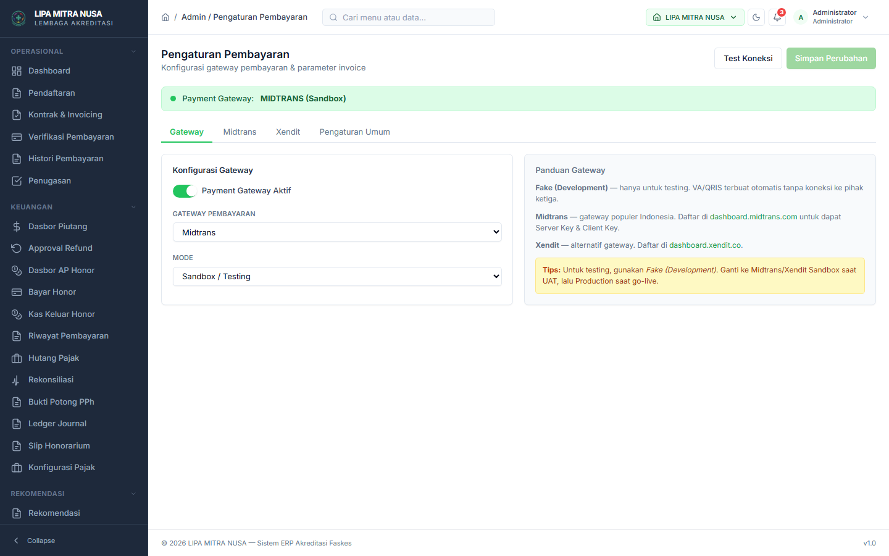
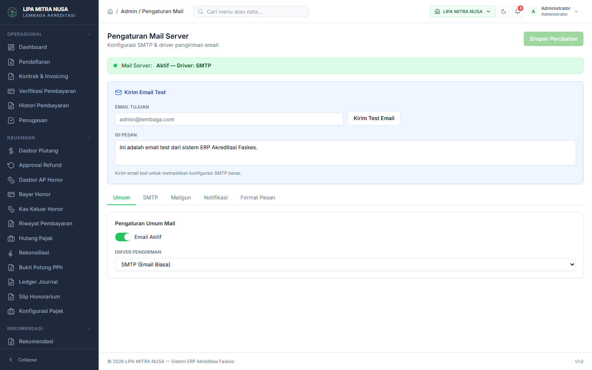
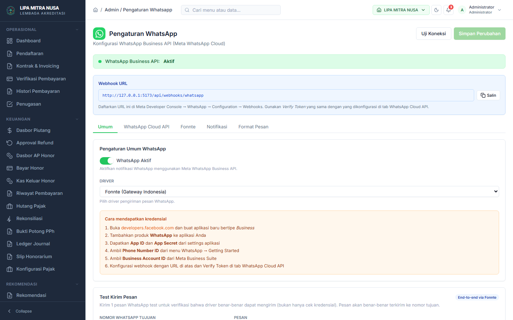
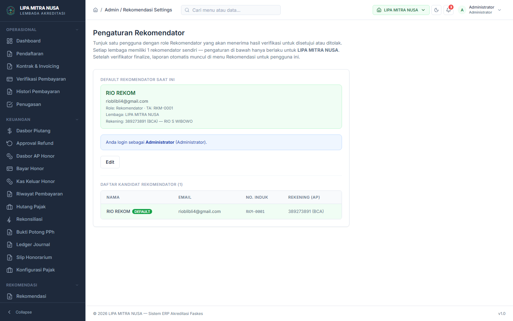
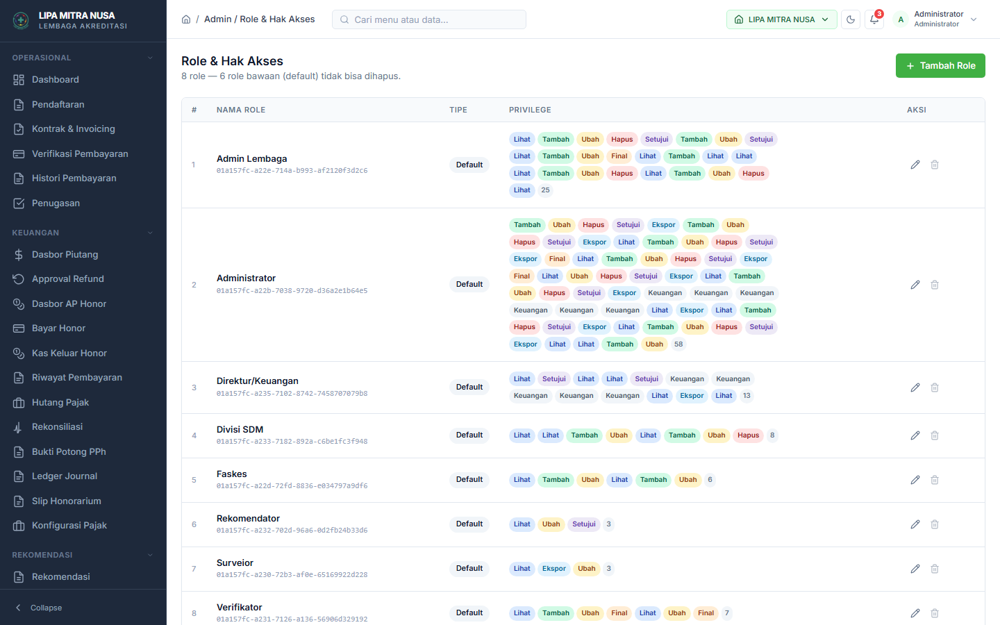
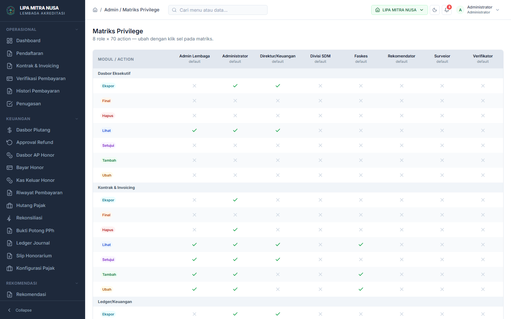
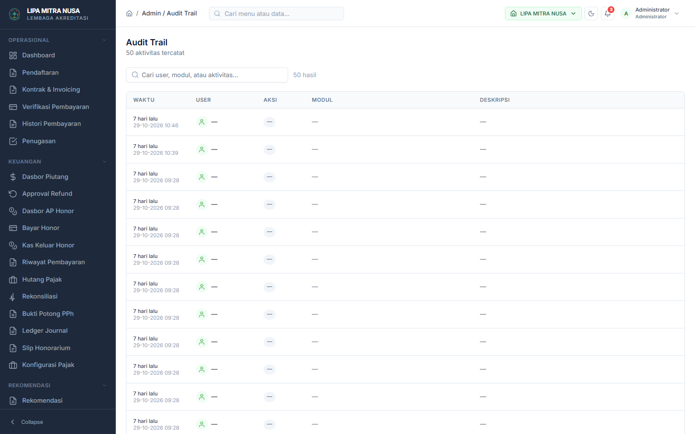
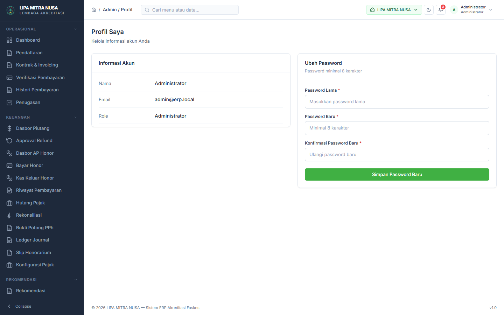

# Bab 08 — Pengaturan & Hak Akses

> Modul: Pengaturan, Kontrak & Invoicing, Rekomendasi, Pengaturan Hak Akses · Peran: Administrator, Admin Lembaga · Alamat portal: `/admin`

Bab ini untuk Anda yang mengurus **konfigurasi sistem** dan **hak akses**
pengguna di lingkungan internal ERP Akreditasi. Isinya tiga kelompok layar:

1. **Konfigurasi pengiriman** — Payment Gateway, Mail Server, dan
   WhatsApp. Tiga layar ini menentukan bagaimana Faskes menerima tagihan,
   menerima pemberitahuan, dan membaca laporan dari sistem.
2. **Penetapan reksa** — satu layar untuk menunjuk siapa yang akan
   menerima hasil verifikasi pada lembaga Anda.
3. **Hak akses** — tiga layar untuk mengatur peran, mencetak matriks
   hak akses, dan menelusuri aktivitas pengguna.

Semua layar bab ini berada di portal internal (`/admin`) dan tampil di
sidebar pada grup **Pengaturan**. Satu layar, **Profil Saya**, tidak
tampil di sidebar dan hanya bisa dibuka lewat menu akun di kanan atas.

---

## Peta peran, modul, dan aksi

Hak akses di sistem ini bergerak dalam tiga lapis:

| Lapis | Arti | Contoh |
|-------|------|--------|
| **Peran** | siapa pengguna Anda — misalnya Administrator, Admin Lembaga, Surveior | Administrator |
| **Modul** | bidang kerja — misalnya Kontrak & Invoicing, Rekomendasi, Pengaturan Hak Akses | Kontrak & Invoicing |
| **Aksi** | apa yang boleh dilakukan pada modul itu | Lihat, Tambah, Ubah, Hapus, Setujui, Ekspor, Final |

Dengan kata lain: peran **Reksa**, modul **Rekomendasi**, aksi **Setujui**
berarti reksa boleh menyetujui rekomendasi. Kombinasi seperti itu dicatat
per pengguna lewat tabel `role_privileges`, yang menunjuk pasangan
modul + aksi pada tabel `menu_actions`.

Tujuh aksi standar yang tersedia pada setiap modul: **Lihat**, **Tambah**,
**Ubah**, **Hapus**, **Setujui**, **Ekspor**, dan **Final**.

### Hak akses bawaan tiap peran

| Peran | Modul yang boleh diakses |
|-------|--------------------------|
| Administrator | Semua modul, semua aksi |
| Admin Lembaga | Pendaftaran & Validasi Dokumen (Lihat/Tambah/Ubah/Hapus/Setujui), Kontrak & Invoicing (Lihat/Tambah/Ubah/Setujui), Penugasan (Lihat/Tambah/Ubah/Final), Verifikasi (Lihat/Tambah), Dasbor Eksekutif (Lihat), SDM & Siklus Penugasan (Lihat), Pengaturan Hak Akses (Lihat/Tambah/Ubah/Hapus), Master Data (Lihat/Tambah/Ubah/Hapus) |
| Surveior | Penugasan (Lihat/Ubah/Ekspor) |
| Verifikator | Penugasan (Lihat/Tambah/Ubah/Final), Verifikasi (Lihat/Ubah/Final) |
| Rekomendator | Rekomendasi (Lihat/Ubah/Setujui) |
| Divisi SDM | Pendaftaran & Validasi Dokumen (Lihat), Penugasan (Lihat/Tambah/Ubah) |
| Direktur/Keuangan | Penugasan (Lihat/Setujui), Verifikasi (Lihat), Kontrak & Invoicing (Lihat/Setujui), Ledger/Keuangan (Lihat/Tambah/Ubah/Setujui/Ekspor), Dasbor Eksekutif (Lihat/Ekspor), Pengaturan Hak Akses (Lihat) |
| Faskes | Pendaftaran & Validasi Dokumen (Lihat/Tambah/Ubah), Kontrak & Invoicing (Lihat/Tambah/Ubah) |

### Dua lapis pemeriksaan

Menu di sidebar hanya muncul bila peran Anda punya aksi **Lihat** pada
modul itu. Namun kondisi itu bukan penjaga terakhir. Setiap kali Anda
menekan tombol yang mengubah data, pemeriksaan ulang dilakukan di sisi
server: permintaan hanya dilayani bila modul + aksi yang diminta memang
terdaftar pada peran Anda. Bila tidak, server menolak dengan status
tolak akses dan pesan **"Anda tidak memiliki hak akses untuk aksi ini."**

Artinya, menyembunyikan menu di layar saja tidak cukup untuk menutup
kemampuan — pemeriksaan di server yang benar-benar menentukan.

---

## 8.1 Payment Gateway

**Alamat:** `/pengaturan-pembayaran` · **Peran:** Administrator, Admin Lembaga, dan setiap peran dengan Kontrak & Invoicing — Ubah · **Syarat akses:** Kontrak & Invoicing — Ubah

### Yang ditampilkan

- Judul layar **Pengaturan Pembayaran** dan subjudul **"Konfigurasi
  gateway pembayaran & parameter invoice"**.
- Pita status berwarna di atas: **Payment Gateway: MIDTRANS (Sandbox)**
  bila gateway aktif, atau **Payment Gateway: Nonaktif** bila sakelarnya
  dimatikan.
- Empat tab: **Gateway**, **Midtrans**, **Xendit**, dan **Pengaturan
  Umum**. Tab **Gateway** terbuka pada tangkapan layar.
- Kartu **Konfigurasi Gateway** memuat:
  - Sakelar **Payment Gateway Aktif** — pada tangkapan layar dalam
    keadaan menyala.
  - Kotak pilihan **Gateway Pembayaran** dengan nilai **Midtrans**.
  - Kotak pilihan **Mode** dengan nilai **Sandbox / Testing**.
- Kartu **Panduan Gateway** di sisi kanan, berisi:
  - **Fake (Development)** — hanya untuk testing. VA/QRIS terbuat otomatis
    tanpa koneksi ke pihak ketiga.
  - **Midtrans** — gateway populer Indonesia. Daftar di
    `dashboard.midtrans.com` untuk dapat Server Key & Client Key.
  - **Xendit** — alternatif gateway. Daftar di `dashboard.xendit.co`.
  - Kotak **Tips:** — "Untuk testing, gunakan Fake (Development). Ganti ke
    Midtrans/Xendit Sandbox saat UAT, lalu Production saat go-live."
- Dua tombol di kanan atas: **Test Koneksi** dan **Simpan Perubahan**.

### Apa yang bisa dilakukan

- **Test Koneksi** — menguji koneksi ke gateway yang sedang aktif.
  Tombol berubah menjadi **Menguji...** selama proses. Hasilnya berupa
  pesan berhasil atau gagal.
- **Simpan Perubahan** — menyimpan seluruh isian tab yang terbuka.
  Tombol berubah menjadi **Menyimpan...** selama proses, dan menjadi
  tidak aktif bila tidak ada isian yang berubah.
- Beralih tab — memilih tab **Midtrans**, **Xendit**, atau **Pengaturan
  Umum** untuk mengisi kredensial dan parameter lain.
- Memilih driver pada **Gateway Pembayaran** menentukan tab mana yang
  relevan; isian kredensial driver yang tidak dipakai disembunyikan.

Isian yang tersedia pada tiap tab:

| Tab | Kartu | Isian |
|-----|-------|-------|
| Midtrans | Kredensial Midtrans | **Server Key**, **Client Key**, **Merchant ID**, **Bank Default VA** (BCA / BNI / Mandiri / Permata / BRI) |
| Xendit | Kredensial Xendit | **API Key**, **Callback Token**, **Channel Code** (BCA / BNI / MANDIRI / BRI / PERMATA) |
| Pengaturan Umum | Pengaturan Umum Pembayaran | **Hari Jatuh Tempo** (bawaan 30), **Email Notifikasi Admin** |

### Catatan

- Konfigurasi disimpan di dalam basis data, bukan di berkas konfigurasi
  aplikasi. Nilai yang tersimpan di basis data itulah yang dipakai sistem.
- **Hari Jatuh Tempo** menentukan tanggal jatuh tempo invoice yang terbit
  dari kontrak.
- Driver **Fake (Development)** hanya untuk pengujian tanpa transaksi
  sungguhan.
- Pesan yang mungkin muncul:
  - **Tidak ada perubahan untuk disimpan.** bila Anda menekan
    **Simpan Perubahan** tanpa mengubah apa pun.
  - **Berhasil disimpan.** bila penyimpanan berhasil.
  - **Gagal menyimpan.** bila penyimpanan ditolak server.
  - **Gagal koneksi.** bila uji koneksi gagal.
- Bila hak akses Anda tidak cukup, server menolak dengan pesan
  **"Anda tidak memiliki hak akses untuk aksi ini."**

---

## 8.2 Mail Server

**Alamat:** `/pengaturan-mail` · **Peran:** Administrator, Admin Lembaga · **Syarat akses:** Pengaturan Hak Akses — Ubah

### Yang ditampilkan

- Judul layar **Pengaturan Mail Server** dan subjudul **"Konfigurasi SMTP
  & driver pengiriman email"**.
- Pita status: **Mail Server: Aktif — Driver: SMTP** atau **Mail Server:
  Nonaktif**.
- Kartu **Kirim Email Test** berisi:
  - **EMAIL TUJUAN** — kolom isian, contoh nilai `admin@lembaga.com`.
  - **ISI PESAN** — area teks berisi **"Ini adalah email test dari
    sistem ERP Akreditasi Faskes."**
  - Keterangan **"Kirim email test untuk memastikan konfigurasi SMTP
    benar."**
  - Tombol **Kirim Test Email** — berubah menjadi **Mengirim...** selama
    proses.
- Lima tab: **Umum**, **SMTP**, **Mailgun**, **Notifikasi**, dan
  **Format Pesan**. Tab **Umum** terbuka pada tangkapan layar.
- Kartu **Pengaturan Umum Mail** memuat sakelar **Email Aktif** dan kotak
  pilihan **DRIVER PENGIRIMAN** dengan nilai **SMTP (Email Biasa)**.

### Apa yang bisa dilakukan

- **Simpan Perubahan** — menyimpan konfigurasi mail yang Anda ubah.
- **Kirim Test Email** — mengirim email percobaan ke alamat tujuan yang
  Anda isi, untuk memastikan konfigurasi server email sudah benar.
- Mengganti **DRIVER PENGIRIMAN** dengan salah satu dari: **SMTP (Email
  Biasa)**, **Mailgun**, **Amazon SES**, **Postmark**, **Mailtrap
  (Development)**, atau **Log saja (Development)**.
- Beralih tab **SMTP** untuk mengisi:
  - **SMTP Host**, **Port** (bawaan 587), **Enkripsi** (TLS / SSL / Tanpa
    Enkripsi), **Username / Email**, **Password / App Password**,
    **Alamat Pengirim (From)**, dan **Nama Pengirim (From Name)** (bawaan
    `LIPA MITRA NUSA`).
  - Kartu **Panduan SMTP** di bawahnya memuat catatan untuk **Gmail /
    Google Workspace** (gunakan App Password), **Mail Server Hosting**
    (port 465/587), dan **Port umum** (587 TLS / 465 SSL).
- Beralih tab **Mailgun** untuk mengisi **Domain Mailgun** dan **Mailgun
  Secret API Key**.
- Beralih tab **Notifikasi** untuk menyalakan email notifikasi:
  - **Email Admin Notifikasi**
  - **Kirim notifikasi saat invoice lunas**
  - **Kirim notifikasi saat PKS ditandatangani**
  - **Kirim notifikasi Surat Tugas ke Surveior**
- Beralih tab **Format Pesan** untuk mengubah subjek dan isi pesan setiap
  notifikasi email:
  - Judul tab **Format Pesan Email** dengan keterangan **"Atur subjek
    dan isi pesan setiap notifikasi yang dikirim lewat Email. Gunakan
    {{variabel}} untuk menyisipkan data otomatis."**
  - Setiap jenis notifikasi tampil sebagai satu blok yang dapat dibuka.
    Blok berisi nama notifikasi, lencana **Diubah** bila isinya sudah
    disesuaikan, lencana **Nonaktif** bila notifikasi dimatikan, sakelar
    **Kirim**, kolom **Subjek pesan**, dan area teks **Isi pesan** dengan
    penghitung karakter.
  - Untuk notifikasi yang isinya berupa dokumen, Anda hanya dapat
    menyesuaikan subjek. Keterangan yang tampil: "Isi pesan Email pada
    notifikasi ini berupa dokumen (HTML + PDF), sehingga tidak bisa
    diedit sebagai teks. Yang dapat disesuaikan hanya subjek pesan."
  - Blok **Variabel tersedia** dengan keterangan **"Klik untuk
    menyisipkan ke isi pesan. Nilai diisi otomatis saat pesan dikirim."**
    Setiap variabel dapat diklik untuk disisipkan.
  - Tombol **Pratinjau** (berubah menjadi **Membuat...**) dan
    **Kembalikan bawaan**.
  - Hasil pratinjau tampil di bawah label **Hasil pratinjau (data
    contoh)**. Bila ada variabel yang tidak punya data contoh, muncul
    peringatan **"Variabel tanpa data contoh: {daftar}. Variabel ini
    tetap diisi otomatis dari data nyata saat pesan dikirim."**
  - Tombol **Simpan Format Pesan** (berubah menjadi **Menyimpan...**)
    menyimpan perubahan.

Jenis notifikasi email yang punya template: **Pengingat Tagihan H-3**,
**Pengingat Tagihan H-1**, **Tagihan Terlambat**, **Tagihan / Invoice ke
Faskes**, **Invoice Lunas**, **Bukti Transfer Ditolak**, **Penugasan Baru
(Tenaga Ahli)**, dan **Slip Honorarium**. Dua di antaranya — **Tagihan /
Invoice ke Faskes** dan **Slip Honorarium** — isinya dokumen, sehingga
hanya subjeknya yang dapat disesuaikan.

### Catatan

- Konfigurasi disimpan di dalam basis data dan nilai di sana yang
  menang atas konfigurasi berkas aplikasi.
- Password SMTP tersimpan sebagai pengaturan di basis data dan
  ditampilkan pada formulir (kolom bertipe password dengan tombol lihat).
- Driver **Log saja (Development)** menulis pesan ke catatan sistem tanpa
  mengirim email sungguhan.
- Pengingat tagihan dikirim pada H-3 dan H-1.
- Teks bawaan tiap template berasal dari konfigurasi bawaan sistem;
  penyesuaian per kanal disimpan terpisah.
- Pesan yang mungkin muncul:
  - **Email test wajib diisi.** bila alamat tujuan atau isi pesan kosong.
  - **Berhasil disimpan.**, **Tidak ada perubahan untuk disimpan.**,
    **Gagal menyimpan.**, dan **Gagal mengirim email test.**
  - **Gagal membuat pratinjau.** dan **Gagal mengembalikan ke format
    bawaan.** pada panel template.
  - **Belum ada notifikasi yang dikonfigurasi untuk kanal email.** bila
    tab **Format Pesan** belum punya template apa pun — ini kondisi
    normal, bukan kesalahan.
  - **Anda tidak memiliki hak akses untuk aksi ini.** bila hak akses Anda
    tidak cukup.

---

## 8.3 WhatsApp

**Alamat:** `/pengaturan-whatsapp` · **Peran:** Administrator, Admin Lembaga · **Syarat akses:** Pengaturan Hak Akses — Ubah

### Yang ditampilkan

- Judul layar **Pengaturan WhatsApp** dan subjudul **"Konfigurasi
  WhatsApp Business API (Meta WhatsApp Cloud)"**.
- Pita status: **WhatsApp Business API: Aktif** atau **WhatsApp Business
  API: Nonaktif**.
- Kartu **Webhook URL** berisi alamat webhook dan tombol **Salin**,
  disertai instruksi **"Daftarkan URL ini di Meta Developer Console →
  WhatsApp → Configuration → Webhooks. Gunakan Verify Token yang sama
  dengan yang dikonfigurasi di tab WhatsApp Cloud API."**
- Lima tab: **Umum**, **WhatsApp Cloud API**, **Fonnte**, **Notifikasi**,
  dan **Format Pesan**. Tab **Umum** terbuka pada tangkapan layar.
- Kartu **Pengaturan Umum WhatsApp** memuat:
  - Sakelar **WhatsApp Aktif** dengan keterangan **"Aktifkan notifikasi
    WhatsApp menggunakan Meta WhatsApp Business API."**
  - Kotak pilihan **DRIVER** dengan pilihan **WhatsApp Cloud API
    (Meta)**, **Fonnte (Gateway Indonesia)**, atau **Log saja
    (Development)**.
- Kartu **Cara mendapatkan kredensial** berisi enam langkah bernomor.
- Dua tombol aksi: **Uji Koneksi** dan **Simpan Perubahan**.

### Apa yang bisa dilakukan

- **Uji Koneksi** — menguji koneksi ke driver WhatsApp yang aktif.
  Tombol berubah menjadi **Menguji...** selama proses. Hasilnya tampil
  sebagai pita **Koneksi Berhasil** atau **Koneksi Gagal**, disertai baris
  **Nomor**, **Nama Bisnis**, **Status**, dan **Quality**.
- **Simpan Perubahan** — menyimpan konfigurasi WhatsApp.
- **Salin** — menyalin alamat webhook ke papan klip.
- Beralih tab **WhatsApp Cloud API** untuk mengisi **App ID**, **App
  Secret**, **Phone Number ID**, **Business Account ID**, **Verify Token
  (Webhook)**, **API Version** (bawaan `v18.0`), dan **Webhook URL**
  (bawaan `/api/webhooks/whatsapp`).
- Beralih tab **Fonnte** untuk mengisi **API Token** dan **Nomor Perangkat**.
- Beralih tab **Notifikasi** untuk menyalakan atau mematikan notifikasi
  berikut (semula dalam keadaan aktif):
  - **Pendaftaran baru faskes**
  - **Status dokumen berubah**
  - **Dokumen divalidasi lengkap**
  - **Jadwal survei terbit**
  - **Tagihan/invoice baru**
  - **Pembayaran terkonfirmasi**
  - **Penugasan baru tenaga ahli**
  - **Kontrak PKS siap ditandatangani**
  - **Sertifikat akreditasi terbit**
  - **Catatan revisi dokumen**
- Beralih tab **Format Pesan** untuk mengubah subjek dan isi pesan
  notifikasi WhatsApp. Isinya sama seperti tab **Format Pesan** pada Mail
  Server, hanya kanalnya WhatsApp:
  - Judul **Format Pesan WhatsApp** dengan keterangan **"Atur subjek dan
    isi pesan setiap notifikasi yang dikirim lewat WhatsApp. Gunakan
    {{variabel}} untuk menyisipkan data otomatis."**
  - Satu blok per jenis notifikasi, lengkap dengan lencana **Diubah**,
    lencana **Nonaktif**, sakelar **Kirim**, kolom **Subjek pesan**, area
    teks **Isi pesan**, blok **Variabel tersedia**, tombol **Pratinjau**,
    dan tombol **Kembalikan bawaan**.
  - Tombol **Simpan Format Pesan** menyimpan perubahan.
- **Kirim Pesan Test** — mengirim pesan percobaan. Tombol berubah menjadi
  **Mengirim...** selama proses. Hasilnya tampil sebagai pita **Pesan
  Terkirim** atau **Pesan Gagal**, disertai baris **Driver: {driver}**.
  - **Nomor WhatsApp Tujuan** dengan contoh `cth: 081234567890`, maksimal
    20 karakter, dan petunjuk **"Format 08xx atau 62xxx."**
  - **Pesan** dengan bawaan **"Halo, ini pesan test dari sistem ERP LIPA
    Akreditasi."**, maksimal 1000 karakter, disertai penghitung karakter.
- **Reset** — mengembalikan isi pesan uji ke nilai bawaan.

### Catatan

- Konfigurasi disimpan di dalam basis data, bukan di berkas konfigurasi
  aplikasi.
- Notifikasi hanya terkirim bila WhatsApp dalam keadaan aktif **dan**
  koneksi berhasil diuji. Pita peringatan pada kartu notifikasi
  berbunyi: **"Notifikasi WhatsApp hanya akan dikirim jika WhatsApp
  Business API dalam keadaan AKTIF/NONAKTIF dan koneksi berhasil diuji."**
- Pesan masuk dari webhook dicocokkan ke invoice lewat nomor pesanan
  pembayaran, bukan lewat pencarian invoice langsung.
- Pesan yang mungkin muncul:
  - **Nomor WhatsApp wajib diisi.** dan **Pesan wajib diisi.**
  - **Nomor WhatsApp minimal 8 digit.**
  - **Berhasil disimpan.**, **Tidak ada perubahan untuk disimpan.**,
    **Gagal menyimpan.**, **Gagal menguji koneksi.**, dan **Gagal
    mengirim pesan test.**
  - **Belum ada notifikasi yang dikonfigurasi untuk kanal whatsapp.**
    pada tab **Format Pesan** bila belum ada template — kondisi normal.
- Alamat webhook boleh dipanggil tanpa login karena memang dipanggil
  oleh Meta.

---

## 8.4 Reksa (Rekomendator)

**Alamat:** `/rekomendasi-settings` · **Peran:** Reksa (Rekomendator), Administrator · **Syarat akses:** Rekomendasi — Ubah

### Yang ditampilkan

- Judul layar **Pengaturan Rekomendator**.
- Paragraf penjelasan di bawahnya: **"Tunjuk satu pengguna dengan role
  Rekomendator yang akan menerima hasil verifikasi untuk disetujui atau
  ditolak. Setiap lembaga memiliki 1 rekomendator sendiri — pengaturan
  di bawah hanya berlaku untuk LIPA MITRA NUSA. Setelah verifikator
  finalize, laporan otomatis muncul di menu Rekomendasi untuk pengguna
  ini."**
- Seksi **DEFAULT REKOMENDATOR SAAT INI** berisi:
  - Nama, email, dan baris **Role: Rekomendator**.
  - Baris tambahan **TA: {nomor induk}** bila akun tertaut ke tenaga
    ahli.
  - Baris **Lembaga: {nama lembaga}**.
  - Baris **Rekening: {no rekening} ({nama bank}) — {atas nama
    rekening}** bila rekening tersedia.
  - Peringatan amber **"Belum ada data rekening. Tautkan akun ini ke
    tenaga ahli di Manajemen Akun agar honor reksa membawa rekening saat
    pembayaran AP."** bila rekening belum ada.
- Banner biru **"Anda login sebagai {nama} ({role})."** — ditambah
  **" Anda sudah menjadi default rekomendator."** bila akun Anda
  sendiri yang menjadi default.
- Tombol **Edit**.
- Seksi **DAFTAR KANDIDAT REKOMENDATOR (1)** berupa tabel dengan kolom
  **NAMA**, **EMAIL**, **NO. INDUK**, dan **REKENING (AP)**. Baris yang
  menjadi default diberi lencana **DEFAULT** dan disorot. Bila rekening
  kolom **REKENING (AP)** kosong, tampil **"belum ada — tautkan ke tenaga
  ahli"**.

### Apa yang bisa dilakukan

- **Edit** — membuka jendela **Edit Default Rekomendator** yang memuat:
  - Teks **"Pilih pengguna dengan role Rekomendator yang akan menerima
    hasil verifikasi. Hanya satu rekomendator yang aktif pada satu
    waktu."**
  - Teks **"Kandidat diambil dari lembaga aktif {nama}."**
  - Kolom **Rekomendator *** dengan pilihan awal **"— Pilih
    rekomendator —"**. Tiap opsi berbunyi `{nama} — {email} ({nomor
    induk})`.
  - Keterangan **"{n} kandidat tersedia. Hanya menampilkan user dengan
    role Rekomendator dan status aktif."**
  - Tombol **Batal** dan **Simpan** (berubah menjadi **Menyimpan...**
    selama proses).
- **Simpan** — meminta konfirmasi **"Setel default rekomendator ke
  {nama}?"**, lalu menyimpan pilihan Anda. Setelah berhasil, daftar
  kandidat dimuat ulang.
- **Jadikan Saya Default** — tombol tambahan yang hanya tampil bila
  Anda sendiri berperan Reksa. Tombol meminta konfirmasi **"Setel diri
  Anda ({nama}) sebagai default reksa?"** lalu menyetel Anda sendiri
  (berubah menjadi **Menyetel...** selama proses).

### Catatan

- Tiap lembaga punya satu reksa sendiri. Pengaturan di layar ini hanya
  berlaku untuk lembaga yang sedang Anda pakai.
- Bila belum ada default rekomendator untuk lembaga Anda, tampil kotak
  kuning **"Belum ada default rekomendator untuk {nama lembaga}. Klik
  tombol "Edit" untuk memilih."**
- Bila belum ada kandidat sama sekali, jendela Edit menampilkan kotak
  kuning **"Belum ada akun dengan role Rekomendator di lembaga {nama}."**
  diikuti **"Buat di Master Data — Tenaga Ahli (peran Reksa, lengkapi
  rekening, lalu buat akun login), atau di Manajemen Akun (pilih role
  Rekomendator dan centang lembaga ini)."**
- Nama peran ini punya beberapa sebutan. Di layar ini nama peran
  tersebut tampil sebagai **Reksa**, sedangkan judul layarnya tertulis
  **Pengaturan Rekomendator**. Di **Master Data — Tenaga Ahli** dan di
  Bab 04, peran yang sama juga disebut **Reksa**. Ketiganya menunjuk
  peran yang sama.
- Akun reksa yang tidak tertaut ke tenaga ahli tidak punya rekening,
  sehingga honor reksa tidak membawa informasi rekening saat pembayaran
  AP.
- Pesan yang mungkin muncul:
  - **Pilih salah satu rekomendator terlebih dahulu.** bila Anda
    menekan **Simpan** tanpa memilih kandidat.
  - **Rekomendator tidak ditemukan di daftar.** bila pilihan Anda tidak
    ada di daftar kandidat.
  - **Anda tidak memiliki hak akses untuk aksi ini.** bila hak akses Anda
    tidak cukup.

---

## 8.5 Role & Hak Akses

**Alamat:** `/roles` · **Peran:** Administrator, Admin Lembaga, Direktur/Keuangan · **Syarat akses:** Pengaturan Hak Akses — Lihat

### Yang ditampilkan

- Judul layar **Role & Hak Akses** dan subjudul **"8 role — 6 role bawaan
  (default) tidak bisa dihapus."**
- Tombol **Tambah Role** di kanan atas judul.
- Tabel peran dengan kolom **#**, **Nama Role**, **Tipe**, **Privilege**,
  dan **Aksi**.
  - **Nama Role** ditampilkan tebal, dengan baris kecil berisi
    pengenal unik peran di bawahnya.
  - **Tipe** berupa lencana **Default** atau **Kustom**.
  - **Privilege** menampilkan lencana untuk tiap aksi yang dimiliki
    (misalnya **Lihat**, **Tambah**, **Ubah**, **Hapus**, **Setujui**,
    **Ekspor**, **Final**), diikuti satu lencana berisi jumlah privilege
    peran tersebut. Untuk modul **Ledger/Keuangan**, lencana yang tampil
    berisi nama modulnya saja, yaitu **Keuangan**.
  - **Aksi** berisi dua ikon: pensil (**Ubah**) dan tong sampah
    (**Hapus**).
- Pada tangkapan layar ada delapan peran: **Admin Lembaga**,
  **Administrator**, **Direktur/Keuangan**, **Divisi SDM**, **Faskes**,
  **Rekomendator**, **Surveior**, dan **Verifikator**.

### Apa yang bisa dilakukan

- **Tambah Role** — membuka jendela **Tambah Role** dengan satu kolom
  **Nama Role *** (contoh: `cth: Admin Lembaga`). Tombol **Tambah** menyimpan
  peran baru.
- **Ubah** (ikon pensil) — membuka jendela **Edit Role** yang terisi nama
  peran. Tombol **Simpan** menyimpan perubahan.
- **Hapus** (ikon tong sampah) — meminta konfirmasi **"Hapus role
  "{nama_role}"? Tindakan ini tidak bisa dibatalkan."** lalu menghapus
  peran. Tombol hapus pada peran bawaan dimatikan dan diberi keterangan
  **"Role default tidak bisa dihapus"**.
- **Batal** — menutup jendela tanpa menyimpan.

### Catatan

- Peran bawaan (default) dibuat oleh sistem dan tidak dapat dihapus.
  Peran kustom dapat Anda tambah dan hapus sendiri.
- Mengganti nama peran bawaan tidak menghapus hak aksesnya. *(perilaku
  perlu konfirmasi ke tim devs)*
- Pesan yang mungkin muncul:
  - **Nama role wajib diisi** bila kolom nama peran dikosongkan.
  - **Anda tidak memiliki hak akses untuk aksi ini.** bila hak akses Anda
    tidak cukup.
- Catatan untuk tim devs: subjudul layar menyebut "6 role bawaan
  (default) tidak bisa dihapus", sementara data bawaan sistem memuat
  delapan peran bawaan. *(perilaku perlu konfirmasi ke tim devs)*

---

## 8.6 Matriks Privilege

**Alamat:** `/privileges` · **Peran:** Administrator, Admin Lembaga, Direktur/Keuangan · **Syarat akses:** Pengaturan Hak Akses — Lihat

### Yang ditampilkan

- Judul layar **Matriks Privilege** dengan subjudul **"8 role × 70 action
  — ubah dengan klik sel pada matriks."**
- Tombol utama **Simpan {n} perubahan** — muncul di kanan atas hanya
  bila ada sel yang sudah diubah dan belum disimpan.
- Tabel matriks:
  - Kolom pertama **Modul / Action** memuat nama modul sebagai baris
    judul, lalu baris-baris aksi di bawahnya (misalnya **Lihat**,
    **Tambah**, **Ubah**, **Hapus**, **Setujui**, **Ekspor**, **Final**).
  - Satu kolom untuk tiap peran. Kepala kolom memuat nama peran,
    keterangan **default** atau **kustom**, dan tombol **Simpan** yang
    muncul pada kolom yang sedang diubah.
  - Tiap sel memuat tanda centang (✓, diizinkan) atau tanda silang (✕,
    tidak diizinkan). Arahkan kursor ke sel untuk melihat keterangan
    `{peran} — {modul} / {aksi}`.
- Legenda di bawah tabel: **Dijinkan**, **Tidak diizinkan**, dan **"·
  Klik sel untuk toggle."**

### Apa yang bisa dilakukan

- **Mengklik sel** — membalik status izin pada satu kombinasi
  peran + modul + aksi. Perubahan langsung ditandai di layar, belum
  tersimpan.
- **Simpan {n} perubahan** (tombol utama) — menyimpan seluruh peran
  yang berubah sekaligus.
- **Simpan** (tombol di kepala kolom peran) — menyimpan perubahan peran
  itu saja.
- **Coba lagi** — memuat ulang matriks, tombol ini muncul bila gagal
  memuat data.

### Catatan

- Tiap modul memiliki tujuh aksi standar: **Lihat**, **Tambah**,
  **Ubah**, **Hapus**, **Setujui**, **Ekspor**, **Final**.
- Perubahan di matriks berlaku pada seluruh modul sekaligus, bukan
  hanya satu menu.
- Aksi **Ubah** pada modul **Pengaturan Hak Akses** sendiri perlu
  diaktifkan lebih dulu. Dengan privilege **Lihat** saja Anda hanya
  dapat melihat matriks tanpa dapat menyimpannya.
- Memberikan atau mencabut privilege **Lihat** pada sebuah modul
  langsung berdampak pada sidebar: menu terkait muncul atau hilang bagi
  pengguna yang memakai peran itu. *(perilaku perlu konfirmasi ke
  tim devs)*
- Bila hak akses Anda tidak cukup, server menolak dengan pesan
  **"Anda tidak memiliki hak akses untuk aksi ini."**

---

## 8.7 Audit Trail

**Alamat:** `/audit-trail` · **Peran:** Administrator, Admin Lembaga, Direktur/Keuangan · **Syarat akses:** Pengaturan Hak Akses — Lihat

### Yang ditampilkan

- Judul layar **Audit Trail** dan subjudul **"50 aktivitas tercatat"**.
- Kotak pencarian dengan contoh isian **"Cari user, modul, atau
  aktivitas..."**.
- Penghitung hasil di sebelah kanan kotak pencarian, misalnya
  **"50 hasil"**.
- Tabel aktivitas dengan kolom:
  - **WAKTU** — ditulis relatif: **Baru saja**, **{n} menit lalu**,
    **{n} jam lalu**, atau **{n} hari lalu**, dengan tanggal lengkap di
    baris bawahnya.
  - **USER** — berisi foto inisial berbentuk lingkaran dan nama
    pengguna.
  - **AKSI** — lencana aksi: **Tambah**, **Lihat**, **Ubah**, **Hapus**,
    **Setujui**, **Ekspor**, atau **Final**.
  - **MODUL** — nama modul yang dikenai aksi.
  - **DESKRIPSI** — keterangan singkat aktivitas.

  Pada tangkapan layar, kolom **AKSI**, **MODUL**, dan **DESKRIPSI**
  menampilkan tanda pisah **—** dan kolom **USER** belum menampilkan
  nama. Hal ini perlu diklarifikasi ke tim devs. *(perilaku perlu
  konfirmasi ke tim devs)*
- Tombol **Muat lebih banyak** di bawah tabel bila masih ada baris yang
  belum ditampilkan.

### Apa yang bisa dilakukan

- **Mencari** — mengetik di kotak pencarian untuk menyaring baris yang
  sudah dimuat di peramban. Bila tidak ada yang cocok, tampil **"Tidak
  ada hasil"**.
- **Muat lebih banyak** — menambah 20 baris berikutnya ke tabel. Penambahan
  ini diproses di sisi peramban, bukan permintaan baru ke server.

### Catatan

- Data audit hanya bisa ditambah, tidak pernah diubah atau dihapus lewat
  aplikasi.
- Yang tercatat antara lain: siapa yang melakukan aksi, jenis aksinya,
  data sebelum dan sesudah, alamat IP, dan jenis peramban. Nilai kata
  sandi dan hash kata sandi tidak pernah ikut tersimpan.
- Jejak audit pada modul Master Data terisi antara lain lewat aksi
  pembuatan dan perubahan lembaga.
- Data dimuat dalam satu permintaan dengan batas 50 baris, urutan
  terbaru lebih dulu.
- Bila tabel kosong, tampil **"Belum ada aktivitas tercatat"** — kondisi
  normal, bukan kesalahan.

---

## 8.8 Profil Saya

**Alamat:** `/profile` · **Peran:** semua pengguna yang sudah login · **Syarat akses:** Autentikasi — sudah login

### Yang ditampilkan

- Judul layar **Profil Saya** dan subjudul **"Kelola informasi akun
  Anda"**.
- Kartu **Informasi Akun** berisi baris:
  - **Nama**
  - **Email**
  - **Role**
  - **Faskes** — hanya tampil bila akun Anda tertaut ke sebuah Faskes.
    Bila kosong, ditulis **—**.
- Kartu **Ubah Password** dengan keterangan **"Password minimal 8
  karakter"**, berisi:
  - **Password Lama *** dengan contoh **"Masukkan password lama"**.
  - **Password Baru *** dengan contoh **"Minimal 8 karakter"**.
  - **Konfirmasi Password Baru *** dengan contoh **"Ulangi password
    baru"**.
- Tombol **Simpan Password Baru** — berubah menjadi **Menyimpan...**
  selama proses dan **Berhasil!** setelah berhasil.
- Kotak hijau berisi pesan sukses dan tambahan **"Mengalihkan ke halaman
  login..."**.
- Bila terjadi kesalahan, tampil kotak merah berisi pesan dari server.

### Apa yang bisa dilakukan

- **Simpan Password Baru** — menyimpan kata sandi baru Anda. Setelah
  berhasil, sesi yang sedang dipakai diakhiri dan Anda diarahkan ke
  halaman login dalam hitungan detik.
- Menolak perubahan bila kolom password lama kosong — pesan **"Password
  lama wajib diisi"**.

### Catatan

- Layar ini tidak memakai modul privilege. Setiap pengguna hanya dapat
  mengubah kata sandi miliknya sendiri.
- Nama, email, role, dan faskes hanya ditampilkan, tidak dapat diubah
  dari layar ini.
- Pesan yang mungkin muncul:
  - **Password lama wajib diisi** bila kolom password lama kosong.
  - **Password baru minimal 8 karakter** bila password baru kurang dari
    8 karakter.
  - **Konfirmasi password baru tidak cocok** bila pengulangan tidak sama
    dengan password baru.
  - **Password lama salah.** bila password lama yang Anda ketik tidak
    benar.
  - **Password baru tidak boleh sama dengan password lama.** bila
    password baru identik dengan password lama.
  - **Password berhasil diubah. Silakan login ulang.** sebagai pesan
    berhasil dari server.

---

## Layar terkait

- [Bab 00 — Alur Siklus Akreditasi](00-alur-siklus.md)
- [Bab 01 — Pendaftaran & Portal Faskes](01-pendaftaran.md) — notifikasi
  status dokumen dan dokumen divalidasi dikirim lewat Email dan WhatsApp
- [Bab 02 — Operasional Internal](02-operasional.md)
- [Bab 04 — Rekomendasi](04-rekomendasi.md) — hasil verifikasi masuk ke
  menu Rekomendasi setelah reksa disetel di layar ini
- [Bab 05 — Keuangan](05-keuangan.md) — tagihan/invoice baru, pembayaran
  terkonfirmasi, dan pengingat tagihan H-3/H-1 memakai template pesan pada
  tab **Format Pesan**
- [Bab 07 — Master Data](07-master-data.md) — akun Reksa dibuat
  melalui **Master Data — Tenaga Ahli** atau **Manajemen Akun**
