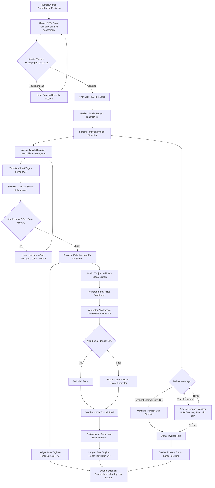
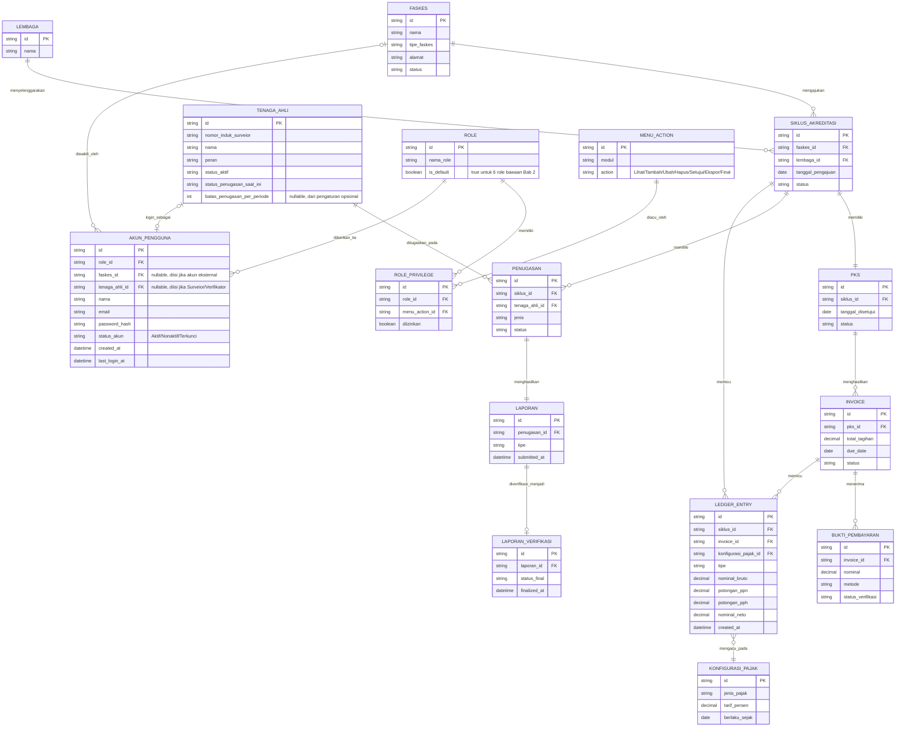

# Product Requirements Document
## Sistem ERP Akreditasi Fasilitas Pelayanan Kesehatan — LIPA MITRA NUSA

**Versi:** 2.6 (Revisi) | **Tanggal:** 23 September 2026 | **Status:** Draft for Review

| Versi | Tanggal | Deskripsi Perubahan | Status |
|---|---|---|---|
| 1.0 | - | Draf awal PRD | Superseded |
| 2.0 | 22 Sep 2026 | Penambahan model data, ERD, flowchart proses bisnis, detail logika penugasan, rekonsiliasi pembayaran, penguatan NFR, skenario kegagalan, exit criteria roadmap, dan ruang lingkup eksklusi | Superseded |
| 2.1 | 22 Sep 2026 | Klarifikasi: Surveior & Verifikator berstatus karyawan internal LIPA MITRA NUSA (bukan mitra eksternal) — dampak ke skema honorarium/payroll, opsi autentikasi SSO, kapasitas beban kerja, dan sumber kebenaran status kepegawaian | Superseded |
| 2.2 | 22 Sep 2026 | Revisi kebijakan: penerbitan Surat Tugas Survei **tidak lagi mensyaratkan status pembayaran Paid**. Gatekeeper pembayaran dilepas dari alur penugasan; status piutang tetap dipantau terpisah melalui dasbor Keuangan. Mengubah FR-2.4, AC-1, flowchart, dan Exit Criteria Fase 2 | Superseded |
| 2.3 | 22 Sep 2026 | Penambahan perhitungan PPN dan PPh otomatis pada honor Surveior & Verifikator. Menambah FR-5.6 s/d FR-5.8, AC-7, entitas Konfigurasi Pajak di ERD, dan isu terbuka soal skema pajak honor | Superseded |
| 2.4 | 23 Sep 2026 | **Jawaban stakeholder atas seluruh Isu Terbuka Bab 11**: pencairan honor dilakukan melalui sistem ini sendiri (bukan payroll gaji tetap); Surveior/Verifikator memiliki Nomor Induk Surveior dan dibayar murni per penugasan (tanpa gaji tetap bulanan); akses akun disediakan/diprovisi oleh lembaga; tidak ada batas jumlah penugasan baku namun ditambahkan pengaturan batas per periode yang dapat diaktifkan sewaktu-waktu, dan status "sedang bertugas" mengunci Surveior dari penugasan baru; kebijakan piutang pasca-survei berupa pengingat otomatis (WA/email) saat jatuh tempo, tanpa sanksi; skema pajak honor dikonfirmasi **PPN dan PPh 21 berlaku bersamaan**, tarif dikelola sebagai master data, bukti potong diterbitkan perusahaan, dan ditambahkan kebutuhan ekspor XML untuk Coretax. Mengubah Bab 2, FR-3.x, FR-5.4, FR-5.6–5.8, NFR-3, ERD, dan Bab 11 | Superseded |
| 2.5 | 23 Sep 2026 | Penambahan **Modul Pengaturan Hak Akses (Privilege Settings)** — matriks privilege yang dapat dikonfigurasi per Role untuk setiap menu/modul dan setiap action (Lihat, Tambah, Ubah, Hapus, Setujui, Ekspor, Final), bukan hanya RBAC tetap di kode program. Menambah FR-6.1 s/d FR-6.5 (modul baru 5.6), AC-10, entitas Role/Menu Action/Role Privilege di ERD | Superseded |
| 2.6 | 23 Sep 2026 | **Perbaikan gap ERD**: menambahkan entitas `AKUN_PENGGUNA` (kredensial login: email, password_hash, status) yang sebelumnya disebut di teks (Bab 4.1, NFR-3) namun belum ada di diagram. `AKUN_PENGGUNA` terhubung ke `ROLE` (wajib), dan opsional ke `FASKES` (untuk kontak eksternal) atau `TENAGA_AHLI` (untuk Surveior/Verifikator) — memisahkan data kredensial dari data bisnis. Menambah FR-6.6 dan mengubah NFR-3, ERD Bab 4 | Draft for Review |

---

## 1. Pendahuluan

### 1.1 Latar Belakang
Saat ini, proses operasional akreditasi Fasilitas Pelayanan Kesehatan (Faskes) di LIPA MITRA NUSA masih berjalan secara semi-manual dan tersebar di berbagai prosedur. Untuk memastikan kepatuhan terhadap 7 Standar Operasional Prosedur (SOP) secara ketat dan mencegah kebocoran pendapatan, dibutuhkan sebuah sistem terpusat (ERP).

### 1.2 Tujuan (Objectives)
- **Otomatisasi Alur Kerja** — mencegah terlewatinya tahapan SOP melalui sistem Gatekeeper (pengunci alur).
- **Sentralisasi Data** — menjadi Single Source of Truth untuk penugasan SDM, verifikasi dokumen, dan laporan keuangan.
- **Visibilitas Finansial** — menciptakan transparansi arus kas (piutang Faskes & utang honorarium) secara real-time.
- **Efisiensi Komunikasi** — mengurangi human error melalui notifikasi WhatsApp otomatis dan pelacakan tiket internal.

### 1.3 Ruang Lingkup Sistem
Sistem mencakup seluruh siklus akreditasi mulai dari pendaftaran Faskes, validasi dokumen, kontrak & pembayaran, penugasan surveior/verifikator, proses verifikasi penilaian, hingga pencatatan keuangan (ledger) dan pelaporan eksekutif. Cakupan detail per modul dijabarkan pada Bab 5, dan batasan yang secara eksplisit tidak termasuk dijabarkan pada Bab 10.

---

## 2. Pengguna Sistem (User Personas)

Sistem menggunakan Role-Based Access Control (RBAC).

| Peran | Tanggung Jawab Inti | Modul Utama yang Diakses | Status Pengguna |
|---|---|---|---|
| Faskes | Mengunggah persyaratan akreditasi, menyetujui PKS, melakukan pembayaran tagihan. | Pendaftaran, Kontrak & Invoicing | Eksternal (klien) |
| Admin Lembaga | Memvalidasi kelengkapan dokumen, mengelola siklus penugasan surveior, menunjuk verifikator, menerbitkan Surat Tugas. | Validasi Dokumen, Penugasan, Verifikasi | Internal — karyawan LIPA MITRA NUSA |
| Surveior | Menerima tugas, melakukan survei, mengirimkan laporan akhir, melaporkan kendala tugas. | Portal Penugasan & Pelaporan | Internal — karyawan LIPA MITRA NUSA |
| Verifikator | Memeriksa kesesuaian Fakta & Analisis (FA) terhadap Elemen Penilaian (EP), mem-finalisasi laporan. | Workspace Verifikasi | Internal — karyawan LIPA MITRA NUSA |
| Divisi SDM | Mengelola daftar tenaga ahli, membuat siklus urutan penugasan, memproses status aktif/non-aktif akun surveior. | Manajemen SDM & Siklus Penugasan | Internal — karyawan LIPA MITRA NUSA |
| Direktur / Keuangan | Memantau dasbor laba/rugi, memvalidasi bukti transfer manual, menyetujui pencairan honorarium, menyetujui kepindahan surveior. | Dasbor Eksekutif, Ledger, Approval | Internal — karyawan LIPA MITRA NUSA |

> Matriks hak akses detail (create/read/update/delete/approve per modul) dikonfigurasi langsung di dalam sistem melalui **Modul Pengaturan Hak Akses** (lihat Bab 5.6, FR-6.1–FR-6.5) — bukan lagi sekadar dokumen turunan RACI yang statis di kode program.

**Catatan revisi 2.1 — Status kepegawaian Surveior & Verifikator:**
Seluruh pengguna internal (Admin Lembaga, Surveior, Verifikator, Divisi SDM, Direktur/Keuangan) berstatus **karyawan LIPA MITRA NUSA**, bukan mitra eksternal/freelance. Ini berdampak pada beberapa keputusan desain berikut (dirangkum di Bab 11 — Isu Terbuka):
- Akun Surveior/Verifikator dibuat oleh Divisi SDM, bukan self-registration.
- "Honor" pada FR-5.2/FR-5.3 kemungkinan berupa insentif tambahan di luar gaji pokok, bukan pembayaran ke pihak eksternal — perlu diklarifikasi hubungannya dengan sistem payroll.
- Sistem dapat memakai autentikasi korporat (SSO/Active Directory) sebagai alternatif akun mandiri.
- "Status aktif/non-aktif" berkaitan dengan status kepegawaian (cuti, resign, mutasi), sehingga perlu ditentukan sumber kebenaran (source of truth) datanya.

**Catatan revisi 2.4 — Jawaban stakeholder (menggantikan asumsi di atas):**
- Surveior dan Verifikator **tidak memiliki gaji tetap bulanan**; keduanya dibayar murni **per penugasan (honor per survei)**. Setiap Surveior memiliki **Nomor Induk Surveior** sebagai identitas unik di sistem.
- Pencairan honor **dilakukan langsung melalui sistem ini** (lihat Ledger, Bab 6), bukan diekspor/terhubung ke sistem payroll gaji tetap eksternal — karena memang tidak ada komponen gaji tetap yang perlu direkonsiliasi.
- Login **tidak memakai SSO/Active Directory korporat maupun self-registration bebas**; akses/akun disediakan (diprovisi) oleh lembaga/perusahaan itu sendiri.

---

## 3. Flowchart Proses Bisnis

Alur utama end-to-end dari pengajuan Faskes hingga pencatatan ke ledger keuangan.

> **Perubahan v2.2:** Jalur "Admin: Tunjuk Surveior" (N) kini bercabang langsung dari penerbitan Invoice (G), berjalan paralel dengan proses pembayaran (H–K) — bukan menunggu status Paid seperti versi sebelumnya. Status pembayaran tetap mengalir ke Dasbor Piutang (AE) dan direkonsiliasi di dasbor Direktur (AD), tapi tidak lagi memblokir penerbitan Surat Tugas.

---

## 4. Model Data & Entity Relationship Diagram (ERD)

### 4.1 Entitas Utama

| Entitas | Deskripsi Singkat | Relasi Kunci |
|---|---|---|
| Faskes | Institusi kesehatan yang mengajukan akreditasi. | 1 Faskes → banyak Siklus Akreditasi |
| Siklus Akreditasi | Satu proses pengajuan akreditasi milik satu Faskes pada satu lembaga. | 1 Siklus → 1 PKS, 1 Invoice, banyak Penugasan |
| Lembaga | Lembaga penyelenggara akreditasi (internal LIPA MITRA NUSA). | 1 Lembaga → banyak Siklus Akreditasi |
| Tenaga Ahli | Individu berperan surveior dan/atau verifikator; dibayar per penugasan (tanpa gaji tetap), diidentifikasi dengan Nomor Induk Surveior. | Banyak-ke-banyak dengan Penugasan, melalui Siklus Urutan Penugasan |
| Penugasan | Satu surat tugas (survei atau verifikasi) yang mengikat Tenaga Ahli ke Siklus Akreditasi. | 1 Penugasan → 1 Laporan; menyimpan status & histori penggantian |
| PKS | Kontrak digital antara Faskes dan Lembaga. | 1 PKS → 1 Invoice |
| Invoice | Tagihan ke Faskes. | 1 Invoice → banyak Bukti Pembayaran (mendukung cicilan) |
| Ledger Entry | Baris jurnal keuangan (piutang Faskes, utang honor), termasuk rincian potongan pajak. | Dibuat otomatis dari event pembayaran lunas, laporan dikirim, verifikasi Final |
| Laporan | Dokumen hasil survei (FA) dan hasil verifikasi (EP). | 1 Laporan Survei → 1 Laporan Verifikasi |
| Konfigurasi Pajak | Tarif PPN dan PPh yang berlaku, dapat diubah Keuangan tanpa mengubah kode. | Direferensikan oleh setiap Ledger Entry honor untuk menghitung potongan |
| Role | Peran pengguna (default maupun kustom) yang menentukan hak akses. | 1 Role → banyak Role Privilege; 1 Role → banyak Akun Pengguna |
| Menu Action | Kombinasi satu menu/modul dan satu action (Lihat/Tambah/Ubah/Hapus/Setujui/Ekspor/Final). | Direferensikan oleh Role Privilege |
| Role Privilege | Baris matriks yang menyatakan apakah satu Role diizinkan melakukan satu Menu Action. | Menghubungkan Role dan Menu Action (many-to-many) |
| Akun Pengguna *(baru v2.6)* | Entitas kredensial login (email, password_hash) — terpisah dari data bisnis Faskes/Tenaga Ahli. Setiap akun wajib punya satu Role, dan opsional terhubung ke satu Faskes (kontak eksternal) atau satu Tenaga Ahli (Surveior/Verifikator). Untuk Admin Lembaga/Divisi SDM/Direktur-Keuangan, akun berdiri sendiri tanpa keterkaitan ke Faskes maupun Tenaga Ahli. | Banyak Akun Pengguna → 1 Role; 1 Akun Pengguna → 0/1 Faskes; 1 Akun Pengguna → 0/1 Tenaga Ahli |

### 4.2 Diagram ERD

### 4.3 Rekomendasi Tindak Lanjut
- Susun skema database fisik (kolom lengkap, tipe data presisi, index) berdasarkan ERD di atas sebagai bagian dari Technical Design Document.
- Tentukan aturan cascade — misalnya histori Penugasan tetap tersimpan saat Tenaga Ahli dinonaktifkan (lihat AC-2).

---

## 5. Kebutuhan Fungsional (Functional Requirements)

### 5.1 Modul Pendaftaran & Validasi Dokumen
- **FR-1.1**: Faskes dapat membuat permohonan penilaian, mengisi DFO, menetapkan tanggal, dan memilih lembaga.
- **FR-1.2**: Faskes wajib mengunggah Surat Permohonan Survei dan Hasil Penilaian Mandiri (Self Assessment).
- **FR-1.3**: Admin Lembaga memiliki fitur checklist untuk memvalidasi kelengkapan data (DFO, SISDMK, ASPAK, INM, IKP).
- **FR-1.4**: Admin dapat mengirimkan catatan revisi via sistem apabila persyaratan dari Faskes belum sesuai.
- **FR-1.5** *(baru)*: Sistem mencatat versi dokumen setiap kali Faskes mengunggah ulang setelah revisi.

### 5.2 Modul Kontrak, Invoicing & Pembayaran
- **FR-2.1**: Sistem dapat mengirimkan draf PKS ke Faskes, dan Faskes dapat melakukan persetujuan/penandatanganan digital.
- **FR-2.2**: Sistem menerbitkan Invoice secara otomatis dengan Due Date setelah PKS disetujui.
- **FR-2.3**: Sistem mendukung pembayaran hybrid: integrasi Payment Gateway (VA/QRIS) dan unggah bukti transfer manual.
- **FR-2.4** *(direvisi v2.2)*: Admin dapat menerbitkan Surat Tugas Survei setelah dokumen Faskes tervalidasi lengkap (FR-1.3) dan PKS disetujui/ditandatangani (FR-2.1). Penerbitan Surat Tugas **tidak lagi mensyaratkan** status Invoice berubah menjadi Paid — status pembayaran dipantau terpisah oleh Keuangan melalui dasbor piutang (FR-5.4) dan notifikasi jatuh tempo (NFR-1).
- **FR-2.5** *(baru)*: Sistem mendukung pembayaran parsial/cicilan; status berubah Paid hanya setelah akumulasi mencapai nilai penuh.
- **FR-2.6** *(baru)*: Validasi bukti transfer manual wajib dalam SLA maksimal 1x24 jam kerja.
- **FR-2.7** *(baru)*: Bukti transfer yang ditolak memicu notifikasi otomatis ke Faskes disertai alasan, dan memungkinkan unggah ulang.
- **FR-2.8** *(baru)*: Sistem mendukung refund/pembatalan pembayaran dengan approval berjenjang dari Direktur/Keuangan, dicatat sebagai Ledger Entry tersendiri.

> **Catatan risiko (v2.2):** Melepas syarat pembayaran sebelum penerbitan Surat Tugas meningkatkan risiko piutang tak tertagih meski survei sudah berjalan. Mitigasi yang tetap berlaku: pengingat WhatsApp H-3/H-1 (NFR-1) dan dasbor piutang real-time (FR-5.4). Kebijakan eskalasi bila Faskes tidak kunjung melunasi pasca-survei belum diatur dalam PRD ini — lihat Bab 11 (Isu Terbuka).

### 5.3 Modul Manajemen Penugasan & Mitigasi Kendala
- **FR-3.1**: Admin dapat menerbitkan Surat Tugas Survei melalui sistem dengan format PDF terstandardisasi.
- **FR-3.2**: Sistem menyediakan form pelaporan kendala bagi surveior (Conflict of Interest atau Force Majeure).
- **FR-3.3**: Sistem memiliki alur penggantian surveior berdasarkan siklus penugasan Divisi SDM.
- **FR-3.4**: Surveior pengganti wajib mengisi kesediaan di dalam sistem (Sinaf internal).
- **FR-3.5** *(baru)*: Jika surveior pengganti menolak, sistem otomatis menawarkan ke kandidat berikutnya dalam antrian dan mencatat penolakan ke histori Tenaga Ahli.
- **FR-3.6** *(baru v2.4)*: Setiap Surveior memiliki **Nomor Induk Surveior** unik, dikelola oleh Divisi SDM sebagai data induk di dalam sistem ini (bukan ditarik dari sistem HR/kepegawaian eksternal) — mencakup status aktif, cuti, resign, dan mutasi.
- **FR-3.7** *(baru v2.4)*: Selama status Surveior adalah "Sedang Bertugas", sistem **memblokir** penugasan baru untuknya sampai penugasan berjalan selesai/ditutup. Verifikator tidak dikenakan pembatasan ini dan dapat menerima **multiple penugasan bersamaan**.
- **FR-3.8** *(baru v2.4)*: Sistem menyediakan pengaturan opsional **"Batas Penugasan per Periode"** (dapat diaktifkan/dinonaktifkan dan diubah nilainya oleh Divisi SDM) untuk membatasi jumlah penugasan bersamaan per Tenaga Ahli, digunakan hanya jika kebutuhan tersebut muncul di kemudian hari. Default: tidak aktif (tanpa batas).

**Logika Siklus Penugasan (detail):**
- Model dasar: rotasi round-robin di antara Tenaga Ahli aktif, dengan urutan yang di-maintain Divisi SDM.
- Filter kelayakan Surveior: status aktif, tanpa CoI dengan Faskes terkait, tidak dalam sanksi, **dan tidak sedang berstatus "Sedang Bertugas"** pada penugasan lain (FR-3.7). Tidak ada batas jumlah penugasan baku secara default; jika "Batas Penugasan per Periode" (FR-3.8) diaktifkan, filter ini turut memeriksa kuota tersebut.
- Filter kelayakan Verifikator: status aktif, tanpa CoI, tidak dalam sanksi — **tanpa** pengecualian status "sedang bertugas", karena Verifikator boleh menerima beberapa penugasan sekaligus.
- Penugasan pengganti mengambil kandidat berikutnya dalam antrian yang sama (bukan antrian terpisah) agar distribusi tetap adil.
- Override manual di luar urutan wajib disertai justifikasi tertulis.

> **Perlu konfirmasi ke Divisi SDM:** apakah rotasi murni round-robin, atau perlu bobot tambahan seperti skor kompetensi/rating dari Faskes sebelumnya?

### 5.4 Modul Verifikasi (Side-by-Side Workspace)
- **FR-4.1**: Admin dapat menunjuk Verifikator sesuai urutan penugasan dan menerbitkan Surat Tugas Verifikator.
- **FR-4.2**: Sistem menyediakan ruang kerja bersanding (split-screen) untuk meneliti kesesuaian FA terhadap EP.
- **FR-4.3**: Verifikator dapat memberikan nilai yang sama bila FA sesuai.
- **FR-4.4**: Perubahan nilai wajib disertai alasan di kolom komentar (tombol simpan diblokir jika kosong).
- **FR-4.5**: Tombol "Final" mengunci hasil verifikasi secara permanen setelah diklik.
- **FR-4.6** *(baru)*: Dialog konfirmasi wajib tampil sebelum tombol "Final" dieksekusi karena tindakan irreversible dan memicu tagihan honor.

### 5.5 Modul Keuangan & Buku Besar (Ledger)
- **FR-5.1**: Pencatatan pemasukan otomatis dari pembayaran Faskes (Piutang Usaha lunas).
- **FR-5.2**: Pembuatan otomatis tagihan internal (AP) untuk honor Surveior ketika laporan dikirim. *(Dikonfirmasi v2.4: Surveior tidak memiliki gaji tetap bulanan — honor per penugasan ini **dicairkan langsung melalui sistem ini**, bukan diekspor ke sistem payroll gaji tetap eksternal.)*
- **FR-5.3**: Pembuatan otomatis tagihan internal (AP) untuk honor Verifikator saat tombol "Final" diklik. *(Berlaku catatan yang sama seperti FR-5.2 — Verifikator juga dibayar murni per penugasan, dicairkan melalui sistem ini.)*
- **FR-5.4**: Dasbor eksekutif bagi Direktur untuk rekonsiliasi proyek (Pemasukan − honor Surveior & Verifikator).
- **FR-5.4a** *(baru v2.4)*: Sistem mengirimkan **pengingat otomatis** (WhatsApp, dengan fallback email — mengikuti NFR-1) kepada Faskes ketika Invoice telah **jatuh tempo** dan survei sudah berjalan. Kebijakan eskalasi dibatasi pada pengingat berjenjang; sistem **tidak** menerapkan sanksi otomatis atau batas waktu keras terhadap kelanjutan proses survei.
- **FR-5.5** *(baru)*: PKS yang direvisi/dibatalkan setelah Invoice terbit memicu Ledger Entry penyesuaian; Invoice lama ditandai *superseded*, bukan dihapus.
- **FR-5.6** *(baru v2.3, dikonfirmasi v2.4)*: Sistem menghitung otomatis komponen pajak atas honor Surveior dan Verifikator — **PPN dan PPh Pasal 21 berlaku bersamaan** (dikonfirmasi stakeholder, bukan salah satu saja) — lalu mencatat rincian nominal bruto, potongan PPN, potongan PPh, dan nominal neto pada Ledger Entry terkait (FR-5.2, FR-5.3).
- **FR-5.7** *(baru v2.3, diperluas v2.4)*: Tarif PPN dan PPh **dikelola sebagai master data/pengaturan** yang dapat diubah oleh Keuangan melalui sistem (bukan hardcode di kode program) agar tetap fleksibel terhadap perubahan regulasi maupun metode perhitungan (progresif/TER/final) tanpa perubahan aplikasi.
- **FR-5.8** *(baru v2.3, diperluas v2.4)*: **Perusahaan (LIPA MITRA NUSA)** menerbitkan bukti potong pajak (termasuk PPh Pasal 21) per periode melalui sistem, untuk keperluan pelaporan pajak Surveior/Verifikator.
- **FR-5.9** *(baru v2.4)*: Sistem dapat menghasilkan **ekspor file XML** dari data pemotongan pajak (bukti potong) sesuai format yang dipersyaratkan, agar dapat diunggah ke **Coretax DJP**.

> **Catatan (v2.4 — menggantikan catatan v2.3):** Isu terbuka mengenai skema pajak honor telah dijawab stakeholder: PPN dan PPh 21 memang **berlaku bersamaan** atas honor Surveior/Verifikator, bukan hanya salah satunya. Tarif kedua pajak tersebut disimpan sebagai master data agar mudah disesuaikan, bukti potong diterbitkan oleh perusahaan, dan sistem perlu menyediakan ekspor XML untuk pelaporan via Coretax (FR-5.9).

### 5.6 Modul Pengaturan Hak Akses (Privilege Settings) *(baru v2.5)*
- **FR-6.1**: Sistem menyediakan **matriks privilege** yang dapat dikonfigurasi oleh Admin/superuser, mencakup seluruh menu/modul (Pendaftaran & Validasi Dokumen, Kontrak & Invoicing, Penugasan, Verifikasi, SDM & Siklus Penugasan, Ledger/Keuangan, Dasbor Eksekutif, Pengaturan Hak Akses itu sendiri) dan **action granular** per menu: Lihat (View), Tambah (Create), Ubah (Edit), Hapus (Delete), Setujui (Approve), Ekspor (Export), dan Final/Kunci (Lock) — bukan hanya RBAC tetap yang di-hardcode di kode program.
- **FR-6.2**: Setiap Role bawaan (Faskes, Admin Lembaga, Surveior, Verifikator, Divisi SDM, Direktur/Keuangan — lihat Bab 2) memiliki set privilege default sesuai tanggung jawabnya, namun Admin/superuser dapat **menyesuaikan (override)** privilege tersebut per menu/action tanpa memerlukan perubahan kode program.
- **FR-6.3**: Admin/superuser dapat **membuat Role kustom** baru di luar 6 role default, dan menetapkan kombinasi privilege menu+action miliknya sendiri, lalu menetapkan Role tersebut ke satu atau lebih akun pengguna.
- **FR-6.4**: Antarmuka pengguna **menyembunyikan atau menonaktifkan** (grey-out) tombol/menu yang tidak diizinkan bagi Role pengguna yang sedang login — bukan sekadar diblokir setelah diklik.
- **FR-6.5**: Setiap perubahan pada matriks hak akses (penambahan Role, pengubahan privilege, penonaktifan Role) tercatat pada audit trail (timestamp + aktor) sesuai NFR-2, dan hanya dapat dilakukan oleh Role dengan privilege "Setujui/Kelola Hak Akses".
- **FR-6.6** *(baru v2.6)*: Kredensial login disimpan pada entitas `Akun Pengguna` yang terpisah dari data bisnis Faskes/Tenaga Ahli. Satu Akun Pengguna wajib memiliki tepat satu Role; opsional terhubung ke satu Faskes (untuk kontak eksternal — satu Faskes boleh punya lebih dari satu Akun Pengguna) atau satu Tenaga Ahli (untuk Surveior/Verifikator — relasi 1:1). Akun Admin Lembaga, Divisi SDM, dan Direktur/Keuangan berdiri sendiri tanpa keterkaitan ke Faskes maupun Tenaga Ahli.

> **Catatan (v2.5):** Penegakan privilege wajib dilakukan di sisi **back-end/API**, bukan hanya di tampilan (UI) — lihat AC-10.

---

## 6. Kebutuhan Non-Fungsional (Non-Functional Requirements)

| ID | Kategori | Kebutuhan |
|---|---|---|
| NFR-1 | Notifikasi | WhatsApp Business API untuk pengingat tagihan (H-3, H-1) dan notifikasi penugasan. Fallback ke email jika gagal kirim, dicatat di log. |
| NFR-2 | Audit Trail | Timestamp + aktor untuk setiap perubahan nilai dokumen, pembatalan surat tugas, persetujuan pembayaran. Retensi minimal 5 tahun, append-only. |
| NFR-3 | Keamanan | Enkripsi kredensial, sesi aman (hashing password, session timeout, HTTPS/TLS). Tinjau kesesuaian dengan UU No. 27/2022 (PDP). *(Dikonfirmasi v2.4, diperjelas v2.6)*: Sistem menggunakan akun mandiri per pengguna, disimpan pada entitas `Akun Pengguna` (FR-6.6) — **tidak melalui self-registration** — akses/akun dibuat dan diberikan oleh lembaga/perusahaan (diprovisi oleh Divisi SDM/Admin Lembaga), bukan SSO/Active Directory korporat. |
| NFR-4 | Platform | Web App responsif, dapat diakses desktop maupun mobile. |
| NFR-5 *(baru)* | Kapasitas & Kinerja | Target [TBD] pengguna concurrent pada jam sibuk; waktu muat halaman utama < 3 detik. |
| NFR-6 *(baru)* | Ketersediaan | Target uptime [TBD, contoh 99.5%], mengingat mekanisme pengunci alur (Gatekeeper) pada modul validasi dokumen dan verifikasi (FR-4.4, FR-4.5) bergantung pada ketersediaan sistem. |
| NFR-7 *(baru)* | Backup & DR | Backup harian, retensi minimal 30 hari; RTO/RPO ditentukan bersama tim infrastruktur. |

---

## 7. Kriteria Penerimaan (Acceptance Criteria)
- **AC-1** *(direvisi v2.2)*: Admin DAPAT menerbitkan Surat Tugas Survei segera setelah dokumen tervalidasi lengkap dan PKS disetujui, **tanpa perlu menunggu** status Invoice menjadi Paid. Status pembayaran tetap terekam secara independen di dasbor piutang.
- **AC-2**: Surveior dapat diganti tanpa menghapus log penugasan sebelumnya.
- **AC-3**: Verifikator TIDAK BISA menyelesaikan verifikasi jika perubahan skor tanpa komentar.
- **AC-4**: Klik "Final" langsung mengunci dokumen dan meneruskan notifikasi tagihan honor ke Keuangan.
- **AC-5** *(baru)*: Invoice dengan pembayaran parsial TIDAK BISA berstatus Paid sebelum akumulasi mencapai nilai penuh.
- **AC-6** *(baru)*: Seluruh perubahan data keuangan tercatat di audit trail, tanpa kemungkinan edit langsung pada entry yang sudah dibuat.
- **AC-7** *(baru v2.3)*: Nominal neto pada Ledger Entry honor harus selalu sama dengan nominal bruto dikurangi total potongan PPN dan PPh yang dihitung sistem — tidak boleh ada selisih yang tidak tercatat.
- **AC-8** *(baru v2.4)*: Surveior berstatus "Sedang Bertugas" TIDAK BISA dipilih/menerima penugasan baru sampai penugasan berjalannya selesai; batasan ini tidak berlaku untuk Verifikator.
- **AC-9** *(baru v2.4)*: Invoice yang telah melewati due date pada Faskes dengan survei berjalan memicu pengingat otomatis (WA, fallback email) — tanpa memblokir atau membatalkan proses survei yang sedang berjalan.
- **AC-10** *(baru v2.5)*: Pengguna dengan Role yang tidak memiliki privilege atas suatu menu/action TIDAK BISA mengakses fungsi tersebut melalui endpoint/API secara langsung, sekalipun tombolnya disembunyikan di UI — penegakan hak akses wajib di sisi back-end.

---

## 8. Skenario Kegagalan & Mitigasi (Edge Cases)

| Skenario | Perilaku Sistem yang Diharapkan |
|---|---|
| Notifikasi WhatsApp gagal terkirim | Fallback otomatis ke email; status gagal-kirim tampil di dasbor Admin. |
| Surveior pengganti juga menolak | Tawarkan ke kandidat berikutnya; jika seluruh kandidat menolak, eskalasi ke Divisi SDM untuk penunjukan manual + justifikasi. |
| PKS direvisi setelah Invoice terbit | Invoice lama *superseded*; Invoice baru diterbitkan; Ledger Entry penyesuaian dibuat otomatis. |
| Bukti transfer nominal tidak sesuai | Status tetap "Menunggu Verifikasi"; jika ditolak, notifikasi otomatis + kesempatan unggah ulang. |
| Sistem down mendekati due date | Notifikasi H-3/H-1 dijadwalkan ulang (retry); due date tidak dianggap lewat karena keterlambatan notifikasi semata. |

---

## 9. Roadmap Rilis (Fase Pengembangan)

### Fase 1 (Bulan 1–3) — MVP & Inti Operasional
**Cakupan:** Portal pendaftaran Faskes, manajemen akun SDM, **Modul Pengaturan Hak Akses (privilege per Role/menu/action — FR-6.1–FR-6.5)**, pembuat PDF Surat Tugas, portal pelaporan surveior, workspace penilaian verifikator.
**Exit Criteria:** Faskes menyelesaikan pendaftaran end-to-end hingga dokumen tervalidasi; Surat Tugas terbit dalam format PDF standar; Verifikator menyelesaikan siklus FA-EP tanpa data hilang (memenuhi AC-2, AC-3); matriks privilege dapat dikonfigurasi dan ditegakkan di back-end untuk seluruh Role bawaan (memenuhi AC-10).

### Fase 2 (Bulan 4–5) — Otomatisasi & Integrasi Eksternal
**Cakupan:** Integrasi Payment Gateway, notifikasi/tiket via WhatsApp API, dan dasbor pemantauan piutang otomatis yang berjalan independen dari alur penugasan.
**Exit Criteria:** Pembayaran VA/QRIS terverifikasi otomatis < 5 menit; notifikasi WhatsApp + fallback email berfungsi; Surat Tugas terbukti dapat diterbitkan segera setelah PKS disetujui tanpa terhambat status pembayaran (memenuhi AC-1 revisi v2.2), sementara dasbor piutang tetap akurat mencerminkan status Invoice secara independen.

### Fase 3 (Bulan 6) — Penyempurnaan ERP Finansial
**Cakupan:** Dasbor analitik Direktur, rekapitulasi laba/rugi per Faskes, otomatisasi invoice & slip honorarium termasuk perhitungan PPN/PPh otomatis (FR-5.6 s/d FR-5.8).
**Exit Criteria:** Dasbor rekonsiliasi real-time dengan selisih nol terhadap perhitungan manual; seluruh Ledger Entry Fase 1–2 tertelusuri tanpa entry hilang (memenuhi AC-6); slip honorarium menampilkan rincian bruto, potongan PPN/PPh, dan neto yang konsisten (memenuhi AC-7).

---

## 10. Di Luar Ruang Lingkup (Out of Scope)
- Integrasi dengan sistem akuntansi eksternal (mis. Accurate, Jurnal, SAP) — Ledger internal berdiri sendiri.
- Dukungan multi-currency — seluruh transaksi dalam Rupiah (IDR).
- Aplikasi mobile native (iOS/Android) — kebutuhan mobile dipenuhi via web responsif.
- Modul pelatihan/e-learning bagi surveior atau verifikator.
- Integrasi otomatis dengan sistem eksternal Faskes (SISDMK, ASPAK) — diunggah manual pada Fase 1–3.

---

## 11. Isu Terbuka (Open Questions) — Terjawab (v2.4)

Seluruh isu berikut telah dijawab oleh stakeholder terkait. Jawaban di bawah ini menjadi rujukan resmi dan telah dipropagasikan ke bab/FR/NFR terkait (lihat kolom "Berdampak ke"); poin-poin ini dianggap **selesai (closed)**, bukan lagi isu terbuka.

| Isu | Pertanyaan | Jawaban / Keputusan | Berdampak ke |
|---|---|---|---|
| Integrasi Payroll | Apakah honor per penugasan (FR-5.2, FR-5.3) dicairkan lewat sistem ini secara terpisah dari gaji, atau perlu terhubung/ekspor ke sistem payroll internal? | **Dicairkan melalui sistem ini.** Tidak ada integrasi/ekspor ke sistem payroll gaji tetap, karena Surveior/Verifikator memang tidak menerima gaji tetap bulanan. | Bab 6 Ledger, FR-5.2, FR-5.3, arsitektur integrasi |
| Sumber Kebenaran Data Pegawai | Apakah data induk pegawai (status aktif, cuti, resign, mutasi) diinput manual oleh Divisi SDM di sistem ini, atau ditarik dari sistem HR/kepegawaian yang sudah ada? | Diinput/dikelola **di dalam sistem ini** oleh Divisi SDM. Surveior memiliki **Nomor Induk Surveior**; baik Surveior maupun Verifikator dibayar melalui **honor per penugasan/survei**, tanpa gaji tetap bulanan. | FR-3.6, onboarding akun, ERD (entitas Tenaga Ahli) |
| Autentikasi | Apakah login memakai akun mandiri per pengguna, atau SSO/Active Directory korporat? | Akun mandiri per pengguna, tetapi **bukan self-registration** — akses diberikan (diprovisi) oleh lembaga/perusahaan. | NFR-3 |
| Kapasitas Beban Kerja | Berapa batas jumlah penugasan bersamaan yang dianggap wajar per karyawan (Surveior/Verifikator) dalam satu periode? | **Tidak ada batas baku.** Namun jika status Surveior sedang "Sedang Bertugas", ia tidak bisa menerima penugasan baru; Verifikator boleh menerima multiple penugasan. Ditambahkan pengaturan opsional **"Batas Penugasan per Periode"** yang dapat diaktifkan sewaktu-waktu jika dibutuhkan. | FR-3.7, FR-3.8, Logika Siklus Penugasan (Bab 5.3) |
| Kebijakan Eskalasi Piutang *(baru v2.2)* | Karena Surat Tugas kini bisa terbit sebelum Invoice lunas, apakah perlu batas waktu maksimal atau sanksi bila Faskes tidak kunjung membayar setelah survei berjalan? | **Tidak ada sanksi/batas waktu keras.** Cukup pengingat (reminder) otomatis via WhatsApp maupun email ketika pembayaran sudah jatuh tempo. | FR-5.4a, kebijakan bisnis Keuangan, NFR-1 |
| Skema Pajak Honor *(baru v2.3)* | Apakah honor Surveior/Verifikator benar dikenakan PPN, atau hanya PPh Pasal 21? Berapa tarif dan metode perhitungan yang berlaku, dan siapa yang menerbitkan bukti potong? | **PPN dan PPh Pasal 21 berlaku bersamaan** (bukan salah satu). Tarif kedua pajak dibuat sebagai **master data** agar fleksibel. Bukti potong diterbitkan oleh **perusahaan**. Ditambah kebutuhan baru: **ekspor XML** untuk diunggah ke **Coretax**. | FR-5.6, FR-5.7, FR-5.8, FR-5.9 *(baru)*, Ledger |

---

## 12. Lampiran — Daftar Istilah

| Istilah | Keterangan |
|---|---|
| Faskes | Fasilitas Pelayanan Kesehatan, entitas yang mengajukan akreditasi. |
| DFO | Dokumen Formulir Observasi — salah satu persyaratan pengajuan akreditasi. |
| PKS | Perjanjian Kerja Sama antara Faskes dan Lembaga akreditasi. |
| FA / EP | Fakta dan Analisis (temuan surveior) / Elemen Penilaian (standar acuan). |
| Gatekeeper | Mekanisme pengunci alur sistem yang mencegah tahapan berjalan sebelum syarat sebelumnya terpenuhi. |
| CoI | Conflict of Interest — benturan kepentingan yang mewajibkan penggantian Tenaga Ahli. |
| PPN | Pajak Pertambahan Nilai — pajak atas transaksi jasa/barang kena pajak, umumnya dipungut dari rekanan berstatus PKP. |
| PPh 21 | Pajak Penghasilan Pasal 21 — pajak atas penghasilan pegawai/pribadi, dipotong langsung oleh pemberi kerja. |
| Nomor Induk Surveior | Identitas unik yang dimiliki setiap Surveior di dalam sistem, dikelola oleh Divisi SDM. |
| Coretax | Sistem inti administrasi perpajakan Direktorat Jenderal Pajak (DJP); menerima unggahan data bukti potong dalam format XML. |
| Privilege | Izin atas satu kombinasi menu/modul dan action (Lihat/Tambah/Ubah/Hapus/Setujui/Ekspor/Final) yang dimiliki suatu Role. |
